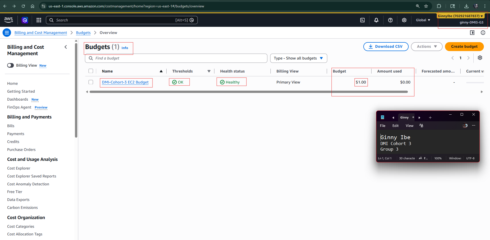
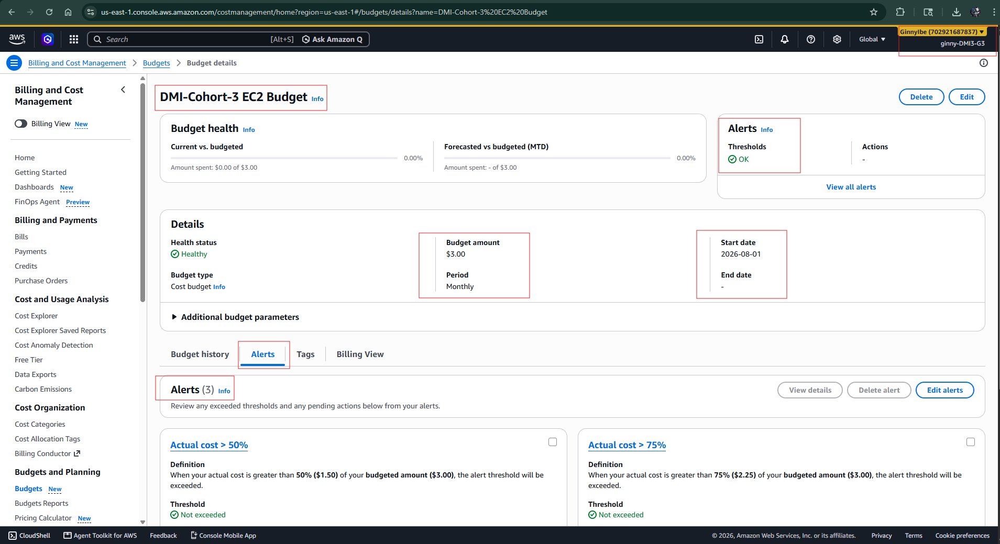
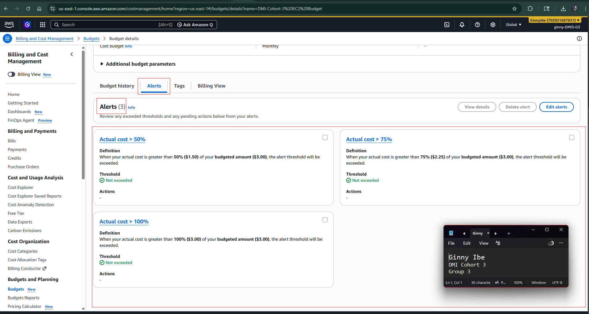

# Assignment 1 — Creating an AWS Free Tier Account & Setting Up Budget Management and Alerts

Part of the DevOps Micro Internship (DMI) with Agentic AI

---

## Purpose

In this assignment, you will create your own AWS Free Tier account and configure budget management with cost alerts. This is an important first step: it lets you follow along with the rest of the course, and the alerts help ensure you do not exceed your budget.

---

# Task 1 — Sign Up for AWS

## Goal

Create your AWS Free Tier account and select the Basic Support Plan (Free).

> No screenshot required for this task.

---

# Task 2 — Log in to the AWS Management Console

## Goal

Log in to your AWS account and access the AWS Management Console.

> No screenshot required for this task.

---

# Task 3 — Familiarize Yourself with the AWS Console

## Goal

Explore the AWS Management Console and review the AWS Free Tier offerings.

> No screenshot required for this task.

---

# Task 4 — Access the Billing Dashboard

## Goal

Open the Billing Dashboard from the AWS Management Console.

> No screenshot required for this task.

---

# Task 5 — Create a Budget

## Goal

Configure a monthly Cost Budget with a descriptive name, the current month as the start month, and your selected budget amount.

> No screenshot required for this task.

---

# Task 6 — Set Budget Alerts

## Goal

Configure budget alert thresholds, such as 50%, 80%, and 100%, and enter your notification email address.

> No screenshot required for this task.

---

# Task 7 — Review & Confirm Your Budget

## Goal

Review your budget and notification settings, then create the budget.

### Evidence

#### Screenshot 1 — AWS Budget setup page showing the budget name, budget amount, and alert thresholds

### Notes

Answer the following in your own words:

**1. Why is it important to set up budget alerts when using an AWS account?**

Budget alerts are important because they help me keep track of my AWS spending and avoid unexpected charges. They notify me when my usage approaches a limit I have set, so I can investigate unusual costs early and take action before the bill grows. This is especially important when learning or testing AWS services, where it is easy to leave resources running accidentally.

Budget alerts are important because AWS uses a pay-as-you-go model, so costs can continue to increase while resources are running. Even when working within the AWS Free Tier, some services have usage limits, and exceeding those limits can result in charges.

Setting up budget alerts gives me an early warning when my spending reaches a specific threshold. This helps me catch things like EC2 instances left running, unused resources, unexpected data-transfer costs, or services that are consuming more than expected.

It’s also a good cloud engineering practice. Instead of waiting until the end of the month to discover an unexpected bill, I can monitor costs proactively and take action early. In a real DevOps environment, this same principle supports cost visibility, accountability, and FinOps practices.

So, budget alerts act as a financial safety net: AWS gives me the flexibility to create resources, while budget alerts help me stay aware of what those resources are costing.

---

# Task 8 — Share Your Progress on WhatsApp

## Goal

Publish the automatically generated DMI Leaderboard message containing your rank and personal progress link on your WhatsApp Status.

Go to the DMI Leaderboard, find your name, select **Share your progress**, and click the **WhatsApp icon**. Copy the generated message, paste it into your WhatsApp Status, and publish it.

### Evidence

#### Screenshot 2 — Published WhatsApp Status showing the automatically generated DMI Leaderboard rank and personal progress link

Add your screenshot here.

> **Privacy Note:** Make sure no private phone numbers, personal messages, or sensitive information are visible in the screenshot.

---

# Submission Instructions

- Add Screenshot 1 showing your AWS budget name, amount, and alert thresholds
- Answer the Notes question under Task 7 in your own words
- Add Screenshot 2 showing your published WhatsApp Status with your DMI Leaderboard rank and personal progress link
- Do not expose sensitive billing, card, identity, account information, private phone numbers, or personal messages

---

# Completion Checklist

- [x] Task 1: AWS Free Tier account created and Basic Support Plan (Free) selected
- [x] Task 2: Logged in to the AWS Management Console
- [x] Task 3: Explored the AWS Console and reviewed AWS Free Tier offerings
- [x] Task 4: Opened the Billing Dashboard
- [x] Task 5: Configured a monthly Cost Budget with name, amount, and start month
- [x] Task 6: Configured budget alert thresholds and notification email
- [x] Task 7: Reviewed and created the budget, and included Screenshot 1
- [x] Task 7: Answered the budget alerts question
- [ ] Task 8: Published the DMI Leaderboard message on WhatsApp Status and included Screenshot 2
- [x] No sensitive information exposed

---

## 📌 About DMI & CloudAdvisory

DevOps Micro Internship (DMI) is a project-based DevOps program run by Pravin Mishra (The CloudAdvisory) focused on real-world execution, systems thinking, and career readiness.

It helps learners build strong DevOps foundations with hands-on experience.

---

## 📌 Resources

- 🌐 DMI Official Website: https://dmi.pravinmishra.com?utm_source=github&utm_medium=readme  
- 🎓 University: https://university.pravinmishra.com?utm_source=github&utm_medium=readme  
- 💬 Discord Community: https://discord.pravinmishra.com?utm_source=github&utm_medium=readme  
- 📝 Blog: https://dmi.pravinmishra.com/blog?utm_source=github&utm_medium=readme  
- ▶️ YouTube Playlist: https://www.youtube.com/playlist?list=PLFeSNDtI4Cho  
- 🔗 Pravin Mishra (LinkedIn): https://www.linkedin.com/in/pravin-mishra-aws-trainer/  
- 🏢 CloudAdvisory (LinkedIn): https://www.linkedin.com/company/thecloudadvisory/

---

*This submission is part of DevOps Micro Internship (DMI) — Agentic AI Track.*
