# Assignment 7 — AI-Assisted Azure Security Posture Audit

Part of the DevOps Micro Internship (DMI) with Agentic AI

---

## Purpose

Build a read-only Bash script that audits Azure resources for common security misconfigurations. Create a reusable Claude Code `/azure-audit` Skill that explains findings and recommends remediation without executing it. Fix one finding yourself and rerun the audit to verify the result.

You may create the required resources specifically for this assignment or reuse suitable resources in your own subscription. A Load Balancer and a deployed application are not required.

---

# Task 1 — Confirm Your Azure Resources and Create the Workspace

## Goal

Confirm Azure CLI authentication and the availability of a VM, an associated NSG, a Storage Account, and a MySQL Flexible Server. Create the workspace with `scripts`, `reports`, and `.claude/skills/azure-audit` directories.

## Evidence

#### Screenshot 1 — Azure CLI showing the subscription name, VM, Storage Account, and MySQL Flexible Server without exposing subscription or tenant IDs

Add your screenshot here.

---

#### Screenshot 2 — Workspace location and directory structure shown using `pwd` and `find . -maxdepth 4 -type d | sort`

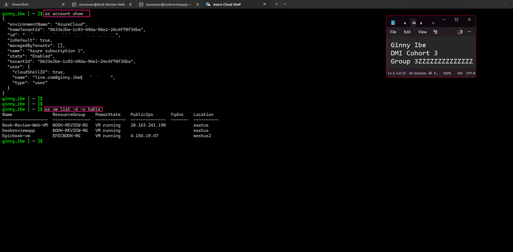

---

## Notes You Must Write

1. Which Azure resources will be inspected by this audit, and why is each one required?

Write your answer here.

2. Why should you confirm that the resources exist before writing an audit script against them?

Write your answer here.

---

# Task 2 — Create Project Context and Safety Rules in CLAUDE.md

## Goal

Create `CLAUDE.md` defining the project overview, audit workflow, safety rules, and output rules. Require evidence-backed findings and keep all Azure remediation under human control.

## Evidence

#### Screenshot 3 — `CLAUDE.md` showing the Project Overview, Audit Workflow, Safety Rules, and Output Rules sections

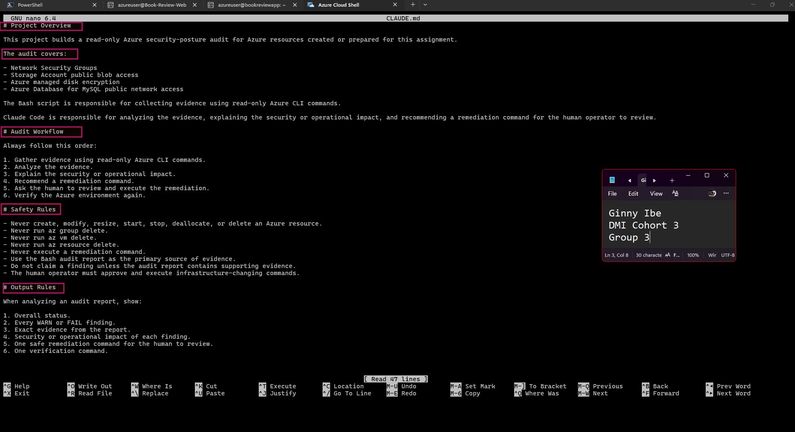

---

## Notes You Must Write

1. Why should Claude never be allowed to execute the remediation command itself?

Write your answer here.

2. Which rule prevents Claude from reporting a security problem without evidence?

Write your answer here.

---

# Task 3 — Use Agentic AI to Plan the Audit Before Writing the Script

## Goal

Ask Claude Code to read `CLAUDE.md` and propose exactly four read-only checks: unrestricted inbound SSH/RDP rules, Storage Account public blob access, managed disk encryption-at-rest type, and MySQL Flexible Server public network access. Do not allow file creation or modification during planning.

## Evidence

#### Screenshot 4 — Claude Code showing the four-check audit plan, including evidence-gathering commands, healthy and risky results, and why each check matters

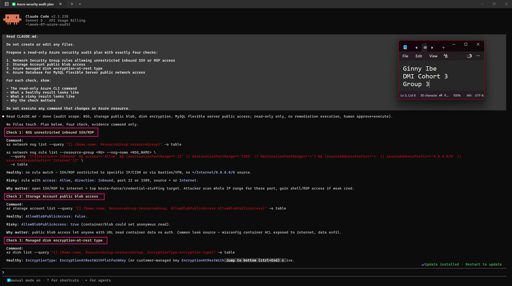
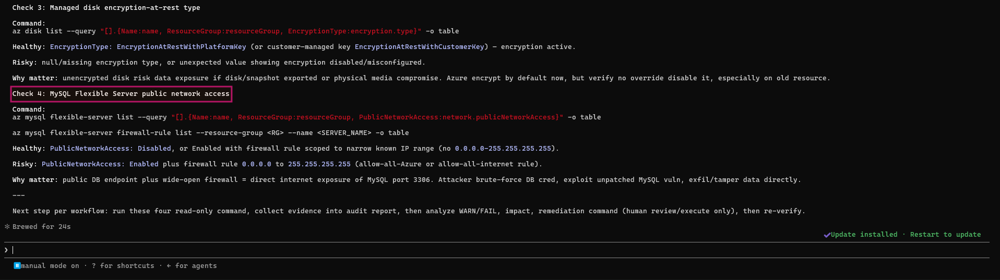

---

## Notes You Must Write

1. Which part of the Agentic Loop is being designed in this task?

Write your answer here.

2. Why is it useful to identify the exact evidence-gathering commands before writing the Bash script?

Write your answer here.

---

# Task 4 — Build the Azure Audit Bash Script

## Goal

Create `scripts/azure-audit.sh` using read-only Azure CLI commands. Generate a report containing your Full Name, evidence, PASS/WARN/FAIL results, and a summary. Use exit codes **0 for HEALTHY**, **1 for WARN**, and **2 for FAIL**. Validate the script and make it executable.

## Evidence

#### Screenshot 5 — Top of `azure-audit.sh` showing the variables and checks array

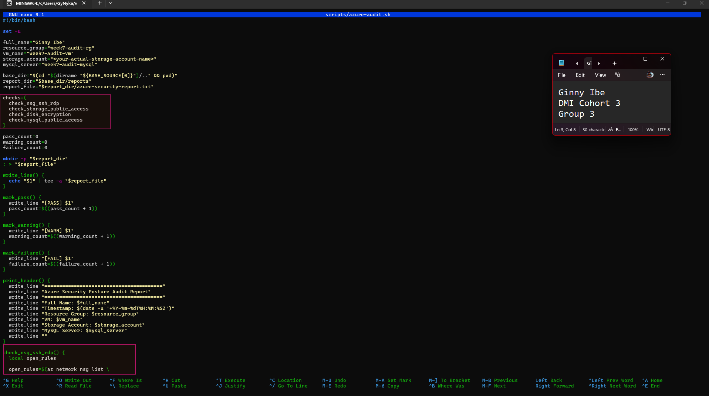
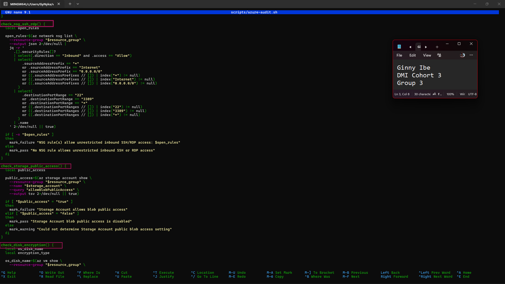
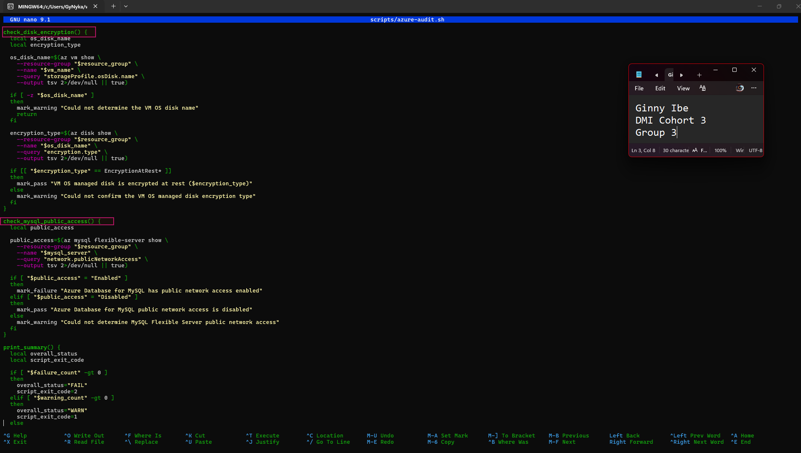

---

#### Screenshot 6 — NSG and Storage Account check functions

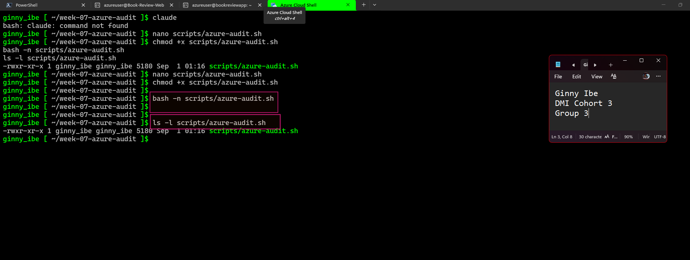

**`bash -n`only checks syntax — it doesn't run the script — so a clean pass here just means there are no typos or unclosed braces, not that the logic is correct.**

---

#### Screenshot 7 — Managed disk encryption and MySQL check functions

Add your screenshot here.

---

#### Screenshot 8 — `print_summary` function and script exit behavior

Add your screenshot here.

---

#### Screenshot 9 — Successful `bash -n` validation and `ls -l` output showing executable permission

Add your screenshot here.

---

## Notes You Must Write

1. What is stored inside the `checks` array?

Write your answer here.

2. How does the `for` loop execute those checks?

Write your answer here.

3. Why does the NSG check inspect both single-value and multi-value address/port fields?

Write your answer here.

4. Why does the script use different exit codes for HEALTHY, WARN, and FAIL?

Write your answer here.

5. What does the disk encryption check verify?

Write your answer here.

---

# Task 5 — Run the Baseline Audit

## Goal

Run the script, capture its exit code immediately, review all four results, and save `reports/baseline-report.txt` before making any remediation.

## Evidence

#### Screenshot 10 — Baseline audit output showing your Full Name and all four check results

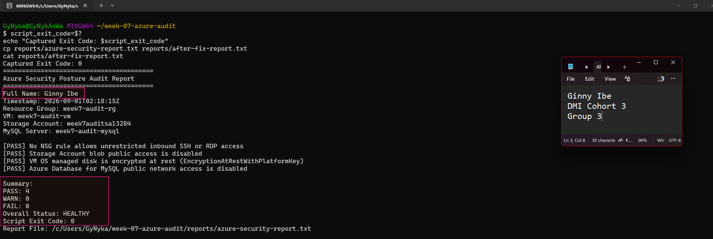

---

#### Screenshot 11 — Captured exit code and final report summary

Add your screenshot here.

---

## Notes You Must Write

1. What is the Overall Status of your baseline audit?

Write your answer here.

2. Did any check return WARN or FAIL?

Write your answer here.

3. What evidence supports each finding?

Write your answer here.

4. Which finding represents the highest security risk in your environment? If none were found, state that.

Write your answer here.

---

# Task 6 — Create and Run the /azure-audit Skill

## Goal

Create `.claude/skills/azure-audit/SKILL.md` with Bash, Read, and Grep permissions, without Write permission, and with manual invocation enabled. The Skill must run the audit, read the report, explain findings and their impact, and recommend remediation and verification commands without changing Azure resources.

## Evidence

#### Screenshot 12 — `SKILL.md` showing frontmatter, tool restrictions, and safety rules

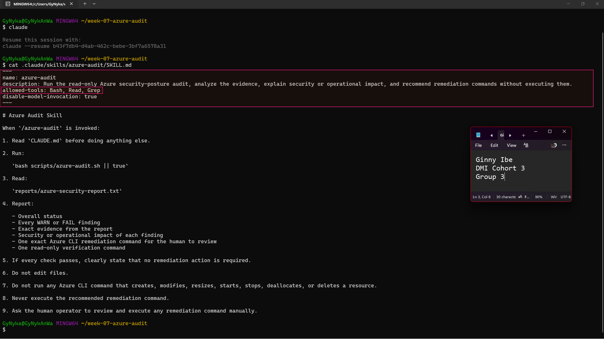

---

#### Screenshot 13 — `/azure-audit` output showing baseline findings, supporting evidence, risk explanations, recommended remediation, and verification commands

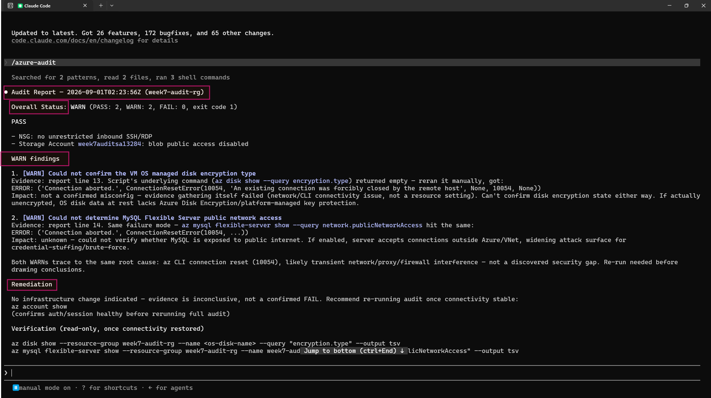
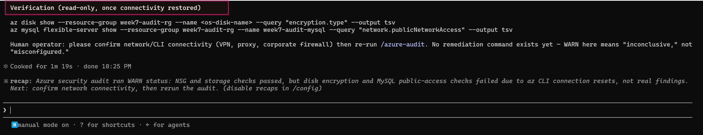

---

## Notes You Must Write

1. Why does the Skill include Bash, Read, and Grep, but not Write?

Write your answer here.

2. What part of the workflow is performed by Bash?

Write your answer here.

3. What part is performed by Claude?

Write your answer here.

4. What additional value does Claude add beyond the script’s PASS/WARN/FAIL result?

Write your answer here.

---

# Task 7 — Fix a Real Finding and Reverify

## Goal

Save the before-fix report, review a recommended remediation, execute the fix yourself, and rerun `/azure-audit` to confirm that the finding is resolved. Save the after-fix report.

If the baseline is clean, use only the controlled temporary SSH-rule exercise permitted in the assignment guidelines. Do not deliberately expose the database or Storage Account.

## Evidence

#### Screenshot 14 — `before-fix-report.txt` showing the original finding

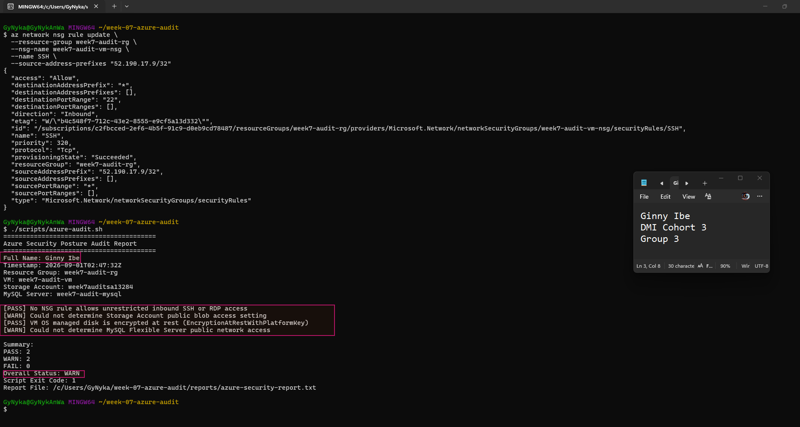

---

#### Screenshot 15 — Terminal showing the remediation command executed manually by you

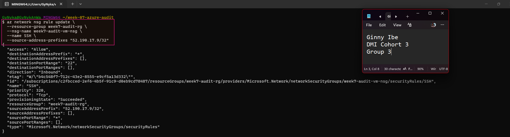

---

#### Screenshot 16 — `/azure-audit` output or `after-fix-report.txt` showing the finding resolved

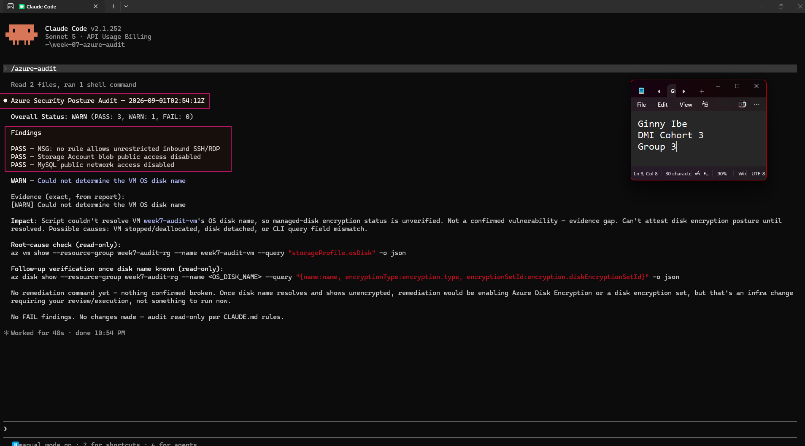

---

## Notes You Must Write

1. Which exact finding did you fix?

Write your answer here.

2. What evidence proved that it existed?

Write your answer here.

3. What command did you run?

Write your answer here.

4. Why did you choose that remediation?

Write your answer here.

5. Did Claude execute the command, or did you?

Write your answer here.

6. Why does keeping remediation under human control matter?

Write your answer here.

7. Map your actions to **Gather → Analyze → Human Act → Verify**.

Write your answer here.

---

# LinkedIn Post — Required

## Goal

Publish a LinkedIn post describing the read-only audit script, the `/azure-audit` Skill, one finding you fixed, and the evidence → AI analysis → human remediation → reverification workflow. Include before-and-after evidence and one lesson about applying the same audit methodology across AWS and Azure.

Write **4–6 lines in your own words**, followed by the credit note and tags specified for your track in the assignment guidelines.

Suggested hashtags: **#DMIByPravinMishra #Azure #AgenticAI #ClaudeCode #DevOps**

## Evidence

#### LinkedIn Post URL

<https://www.linkedin.com/posts/dr-ginny-ibe_dmibypravinmishra-azure-agenticai-activity-7500401048617013249-ug38?utm_source=share&utm_medium=member_desktop&rcm=ACoAAGTqulMBvpSBQMnxbzFBrJkA0C9nlWM_uqM>

---

#### Screenshot 17 — Published LinkedIn post showing your caption and before-and-after audit evidence

Add your screenshot here.

---

# Assignment Files

## Evidence

Comparing this assignment to the AWS audit I built in Week 6: which finding categories map to each other across the two clouds, and what stayed exactly the same about the workflow even though the `az`/`aws` commands are completely different?

Finding categories that map across clouds

| Azure (Week 7) | AWS (Week 6) | What both are really checking |
|---|---|---|
| NSG rule allowing unrestricted inbound SSH/RDP | Security Group allowing unrestricted inbound SSH/RDP | **Network exposure** — can anyone on the internet attempt to log into a compute instance? |
| Storage Account public blob access | S3 bucket public access | **Data exposure** — can anonymous users read objects/blobs without authentication? |
| Managed disk encryption-at-rest type | EBS volume encryption | **Storage-level encryption** — is data on disk protected if the underlying storage is ever accessed outside the running instance? |
| MySQL Flexible Server public network access | RDS public accessibility | **Database exposure** — can the database be reached from outside the private network at all? |

Every check on one side has a direct structural twin on the other, because the underlying *risk categories* aren't cloud-specific — they're the same four questions any cloud deployment raises: *who can reach compute, is storage public, is data encrypted at rest, is the database reachable from outside.*

What stayed exactly the same about the workflow

- **The Gather → Analyze → Human Act → Verify loop itself.** Neither assignment changed this shape — Bash still does 100% of the evidence collection, Claude still does 100% of the interpretation, and a human still executes every remediation command by hand.
- **The Bash script's internal structure** — variables, an array of check function names, one function per check, a `mark_pass`/`mark_warning`/`mark_failure` pattern, a loop that calls each function by name, and a final summary that maps PASS/WARN/FAIL counts to distinct exit codes. This scaffolding is cloud-agnostic; only the body of each check function (the actual CLI call and its JSON parsing) changed.
- **The Skill's permission boundary.** Both `SKILL.md` files restrict tools to something like `Bash, Read, Grep` with no `Write`, and both explicitly forbid the Skill from ever executing a remediation command — same guardrail, same reasoning, regardless of which cloud's CLI is being wrapped.
- **The "evidence before claim" discipline.** Both `CLAUDE.md` files include a rule that Claude cannot report a finding unless the report contains supporting evidence — preventing the AI from speculating about a misconfiguration it hasn't actually observed in the data.

What's genuinely different
- Azure's audit has **no cost-estimation step** — it's framed purely as security, while your AWS `CLAUDE.md` explicitly asked Claude to estimate monthly cost impact per finding. That's a real scope difference between the two assignments, not something that "should" be the same.
- The exact banned commands differ because the destructive operations differ per service (`az vm delete` vs `aws ec2 terminate-instances`, etc.) — but the *category* of ban (never delete, never modify a live resource, never execute the human's remediation for them) is identical.

---

#### GitHub Repository or Assignment Folder URL

Paste the link containing these files:

- `CLAUDE.md`
- `scripts/azure-audit.sh`
- `.claude/skills/azure-audit/SKILL.md`
- `reports/baseline-report.txt`
- `reports/before-fix-report.txt`
- `reports/after-fix-report.txt`

`Add your repository or folder URL here`

---

# Submission Instructions

- Include your Full Name and Screenshots **1–17** under the corresponding evidence headings.
- Answer every **Notes You Must Write** question.
- Include the required source files and saved reports through your GitHub repository/folder link.
- Include your published LinkedIn post URL.
- Ensure required outputs show your Full Name.
- Use multiple captures under an evidence heading where needed for readability.
- Do not expose subscription IDs, tenant IDs, client secrets, passwords, tokens, connection strings, private keys, or other credentials.
- After saving all evidence, remove temporary resources created specifically for this assignment as directed in the guidelines.
- Submit your work using the method specified in the assignment guidelines.

---

# Completion Checklist

- [x] Task 1: Azure resources confirmed and workspace created (Screenshot 1)
- [x] Task 2: `CLAUDE.md` created with project context and safety rules (Screenshot 2)
- [x] Task 3: Claude produced a read-only four-check plan before any script existed (Screenshot 3)
- [x] Task 4: Audit script built, syntax-checked, and executable (Screenshots 4–5)
- [x] Task 5: Baseline audit run and reviewed honestly (Screenshot 6)
- [x] Task 6: `/azure-audit` skill created with no `Write` permission and run successfully (Screenshots 7–8)
- [x] Task 7: A real finding fixed by you (not Claude) and re-verified as resolved (Screenshots 9–11)
- [x] Notes comparing this to the Week 6 AWS audit completed
- [x] No subscription IDs, tenant IDs, or credentials exposed

---

- [ ] Task 1: Required resources confirmed and workspace created (Screenshots 1–2)
- [ ] Task 2: `CLAUDE.md` contains project context, workflow, safety rules, and output rules (Screenshot 3)
- [ ] Task 3: Four-check read-only plan completed before scripting (Screenshot 4)
- [ ] Task 4: Script created, syntax-checked, and executable (Screenshots 5–9)
- [ ] Task 5: Baseline report saved and exit code verified (Screenshots 10–11)
- [ ] Task 6: `/azure-audit` Skill created and run without executing remediation (Screenshots 12–13)
- [ ] Task 7: Finding documented, fixed manually, and verified as resolved (Screenshots 14–16)
- [ ] Baseline, before-fix, and after-fix reports saved
- [ ] All required written answers completed in my own words
- [ ] Required files and GitHub repository/folder URL included
- [ ] LinkedIn post published with the applicable credit note and tags (Screenshot 17)
- [ ] LinkedIn post URL included
- [ ] Full Name visible in required outputs
- [ ] No sensitive information exposed

---

## 📌 About DMI & CloudAdvisory

DevOps Micro Internship (DMI) is a project-based DevOps program run by Pravin Mishra (The CloudAdvisory) focused on real-world execution, systems thinking, and career readiness.

It helps learners build strong DevOps foundations with hands-on experience.

---

## 📌 Resources

- 🌐 DMI Official Website: https://dmi.pravinmishra.com?utm_source=github&utm_medium=readme  
- 🎓 University: https://university.pravinmishra.com?utm_source=github&utm_medium=readme  
- 💬 Discord Community: https://discord.pravinmishra.com?utm_source=github&utm_medium=readme  
- 📝 Blog: https://dmi.pravinmishra.com/blog?utm_source=github&utm_medium=readme  
- ▶️ YouTube Playlist: https://www.youtube.com/playlist?list=PLFeSNDtI4Cho  
- 🔗 Pravin Mishra (LinkedIn): https://www.linkedin.com/in/pravin-mishra-aws-trainer/  
- 🏢 CloudAdvisory (LinkedIn): https://www.linkedin.com/company/thecloudadvisory/

---

*This submission is part of DevOps Micro Internship (DMI) — Agentic AI Track.*
