# Assignment 4 — Automate EpicBook Deployment with Dual Pipelines

Part of the DevOps Micro Internship (DMI) with Agentic AI

---

## Purpose

In this assignment, you will automate the EpicBook infrastructure and application deployment on Microsoft Azure using two repositories and two Azure DevOps pipelines. Terraform will provision the infrastructure, and Ansible will configure the servers, connect EpicBook to Azure Database for MySQL, and deploy the application through Nginx.

---

# Task 0 — Verify Accounts, Tools, and Pipeline Capacity

## Goal

Confirm that the required accounts, tools, pipeline agent, SSH key pair, and Terraform remote-state location are ready.

No submission screenshot is required for this task.

---

# Task 1 — Prepare the Two Repositories

## Goal

Create separate Infrastructure and Application Repositories for the EpicBook deployment.

No submission screenshot is required for this task.

---

# Task 2 — Configure Azure DevOps Connections, Secure Files, and Secrets

## Goal

Configure controlled pipeline access to GitHub, Microsoft Azure, the virtual machines, and Azure Database for MySQL.

No submission screenshot is required for this task.

> Do not expose the Azure Client Secret, SSH private key, MySQL password, access token, subscription ID, or another sensitive value.

---

# Task 3 — Author the Terraform Infrastructure Configuration

## Goal

Define the complete EpicBook Azure infrastructure using Terraform and an Azure Storage remote backend.

No submission screenshot is required for this task.

---

# Task 4 — Author and Run the Infrastructure Pipeline

## Goal

Validate, plan, approve, and apply the Terraform configuration through the Infrastructure Pipeline.

## Evidence

### Screenshot 1 — Successful Infrastructure Pipeline

Add a screenshot of the Infrastructure Pipeline run showing:

* Successful `terraform apply` completion
* `app_public_ip`
* `backend_ansible_host`
* `backend_private_ip`
* `mysql_fqdn`

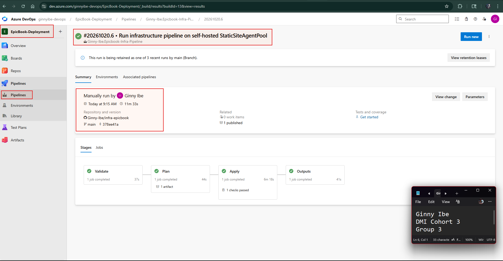
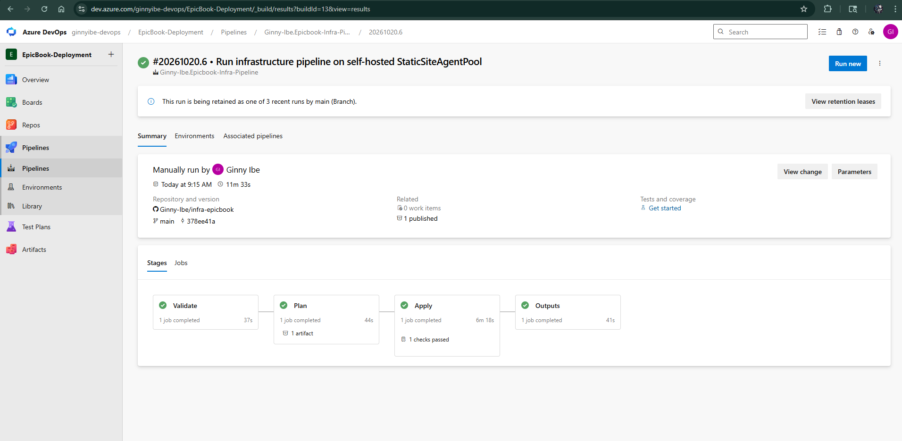
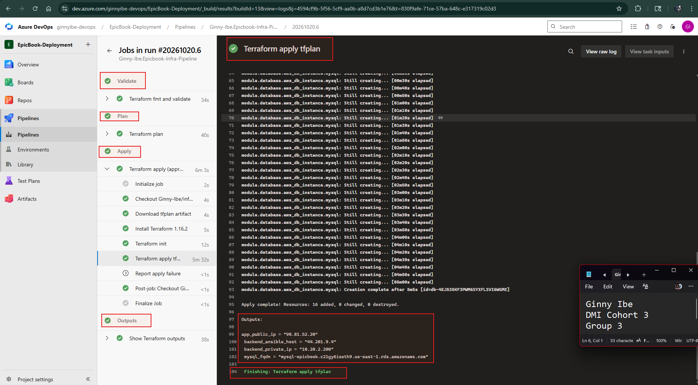
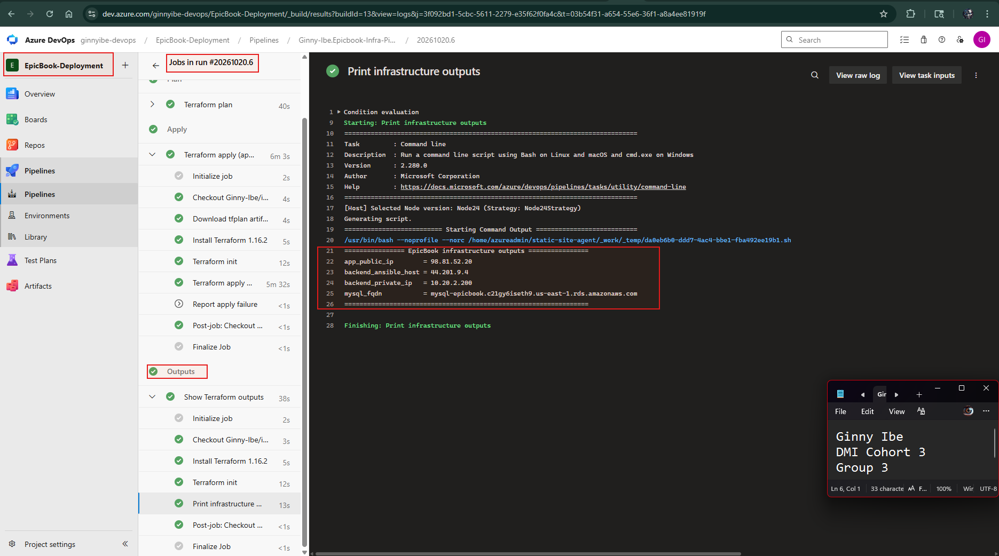

> Do not expose the MySQL password, Client Secret, Terraform state, SSH private key, or another sensitive value.

---

### Screenshot 2 — Provisioned Azure/AWS Resources

Add a screenshot of the Azure/AWS Portal Resource Group overview showing:

* Virtual Network and related networking resources
* Frontend VM
* Backend VM
* Azure Database for MySQL Flexible Server
* Related EpicBook resources

AWS Frontend 
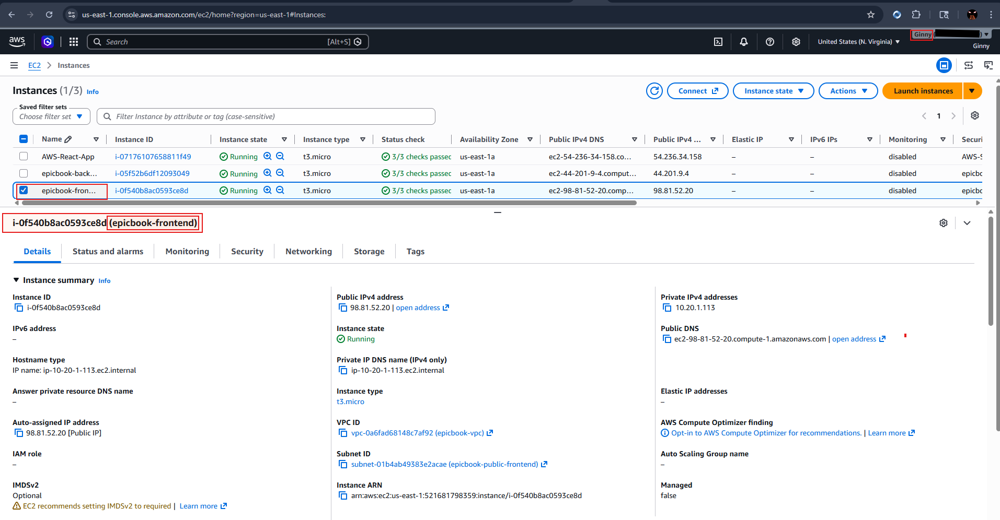

AWS Backend 
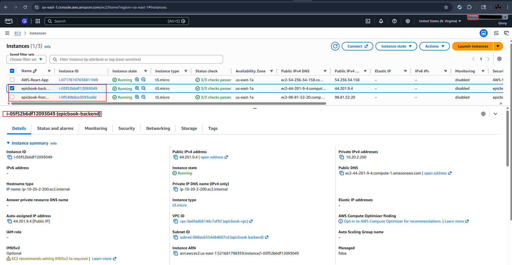

> Hide sensitive IDs, credentials, and database details.

---

# Task 5 — Complete the Manual Terraform-to-Ansible Handoff

## Goal

Transfer the required non-sensitive Terraform outputs to the Application Repository for use by Ansible.

No submission screenshot is required for this task.

---

# Task 6 — Author the Ansible Application Configuration

## Goal

Create idempotent Ansible automation that configures the frontend and backend VMs, prepares the database, configures Nginx, and deploys EpicBook.

No submission screenshot is required for this task.

---

# Task 7 — Author and Run the Application Pipeline

## Goal

Run the Application Pipeline to configure the VMs, deploy EpicBook, and verify the application environment.

## Evidence

### Screenshot 3 — Successful Application Pipeline

Add a screenshot of the Application Pipeline run summary showing all required stages or jobs succeeded.

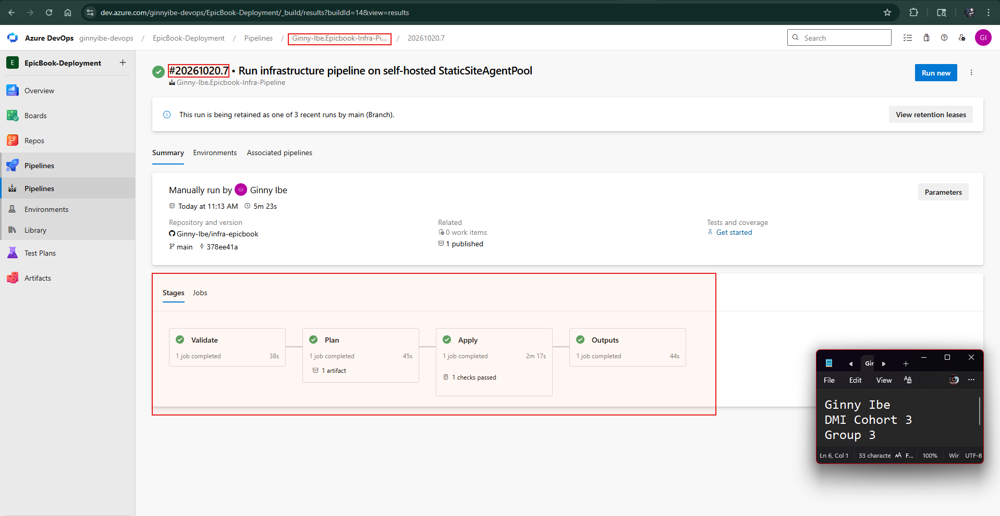

---

### Screenshot 4 — Successful Ansible Play Recap

Add a screenshot of the Application Pipeline log showing:

* Ansible play recap
* Successful configuration or verification
* Zero failed hosts
* Zero unreachable hosts

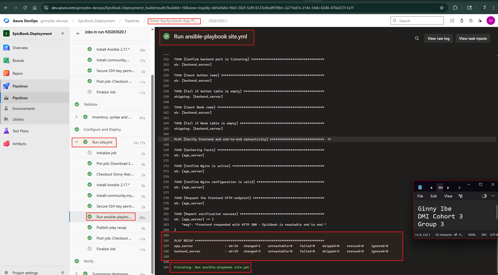

> Do not expose the SSH private key, MySQL password, Client Secret, or complete database connection string.

---

# Task 8 — Verify the Complete EpicBook Workflow

## Goal

Verify that the frontend, backend, and Azure Database for MySQL work together correctly.

## Evidence

### Screenshot 5 — Running EpicBook Application

Add a browser screenshot showing:

* Running EpicBook application
* Frontend public IP address in the browser address bar
* Your Full Name
* Deployment date

The screenshot may show a product, cart, or successful order view.

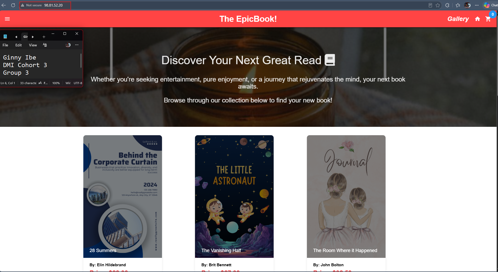
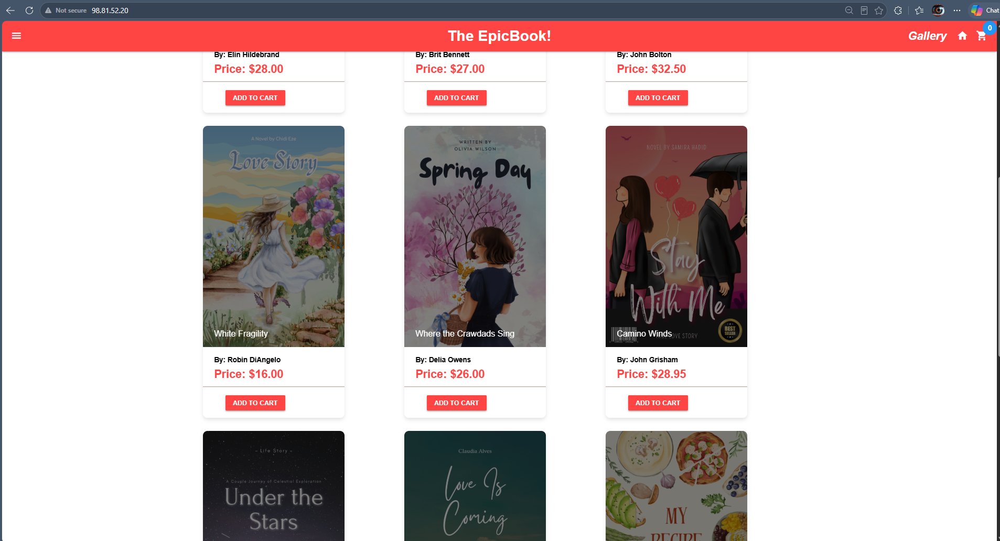
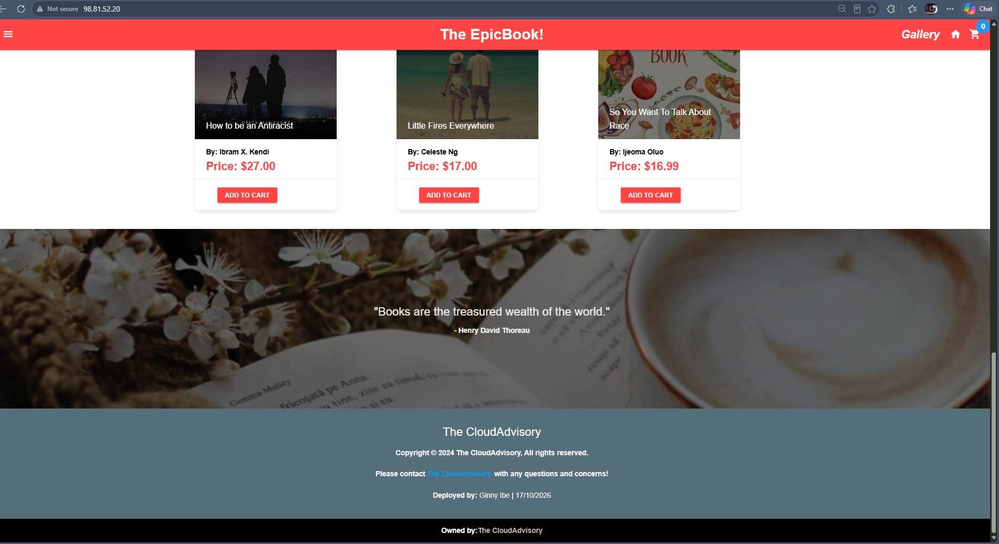

> Do not expose credentials or sensitive information.

---

# Required URLs

## Frontend Application URL

**http://98.81.52.20**

## Infrastructure Repository URL

**https://github.com/Ginny-Ibe/infra-epicbook**

## Application Repository URL

**https://github.com/Ginny-Ibe/theepicbook**

---

# Two-Repository Model

Write a short explanation of why separate Infrastructure and Application Repositories were used.

- The infrastructure and the application live in separate repositories because they change at different speeds and carry different risks. infra-epicbook holds the Terraform code that creates the VPC, subnets, security groups, EC2 servers and RDS database. A mistake there can delete or expose real resources, so its pipeline has a manual approval gate before terraform apply. theepicbook holds the Node.js app and the Ansible roles that configure the servers and deploy the code. It changes much more often, and a bad deploy is easy to roll back.

- Keeping them apart also limits access. Only the infrastructure pipeline is allowed to use the AWS credentials (Epicbook-aws-secrets). Only the application pipeline can use the SSH private key in Secure Files. An app change can't trigger Terraform, and an infrastructure change doesn't redeploy the app, so each repository has its own history, pipeline and permissions. This mirrors how a separate platform team and app team would work.

---

# Manual Terraform-to-Ansible Handoff

Write a short explanation of how the following non-sensitive Terraform outputs were transferred to the Application Repository:

* `app_public_ip`
* `backend_ansible_host`
* `backend_private_ip`
* `mysql_fqdn`

After the Infrastructure Pipeline's Apply stage succeeded, its Outputs stage printed the four non-sensitive values with terraform output -raw. I copied them from that log into the Application Repository by hand:

- app_public_ip (98.81.52.20) and backend_ansible_host (44.201.9.4) went into ansible/inventory/hosts.ini. They're set as ansible_host for app_server under [frontend] and backend_server under [backend], so Ansible knows which servers to SSH into.
- backend_private_ip (10.20.2.200) and mysql_fqdn (the RDS endpoint) went into ansible/group_vars/all.yml. The frontend role uses backend_private_ip in the Nginx proxy_pass line. The backend and database roles use mysql_fqdn to connect to RDS.

Before committing, I checked the inventory with ansible-inventory --graph and confirmed SSH access with ansible all -m ping. Then I committed and pushed the files to theepicbook.

Only these four addresses crossed between the repositories. The database username and password stayed in the Epicbook-mysql-secrets variable group, and the SSH private key stayed in Secure Files. Both reach Ansible only at runtime through the pipeline, so no secret was written to either repository.

---

# LinkedIn Requirement

## Evidence

### Screenshot 6 — LinkedIn Post

Add a screenshot of your LinkedIn post showing:

* Post text
* At least one image or link

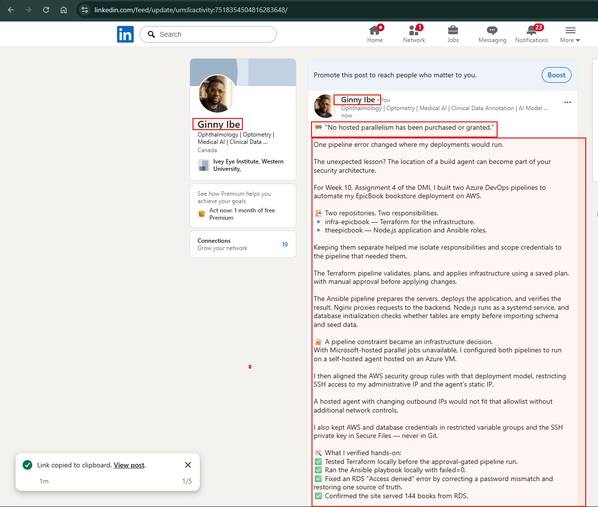

## LinkedIn Post URL

**https://www.linkedin.com/posts/dr-ginny-ibe_dmibypravinmishra-devops-azuredevops-ugcPost-7518354503398735872-2N9R**  

Your post must include:

* What you automated
* Why separate Infrastructure and Application Repositories were used
* A brief explanation of the Terraform and Ansible pipelines
* How Azure credentials, the SSH key, and database secrets were protected
* One challenge you encountered
* How you solved the challenge
* Relevant technologies and skills

> Do not expose credentials, SSH keys, database passwords, subscription details, or other sensitive information.

---

# Submission Instructions

* Complete all tasks in sequence.
* Include your Full Name.
* Include a short explanation of the two-repository model.
* Include a short explanation of the manual Terraform-to-Ansible handoff.
* Include the Infrastructure Repository URL.
* Include the Application Repository URL.
* Include the final EpicBook application URL.
* Include Screenshots 1–6.
* Include the public LinkedIn post URL.
* Confirm that all screenshots are readable.
* Do not include Terraform state.
* Do not expose the Azure Client Secret, MySQL password, SSH private key, access token, complete connection string, subscription ID, tenant ID, account ID, or another sensitive value.
* Follow the Assignment Submission Guidelines.

---

# Completion Checklist

* [X] Two separate repositories were created
* [X] The Infrastructure Repository contains Terraform and its pipeline
* [X] The Application Repository contains EpicBook, Ansible, and its pipeline
* [X] Your Full Name and deployment date are visible in EpicBook
* [X] Both pipelines use the intended `main` branch
* [X] The Azure Resource Manager Service Connection works
* [X] The Azure Client Secret is not stored in Git or YAML
* [X] Terraform uses an Azure Storage remote backend
* [X] Terraform state was not published or committed
* [X] Separate frontend, backend, and database subnets were created
* [X] The frontend VM accepts public HTTP traffic on port 80
* [X] SSH access is restricted
* [X] The backend application port is not publicly accessible
* [X] Azure Database for MySQL uses private access
* [X] The Infrastructure Pipeline validates, plans, applies, and displays non-sensitive outputs
* [X] The reviewed Terraform plan was used during Apply
* [X] Approval or manual validation occurred before Apply
* [X] `app_public_ip` is available
* [X] `backend_ansible_host` is available
* [X] `backend_private_ip` is available
* [X] `mysql_fqdn` is available
* [X] Only non-sensitive Terraform outputs were transferred to the Application Repository
* [X] The SSH private key is stored in Azure DevOps Secure Files
* [X] The SSH private key was not committed or published
* [X] The MySQL password is stored as a secret pipeline variable
* [X] Ansible reaches both frontend and backend VMs
* [X] Ansible completes with zero failed and zero unreachable hosts
* [X] Nginx proxies requests to the backend private IP
* [X] EpicBook runs as a persistent service
* [X] The database schema and seed data are available
* [X] The application displays database-backed products
* [X] Cart or checkout actions are recorded in MySQL
* [X] The final application displays your Full Name and deployment date
* [X] Screenshots 1–6 are included and readable
* [X] The Infrastructure Repository URL is included
* [X] The Application Repository URL is included
* [X] The final EpicBook application URL is included
* [X] The LinkedIn post is published
* [X] The LinkedIn post URL is included
* [X] No secret or sensitive identifier is exposed

---

*This submission is part of the DevOps Micro Internship (DMI) — Agentic AI Track.*
