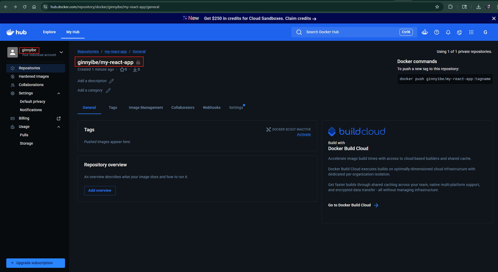
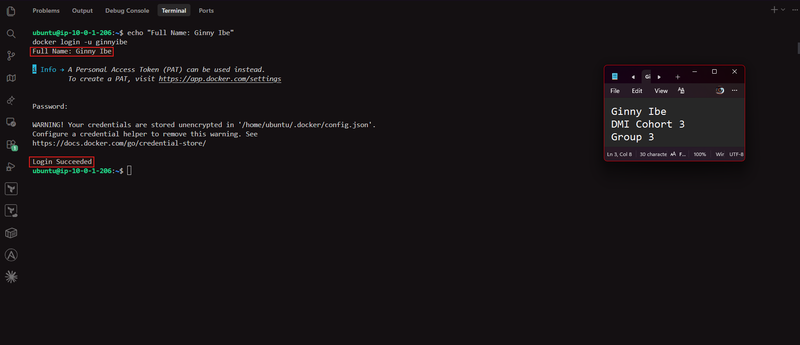
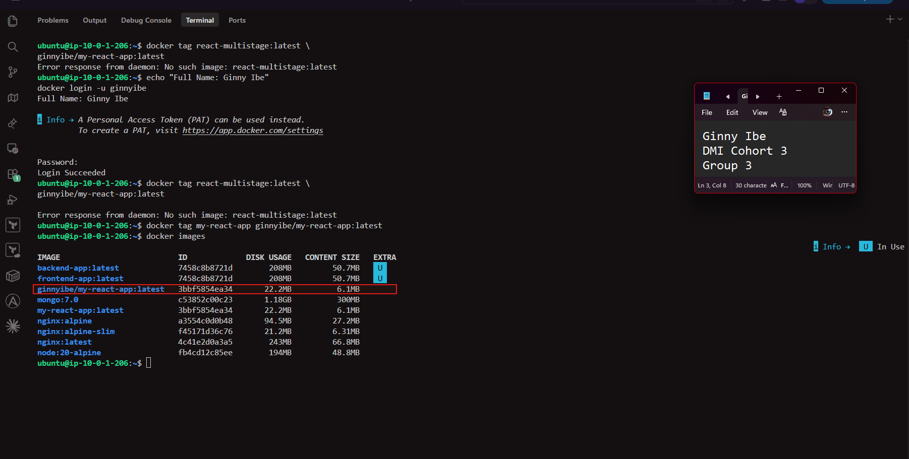
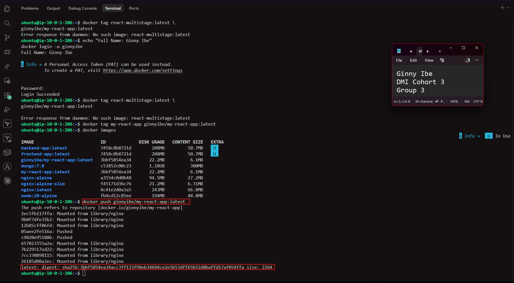
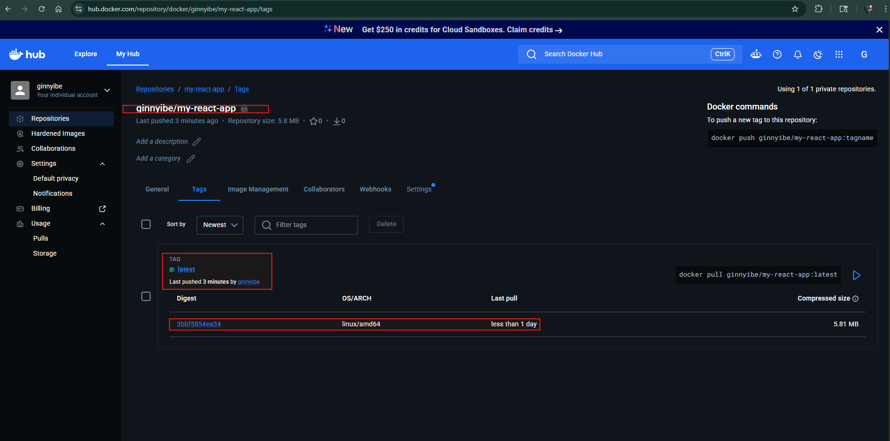
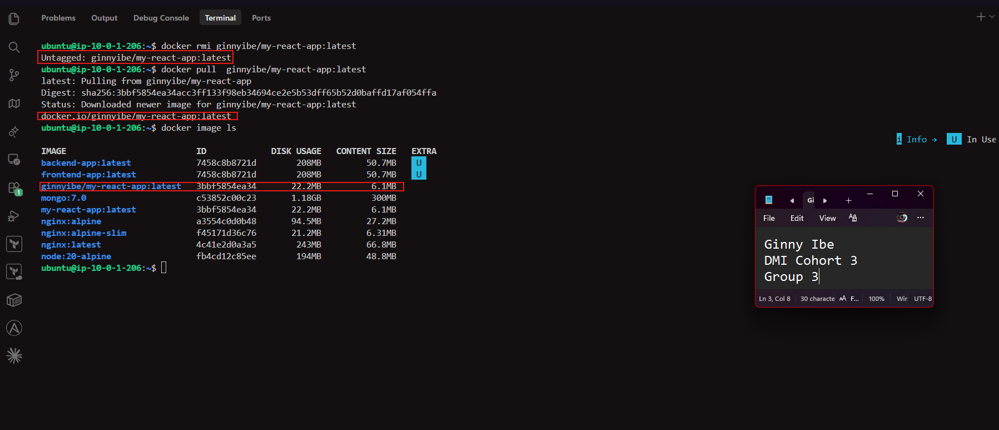
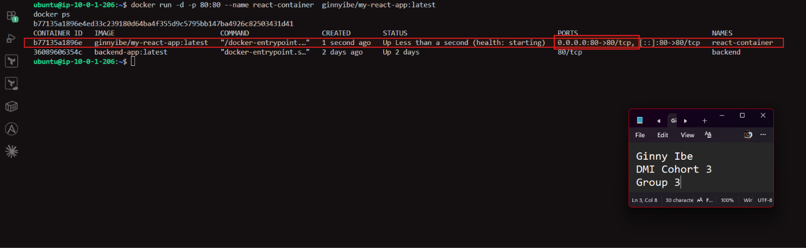
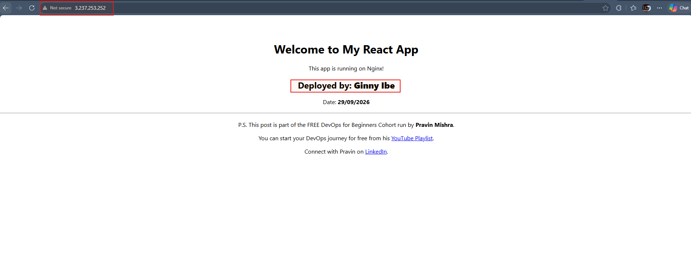
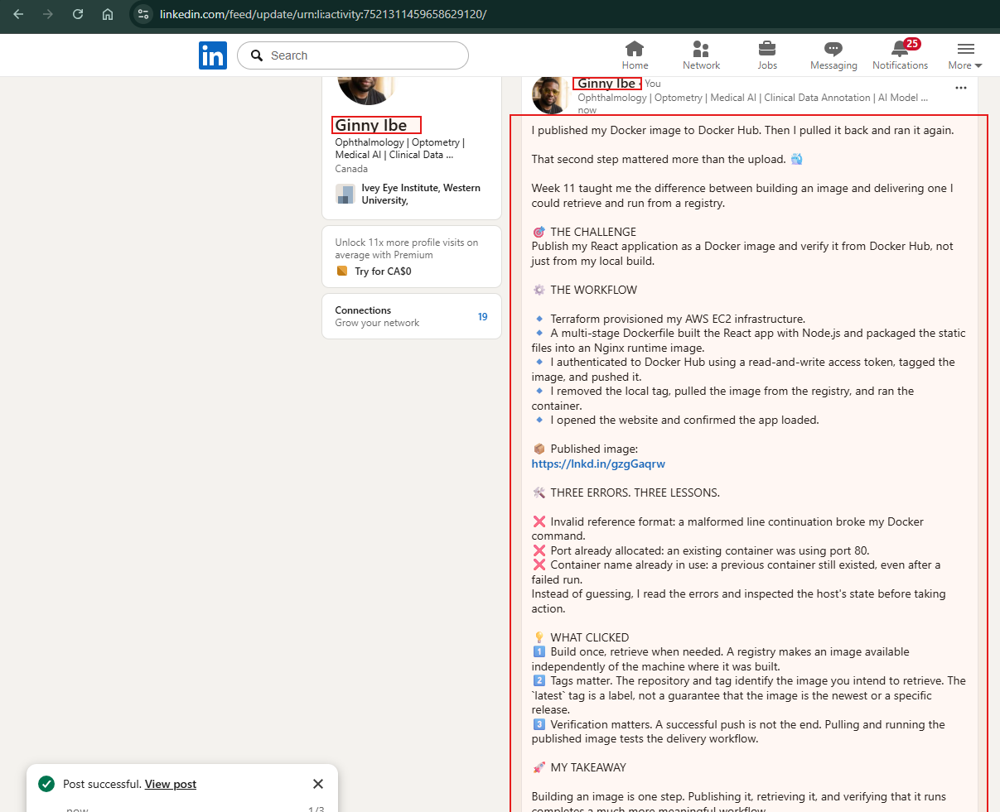

# Assignment 5 — Publish a Docker Container on Docker Hub

Part of the DevOps Micro Internship (DMI) with Agentic AI

---

## Purpose

In this assignment, you will publish a Dockerized React application to Docker Hub, remove the local image tags, pull the image again from Docker Hub, and run it to verify that it can be downloaded and deployed from a container registry.

---

# Task 1 — Publish a Docker Image to Docker Hub

## Goal

Tag a locally built React image, publish it to Docker Hub, remove the local copy, pull it again from Docker Hub, and run it successfully.

### Evidence

#### Screenshot 1 — Public Docker Hub Repository

Add a screenshot of Docker Hub showing your newly created public repository:

```text
my-react-app
```



---

#### Screenshot 2 — Successful Docker Login

Add a screenshot of the terminal showing:

```text
Login Succeeded
```

Ensure that your full name is visible and that no password, Personal Access Token, or device code is exposed.



---

#### Screenshot 3 — Correctly Tagged Image

Add a screenshot of the terminal showing:

```bash
docker image ls ginnyibe/my-react-app
```

The output must show the `latest` tag.



---

#### Screenshot 4 — Successful Docker Push

Add a screenshot of the terminal showing successful completion of:

```bash
docker push ginnyibe/my-react-app:latest
```

The output must include a pushed status or image digest.



---

#### Screenshot 5 — Published `latest` Tag in Docker Hub

Add a screenshot of your Docker Hub repository showing the uploaded `latest` image tag.



---

#### Screenshot 6 — Local Image Removed and Pulled Again

Add a screenshot of the terminal showing:

- The targeted local image tags removed
- Successful `docker pull` output
- `docker image ls` showing the pulled image



---

#### Screenshot 7 — Running Pulled Image

Add a screenshot of the terminal showing:

```bash
docker ps
```

The output must show the running `react-container` with:

```text
0.0.0.0:80->80/tcp
```



---

#### Screenshot 8 — React Application in Browser

Add a browser screenshot showing the React application at:

```text
http://3.237.253.252/
```

Ensure that the VM public IP is visible in the address bar. Add your full name as a clear caption directly below the screenshot.



---

# Docker Hub Repository URL

**Repository URL:** <https://hub.docker.com/repository/docker/ginnyibe/my-react-app/general>

---

# Registry and Image Tagging Notes

Write a short explanation covering:

- Why image tagging is required before pushing to Docker Hub
- Why a container registry is useful in DevOps workflows
- Why production deployments should use versioned image tags instead of relying only on `latest`

Why image tagging is required before pushing to Docker Hub
- When you run docker push, Docker reads the image name to work out where to send it. A local image called my-react-app has no Docker Hub account in its name, so Docker would try to push it to the official library/my-react-app repository, which I don't have permission to push to. Tagging it as ginnyibe/my-react-app:latest adds the account that owns the repository (ginnyibe), the repository name (my-react-app) and the version (latest). A tag doesn't copy or rebuild the image. It's just another name pointing to the same image, which is why both names show the same IMAGE ID in docker images.

Why a container registry is useful in DevOps workflows

- A container registry is a central place to store and share built images. In a DevOps workflow, the CI pipeline builds and tests the image once and pushes it to the registry. Every environment (testing, staging, production) then pulls that same image, so what was tested is exactly what gets deployed. Servers don't need the source code, Node.js or build tools. They only need Docker and access to the registry, and new servers can be set up by pulling the image. Registries also keep a history of image versions, which makes rollbacks possible, and private repositories control who can push or pull.

Why production deployments should use versioned tags instead of only latest

- latest is just the default tag. It doesn't mean "newest" or "stable", and it moves every time someone pushes a new image under that name. If production uses latest, two servers pulling at different times can end up running different code, and it's hard to tell which version is actually live. Rolling back is also difficult, because the previous image no longer has a name. Versioned tags such as my-react-app:1.0.0 or a Git commit SHA always point to one specific build. That makes deployments repeatable and easy to audit, and rolling back is just a matter of redeploying the previous tag. A common approach is to push every image with a version tag (and optionally latest as well), but deploy to production only by version tag.


---

# LinkedIn Requirement

## Goal

Create a LinkedIn post about publishing a Docker container image to Docker Hub.

Include:

- Assignment title: **Publish a Docker Container Image to Docker Hub**
- Your Docker Hub repository URL
- What you published
- How you verified the remote image by pulling and running it
- Key learning outcomes

### Evidence

#### LinkedIn Post URL

<https://www.linkedin.com/posts/dr-ginny-ibe_dmibypravinmishra-devops-docker-share-7521311458073325568-vIhj/?utm_source=share&utm_medium=member_desktop&rcm=ACoAAGTqulMBvpSBQMnxbzFBrJkA0C9nlWM_uqM>

---

#### LinkedIn Post Screenshot



---

# Submission Instructions

- Complete all steps in sequence.
- Include Screenshots 1–8 exactly as specified.
- Include your Docker Hub repository URL.
- Include the Registry and Image Tagging Notes.
- Include the LinkedIn post URL and screenshot.
- Ensure that your full name is visible in all terminal screenshots.
- Add your full name as a clear caption below the browser screenshot.
- Do not expose passwords, Personal Access Tokens, device codes, credentials, or other sensitive information.

---

# Completion Checklist

- [x] Public `my-react-app` repository created
- [x] Docker login completed successfully
- [x] `react-multistage:latest` tagged correctly
- [x] Image pushed to Docker Hub
- [x] `latest` tag verified in Docker Hub
- [x] Targeted local image tags removed
- [x] Image pulled again from Docker Hub
- [x] Pulled image runs successfully
- [x] React application is accessible through the VM public IP
- [x] Docker Hub repository URL included
- [x] Registry and image-tagging notes completed
- [x] LinkedIn post URL and screenshot included
- [x] All required screenshots included
- [x] Full name visible in terminal screenshots
- [x] Browser screenshot has a full-name caption
- [x] No passwords, tokens, or credentials exposed
---

## 📌 About DMI & CloudAdvisory

DevOps Micro Internship (DMI) is a project-based DevOps program run by Pravin Mishra (The CloudAdvisory) focused on real-world execution, systems thinking, and career readiness.

It helps learners build strong DevOps foundations with hands-on experience.

---

## 📌 Resources

- 🌐 DMI Official Website: https://dmi.pravinmishra.com?utm_source=github&utm_medium=readme  
- 🎓 University: https://university.pravinmishra.com?utm_source=github&utm_medium=readme  
- 💬 Discord Community: https://discord.pravinmishra.com?utm_source=github&utm_medium=readme  
- 📝 Blog: https://dmi.pravinmishra.com/blog?utm_source=github&utm_medium=readme  
- ▶️ YouTube Playlist: https://www.youtube.com/playlist?list=PLFeSNDtI4Cho  
- 🔗 Pravin Mishra (LinkedIn): https://www.linkedin.com/in/pravin-mishra-aws-trainer/  
- 🏢 CloudAdvisory (LinkedIn): https://www.linkedin.com/company/thecloudadvisory/

---

*This submission is part of DevOps Micro Internship (DMI) — Agentic AI Track.*
