# Assignment 8 — AI-Assisted Docker Container Hardening Audit

Part of the DevOps Micro Internship (DMI) with Agentic AI

---

## Purpose

In this assignment, you will build a read-only Bash script that audits a running Docker container for common hardening gaps — running as root, missing health checks, unpinned image tags, privileged mode, and unnecessary exposed ports — then connect that script to Claude Code as a reusable `/docker-audit` skill. You will run the audit against your production-grade EpicBook stack, fix what it finds by editing the Dockerfile yourself, rebuild the image, and re-run the audit to prove the fix worked. Claude analyzes evidence and recommends a fix; it never edits your Dockerfile or rebuilds the image itself.

---

# Target Container

**Target Container Name:** `Add the exact container name here`

---

# Task 1 — Prepare the Audit Workspace

## Goal

Create an audit workspace and confirm that the supplied files are available.

### Evidence

#### Screenshot 1 — Audit Workspace Files

Add a terminal screenshot showing your full name and both supplied files:

```text
docker-audit.sh
SKILL.md
```

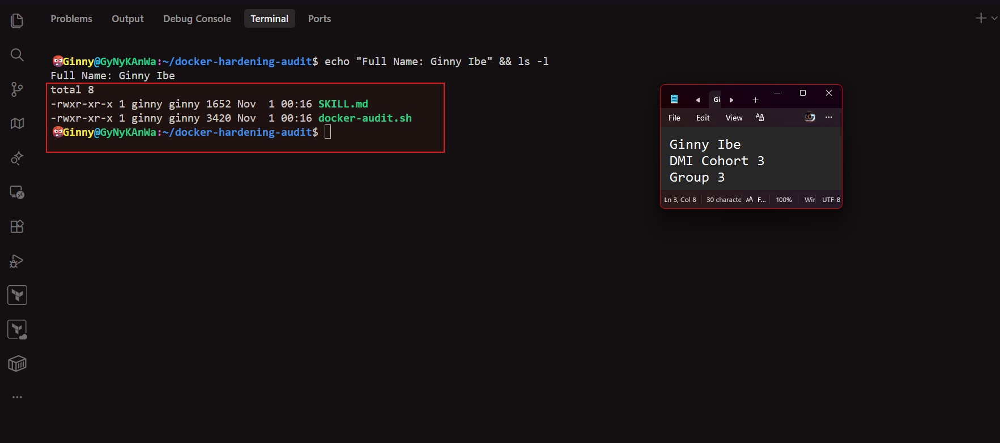

---

# Task 2 — Add the Docker Audit Skill to Claude Code

## Goal

Add the supplied `docker-audit` skill to Claude Code and confirm that it is available.

### Evidence

#### Screenshot 2 — Docker Audit Skill Available in Claude Code

Add a screenshot of Claude Code showing `docker-audit` in the available skill list.

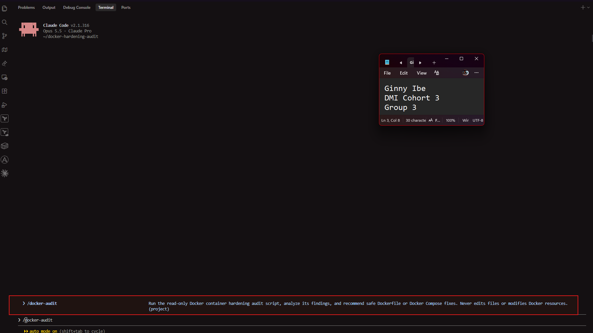

---

# Task 3 — Validate the Audit Script

## Goal

Verify the audit script line endings, Bash syntax, and usage message.

### Evidence

#### Screenshot 3 — Script Validation

Add a terminal screenshot showing:

- LF line-ending check
- Successful `bash -n docker-audit.sh` validation
- Your full name
- The usage message displayed when the script runs without a container name

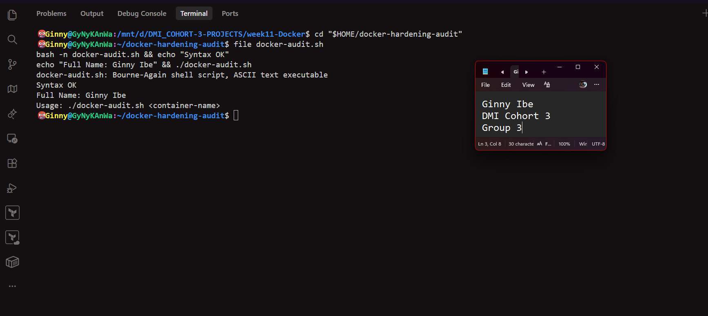

---

# Task 4 — Run the Initial Docker Security Audit

## Goal

Audit a running container and record the initial findings.

### Evidence

#### Screenshot 4 — Selected Target Container

Add a terminal screenshot showing:

- Your full name
- `docker ps`
- The audit command using the selected target container name

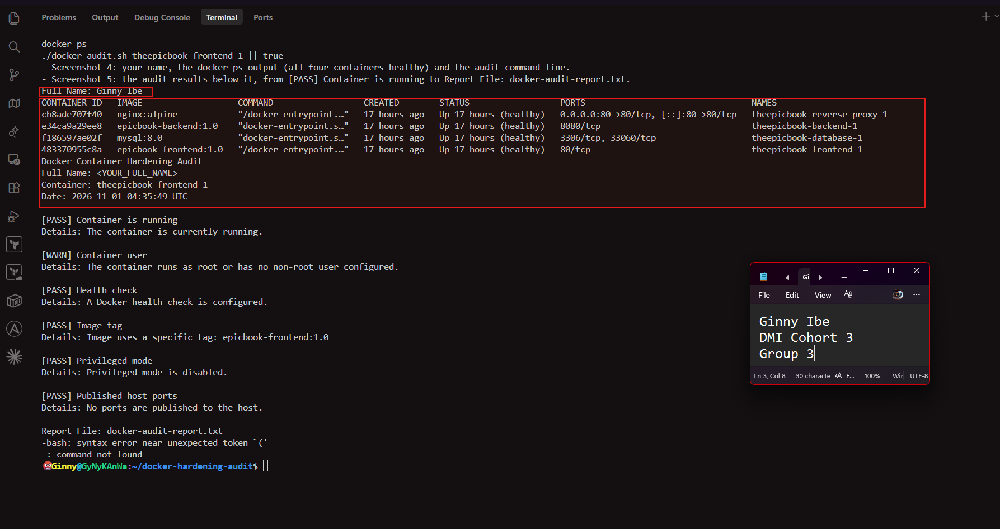

---

#### Screenshot 5 — Initial Audit Results

Add a terminal screenshot showing the initial Docker audit results.

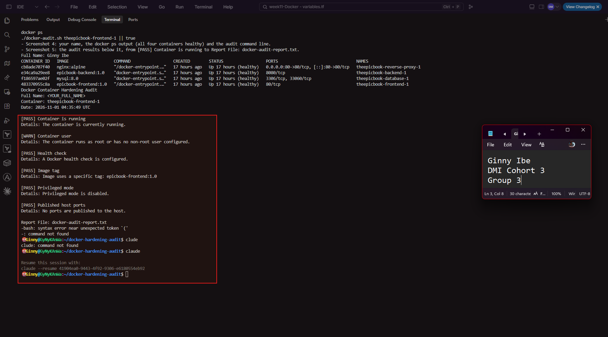

---

# Task 5 — Use AI Assistance to Understand the Findings

## Goal

Use the supplied `docker-audit` skill to understand the initial audit results safely.

### Evidence

#### Screenshot 6 — Audit Explanation and Recommended Fix

Add a Claude Code screenshot showing:

- Audit finding
- Security risk
- Recommended manual fix
- Verification method

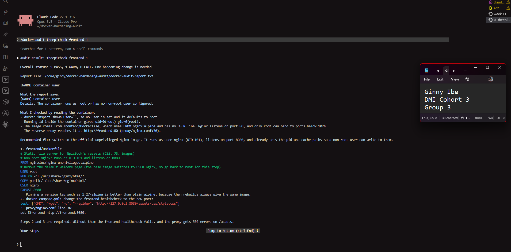
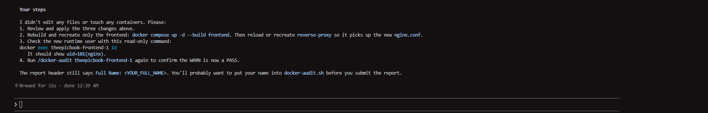

---

# Task 6 — Apply One Container-Hardening Fix

## Goal

Manually fix one WARN or FAIL finding from the initial audit.

### Evidence

#### Screenshot 7 — Hardening Configuration Change

Add a screenshot of the updated Dockerfile or `docker-compose.yml` showing the selected hardening fix.

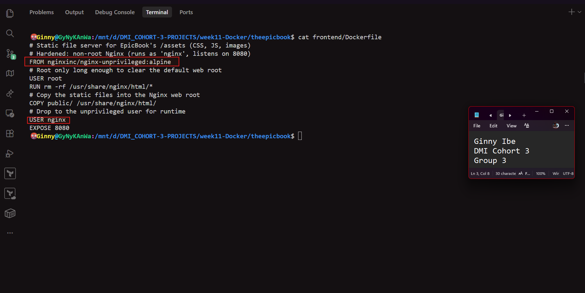

---

#### Screenshot 8 — Updated Service Running

Add a terminal screenshot showing your full name and the rebuilt or recreated service/container running successfully.

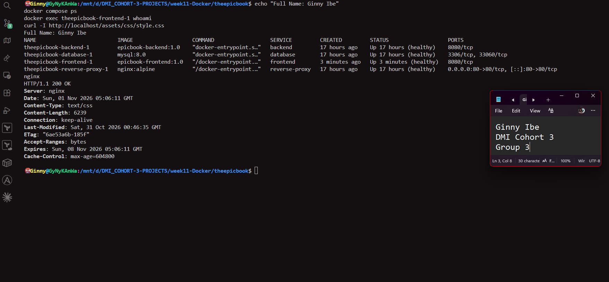

---

# Task 7 — Re-Run the Audit and Compare Results

## Goal

Verify that the selected hardening fix improved the container configuration.

### Evidence

#### Screenshot 9 — Final Audit Results

Add a terminal screenshot showing:

- Your full name
- The updated running container
- The final audit report

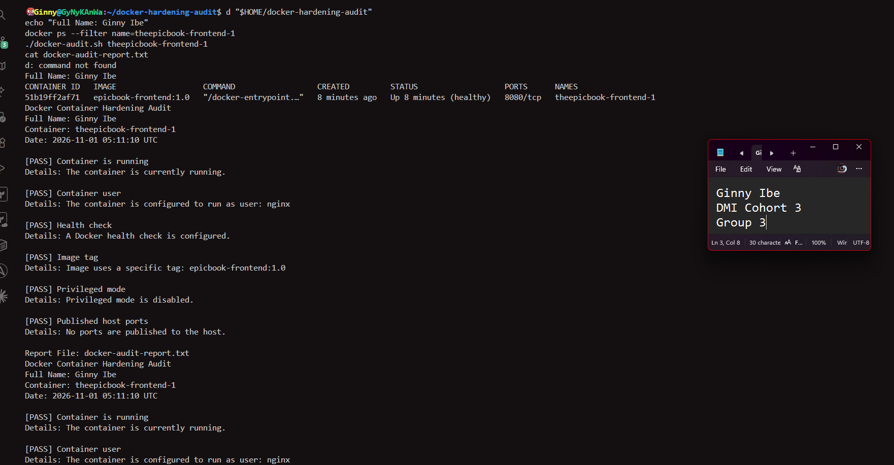
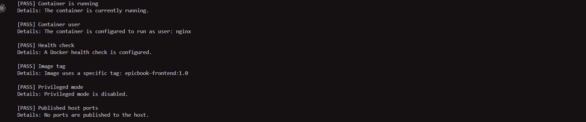

---

### Before-and-After Comparison

Write a short comparison covering:

- Initial audit finding
- Dockerfile or Docker Compose change applied
- Final audit result
- Security benefit of the improvement

## Before-and-After Comparison

| Check | Initial Audit | Final Audit | Changed? |
|---|---|---|---|
| Container is running | PASS | PASS | No |
| Container user | ⚠️ WARN: Runs as root or no non-root user configured | PASS: Configured to run as user `nginx` | Yes |
| Health check | PASS | PASS | No |
| Image tag | PASS: `epicbook-frontend:1.0` | PASS: `epicbook-frontend:1.0` | No |
| Privileged mode | PASS | PASS | No |
| Published host ports | PASS: None published | PASS: None published | No |

Overall: 5 PASS / 1 WARN / 0 FAIL became 6 PASS / 0 WARN / 0 FAIL.

Initial audit finding:
The first audit of theepicbook-frontend-1 reported [WARN] Container user with the detail "The container runs as root or has no non-root user configured." The frontend Dockerfile was based on nginx:alpine and never set a USER, so the Nginx process serving EpicBook's static files (CSS, JS, images) ran as root. docker exec theepicbook-frontend-1 whoami confirmed this by returning root. The other five checks passed, because the stack already had healthchecks, pinned 1.0 image tags, no privileged mode, and the reverse proxy was the only container publishing a port.

Dockerfile / Docker Compose change applied:
In frontend/Dockerfile, I replaced the base image nginx:alpine with nginxinc/nginx-unprivileged:alpine. The Dockerfile switches to USER root only long enough to clear the default web root and copy in the static files, then drops to USER nginx before the container runs. A non-root process can't bind port 80, so the frontend now listens on port 8080. Two related settings were updated to match:
- docker-compose.yml: the frontend healthcheck now checks http://127.0.0.1:8080/assets/css/style.css.
- proxy/nginx.conf: the frontend upstream changed from http://frontend:80 to http://frontend:8080.

I rebuilt only the frontend with docker compose up -d --build --no-deps frontend, so the backend and database kept running untouched. The reverse proxy wasn't restarted either: its config was checked with nginx -t and reloaded with nginx -s reload.

Final audit result:
Re-running the audit showed [PASS] Container user with the detail "The container is configured to run as user: nginx." All six checks now pass. docker exec theepicbook-frontend-1 whoami now returns nginx, and the container reports Up (healthy) on port 8080. curl -I http://localhost/assets/css/style.css returned HTTP/1.1 200 OK through the reverse proxy, so the change didn't break the application.

Security benefit of the improvement:
The frontend's Nginx process no longer runs with root privileges. If an attacker exploited a weakness in Nginx or its configuration, they would only get the nginx user's permissions. They couldn't install packages, change system files or the Nginx binary, or bind privileged ports, and they'd have a much weaker starting point for breaking out of the container to the host. This applies the principle of least privilege: the frontend only needs to read and serve static files, so it now runs with only those rights. It also matches the backend, which already runs as the non-root node user, so every EpicBook application container now runs as non-root. The database and reverse proxy still run on their official images.


---

# LinkedIn Requirement

## Goal

Create a LinkedIn post about the container security checks you performed, one hardening improvement you applied, and why the improvement matters.

### Evidence

**LinkedIn Post URL:** <https://www.linkedin.com/posts/dr-ginny-ibe_dmibypravinmishra-devops-docker-ugcPost-7522539294901796864-aGoY/?utm_source=share&utm_medium=member_desktop&rcm=ACoAAGTqulMBvpSBQMnxbzFBrJkA0C9nlWM_uqM>

#### LinkedIn Post Screenshot

Add a screenshot of the published LinkedIn post, including the final audit result.

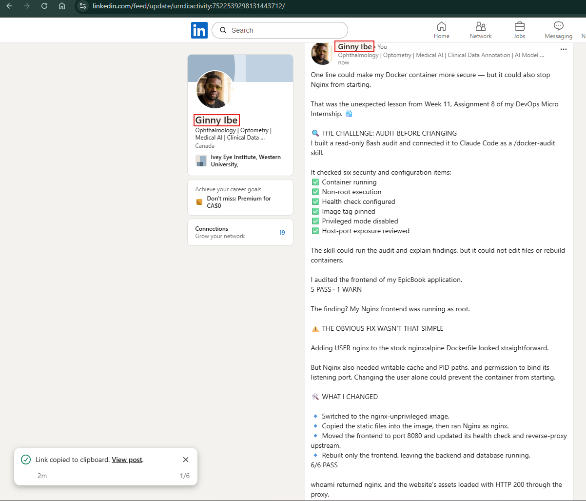
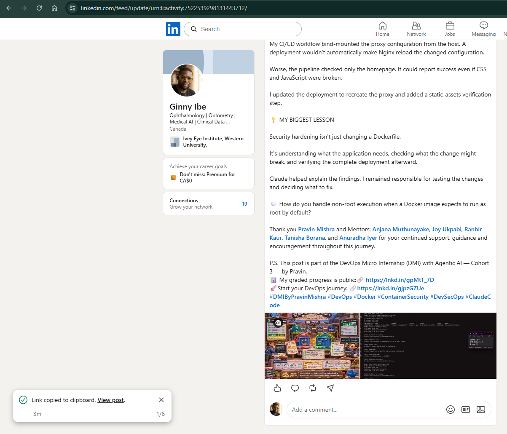

---

# Submission Instructions

- Include Screenshots 1–9 exactly as specified.
- Include the target container name and before-and-after comparison.
- Include the LinkedIn post URL and screenshot.
- Ensure that your full name is visible in all required terminal screenshots.
- Do not expose passwords, API keys, tokens, account IDs, or `.env` file contents.

---

# Completion Checklist

- [x] Audit workspace created and supplied files verified
- [x] `docker-audit` skill added to Claude Code
- [x] Audit script validated successfully
- [x] Running target container identified
- [x] Initial Docker audit completed
- [x] Claude Code explanation of findings captured
- [x] One hardening fix applied manually
- [x] Affected service or container rebuilt and recreated
- [x] Final Docker audit completed
- [x] Before-and-after comparison completed
- [x] Screenshots 1–9 included
- [x] LinkedIn post URL and screenshot included
- [x] No sensitive information exposed

---

## 📌 About DMI & CloudAdvisory

DevOps Micro Internship (DMI) is a project-based DevOps program run by Pravin Mishra (The CloudAdvisory) focused on real-world execution, systems thinking, and career readiness.

It helps learners build strong DevOps foundations with hands-on experience.

---

## 📌 Resources

- 🌐 DMI Official Website: https://dmi.pravinmishra.com?utm_source=github&utm_medium=readme  
- 🎓 University: https://university.pravinmishra.com?utm_source=github&utm_medium=readme  
- 💬 Discord Community: https://discord.pravinmishra.com?utm_source=github&utm_medium=readme  
- 📝 Blog: https://dmi.pravinmishra.com/blog?utm_source=github&utm_medium=readme  
- ▶️ YouTube Playlist: https://www.youtube.com/playlist?list=PLFeSNDtI4Cho  
- 🔗 Pravin Mishra (LinkedIn): https://www.linkedin.com/in/pravin-mishra-aws-trainer/  
- 🏢 CloudAdvisory (LinkedIn): https://www.linkedin.com/company/thecloudadvisory/

---

*This submission is part of DevOps Micro Internship (DMI) — Agentic AI Track.*
