# Assignment 02 — ReplicaSets: Keeping Your Pods Alive

Part of the DevOps Micro Internship (DMI) with Agentic AI

---

## Purpose

In this assignment, you will create three NGINX Pods using a ReplicaSet, test auto-healing by deleting one Pod, and scale the ReplicaSet from three to five Pods.

---

# Task 0 — Pre-check: Remove the Pod from Assignment 01

## Goal

Confirm that you are connected to your learning cluster and remove the previous standalone Pod to prevent the ReplicaSet from adopting it.

### Evidence

No screenshots required.

---

# Task 1 — Set Up Your Working Directory

## Goal

Create and enter a dedicated directory for this ReplicaSet lab.

### Evidence

#### Screenshot 01 — Output of `pwd` showing the working directory ending in `/k8s-labs/replicasets`

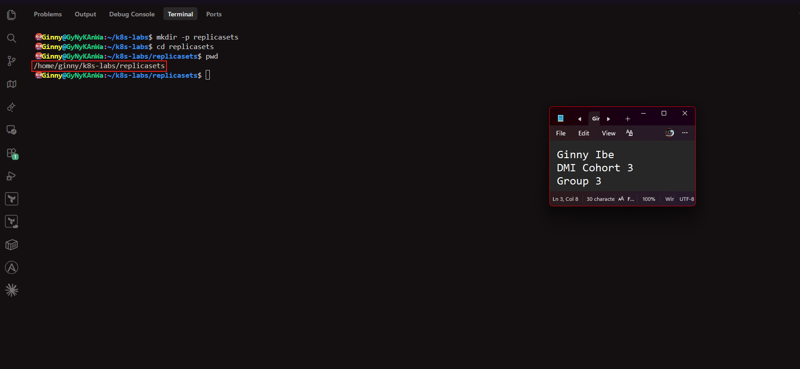

---

### Notes

**1. Why is it useful to keep Kubernetes manifests in organized directories?**

   - Related files stay together, so each lab or app has its own folder and nothing gets mixed up.
   - It's easy to find, reuse and edit a manifest later.
   - You can run kubectl apply -f on a whole folder.
   - A clear structure makes it easier to version-control with Git and to share with a team.
   - It lowers the risk of applying the wrong file to the wrong application.

---

**2. What file will you create in this directory for this assignment?**

- nginx-replicaset.yaml, the manifest that defines the ReplicaSet and its three NGINX Pods. 

---

# Task 2 — Create and Apply the NGINX ReplicaSet

## Goal

Create a ReplicaSet that maintains three NGINX Pods.

### Evidence

#### Screenshot 02 — Completed `nginx-replicaset.yaml` manifest showing `replicas: 3`

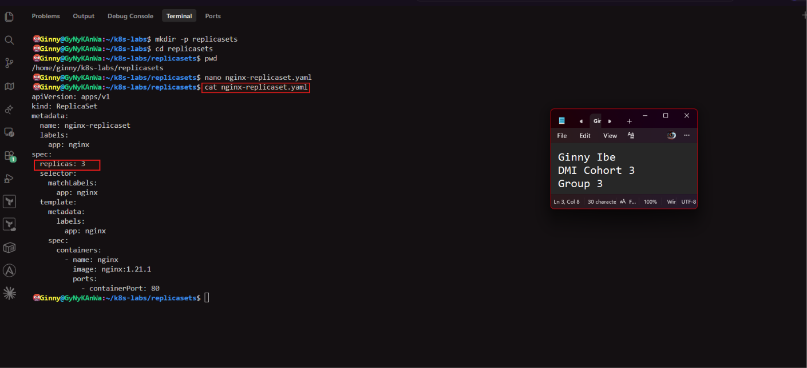

---

#### Screenshot 03 — Output of `kubectl apply -f nginx-replicaset.yaml`

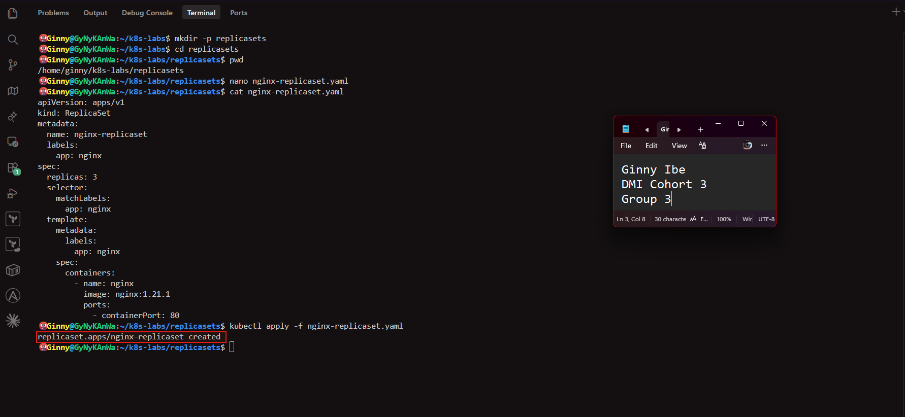

---

#### Screenshot 04 — Output of `kubectl get pods` showing three NGINX Pods with `1/1` under `READY` and `Running` under `STATUS`

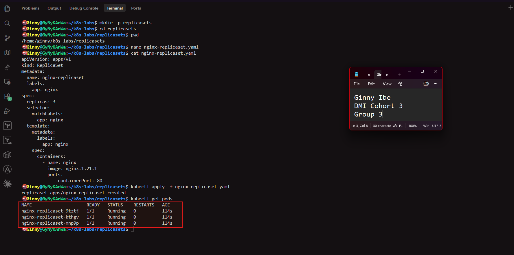
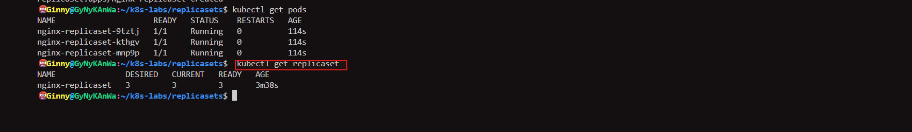

---

### Notes

**1. What does `replicas: 3` mean in this manifest?**

  - It sets the desired number of identical Pods. The ReplicaSet keeps comparing this number with how many matching Pods are actually running, and creates or removes Pods to keep them equal.

---

**2. Why must `selector.matchLabels` match `template.metadata.labels`?**

   - The selector is how the ReplicaSet recognizes which Pods belong to it, and the template labels are what get put on every Pod it creates.
   - If they didn't match, the ReplicaSet would create Pods it couldn't recognize as its own. It would count too few Pods and keep creating more. Kubernetes rejects a mismatched manifest for this reason.

---

**3. What image and image tag are used for the NGINX container?**

   - The image is nginx with the tag 1.21.1, so nginx:1.21.1. Pinning a version keeps the deployment predictable. Without a tag, Kubernetes would use latest, which can change.

---

# Task 3 — Test ReplicaSet Auto-Healing

## Goal

Delete one Pod managed by the ReplicaSet and observe Kubernetes automatically create a replacement.

### Evidence

#### Screenshot 05 — Output of the command deleting one ReplicaSet-managed Pod

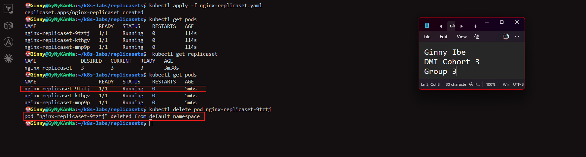

---

#### Screenshot 06 — Output of `kubectl get pods` showing the replacement Pod with a different name from the deleted Pod

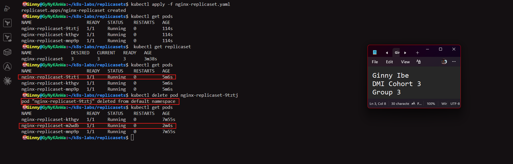

---

#### Screenshot 07 — Output showing three NGINX Pods with `1/1` under `READY` and `Running` under `STATUS` again

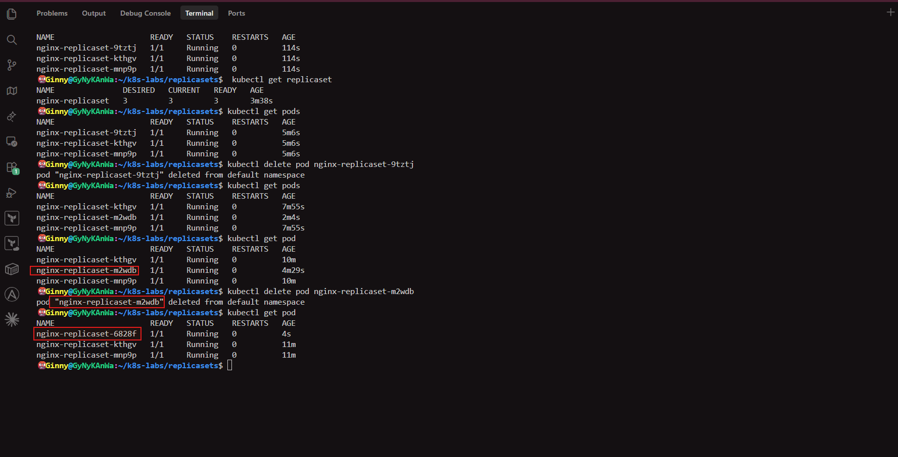

---

### Notes

**1. What happened after you deleted one Pod?**

- The ReplicaSet saw that only 2 of the 3 desired Pods remained. It immediately created a new Pod from its template. The replacement has a different name and a young age, while the other two kept their original names and ages. No manual command was needed to recreate it.

---

**2. How does the ReplicaSet know that a replacement Pod is needed?**

- The ReplicaSet controller continuously compares the desired state (replicas: 3) with the actual state, meaning the number of running Pods matching its selector app=nginx. When it counts 2 instead of 3, it creates one more Pod from its template to close the gap.

---

**3. What proves that auto-healing worked successfully?**

   - The count returned to three Pods, all 1/1 Running.
   - A new Pod appeared with a different name from the deleted one and a much smaller age than the other two.
   - You created nothing yourself, so Kubernetes did it on its own.

---

# Task 4 — Manually Scale the ReplicaSet

## Goal

Scale the ReplicaSet from three NGINX Pods to five NGINX Pods by changing the YAML manifest.

### Evidence

#### Screenshot 08 — Updated `nginx-replicaset.yaml` showing `replicas: 5`

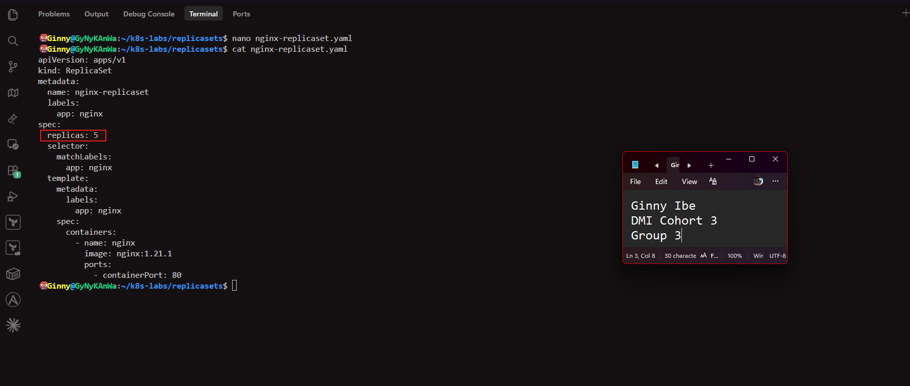

---

#### Screenshot 09 — Output of `kubectl get pods` showing five NGINX Pods with `1/1` under `READY` and `Running` under `STATUS`

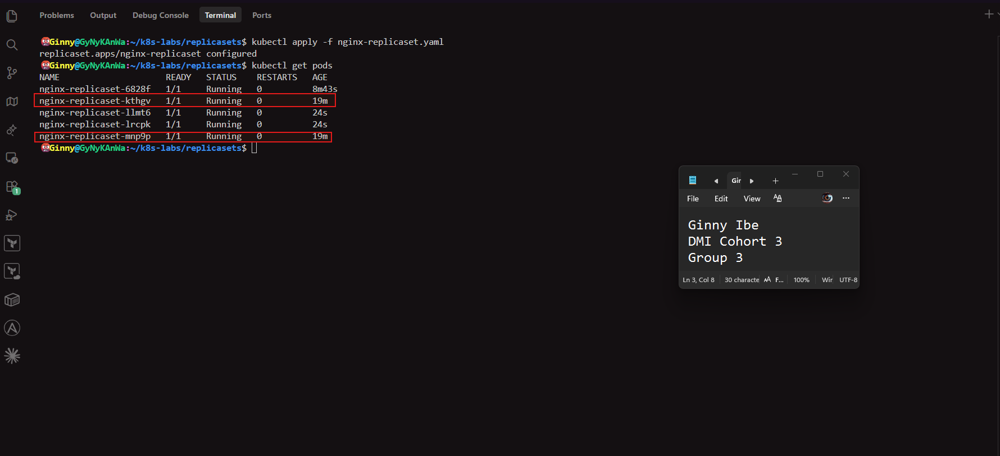
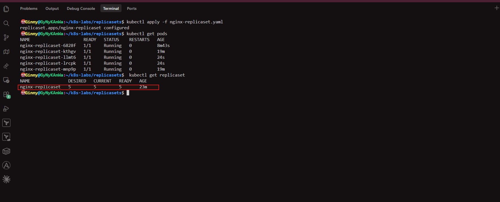

---

### Notes

**1. What change did you make to scale the ReplicaSet?**

- I edited nginx-replicaset.yaml and changed replicas: 3 to replicas: 5. I then re-applied the file with kubectl apply -f nginx-replicaset.yaml. Nothing else in the manifest changed.

---

**2. Did you manually create the additional Pods? Explain why or why not.**

- No. I only changed the desired state in the manifest. The ReplicaSet noticed that 3 Pods were running when 5 were required, and created the 2 missing Pods from its Pod template.
- This is the declarative approach: I say what I want, and Kubernetes works out how to reach it.

---

**3. What would happen if you changed the replica count from five back to three?**

- The ReplicaSet would see 5 Pods when only 3 are desired. It would delete 2 of them until the actual state matched, and 3 Pods would remain. Reconciliation works in both directions.

---

# LinkedIn Requirement

Create a LinkedIn post that includes:

- A short explanation of what a Kubernetes ReplicaSet does.
- What happened when you deleted one NGINX Pod.
- How Kubernetes automatically created a replacement Pod to maintain the desired replica count.
- What you learned by changing the replica count from three to five.
- One screenshot showing either:
  - Three Pods running after the auto-healing test, or
  - Five Pods running after scaling the ReplicaSet.

Do not share sensitive information, cluster credentials, tokens, or kubeconfig details in your post.

### Evidence

#### Screenshot 10 — Published LinkedIn post showing your name, the required explanation, and the attached Pod screenshot

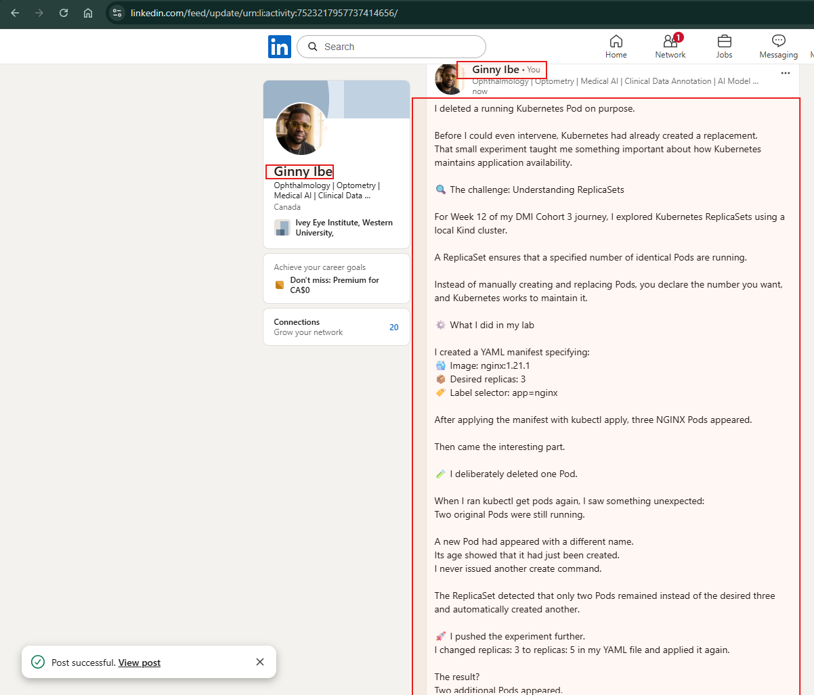

---

### Post Link

https://www.linkedin.com/posts/dr-ginny-ibe_dmibypravinmishra-devops-kubernetes-ugcPost-7523217954298109953-4CdB/?utm_source=share&utm_medium=member_desktop&rcm=ACoAAAaOpwIBKDeEm7KqEaRWVo6I-P1_Vo2LDAE

---

# Submission Instructions

- Add all required screenshots, numbered 01–10, to this template.
- Full Name must be visible in required screenshots.
- Ensure screenshots are clear and readable.
- Submit the final `nginx-replicaset.yaml` file showing `replicas: 5`. Screenshot 02 provides evidence of the initial manifest with `replicas: 3`.
- Complete the Notes sections in Tasks 1–4 in your own words.
- Include the published LinkedIn post URL.
- Do not expose tokens, passwords, private keys, kubeconfig files, or account IDs.

---

# Completion Checklist

- [x] Completed Task 0 and confirmed that the previous `nginx-pod` is no longer listed
- [x] Created and entered the ReplicaSet working directory (Screenshot 01)
- [x] Created `nginx-replicaset.yaml` with an initial replica count of three (Screenshot 02)
- [x] Applied the ReplicaSet manifest successfully (Screenshot 03)
- [x] Confirmed three NGINX Pods are running (Screenshot 04)
- [x] Deleted one ReplicaSet-managed Pod (Screenshot 05)
- [x] Observed the automatically created replacement Pod (Screenshot 06)
- [x] Confirmed three NGINX Pods are running again (Screenshot 07)
- [x] Changed the replica count from three to five (Screenshot 08)
- [x] Confirmed five NGINX Pods are running (Screenshot 09)
- [x] Submitted the final `nginx-replicaset.yaml` file with `replicas: 5`
- [x] Completed the Notes sections in Tasks 1–4
- [x] Published the LinkedIn post with the required explanation and Pod screenshot (Screenshot 10)
- [x] Included the published LinkedIn post URL
- [x] Included all required screenshots
- [x] No sensitive data exposed

---

## 📌 About DMI & CloudAdvisory

DevOps Micro Internship (DMI) is a project-based DevOps program run by Pravin Mishra (The CloudAdvisory) focused on real-world execution, systems thinking, and career readiness.

It helps learners build strong DevOps foundations with hands-on experience.

---

## 📌 Resources

- 🌐 DMI Official Website: https://dmi.pravinmishra.com?utm_source=github&utm_medium=readme  
- 🎓 University: https://university.pravinmishra.com?utm_source=github&utm_medium=readme  
- 💬 Discord Community: https://discord.pravinmishra.com?utm_source=github&utm_medium=readme  
- 📝 Blog: https://dmi.pravinmishra.com/blog?utm_source=github&utm_medium=readme  
- ▶️ YouTube Playlist: https://www.youtube.com/playlist?list=PLFeSNDtI4Cho  
- 🔗 Pravin Mishra (LinkedIn): https://www.linkedin.com/in/pravin-mishra-aws-trainer/  
- 🏢 CloudAdvisory (LinkedIn): https://www.linkedin.com/company/thecloudadvisory/

---

*This submission is part of DevOps Micro Internship (DMI) — Agentic AI Track.*
