# Assignment 3 — Deployments: From Basics to Rolling Updates

Part of the DevOps Micro Internship (DMI) with Agentic AI

---

## Purpose

Create an NGINX Deployment, configure RollingUpdate, update the container image, roll back to the previous revision, and scale the workload.

---

# Task 0 — Pre-check: Remove the Assignment 02 ReplicaSet

## Goal

Confirm that you are connected to your learning cluster and remove the previous ReplicaSet and its managed Pods before starting this lab.

### Evidence

No screenshots required.

---

# Task 1 — Set Up the Working Directory

## Goal

Create and enter the dedicated Deployment lab directory.

### Evidence

#### Screenshot 01 — Output of `pwd` showing the directory ending in `/k8s-labs/deployments`

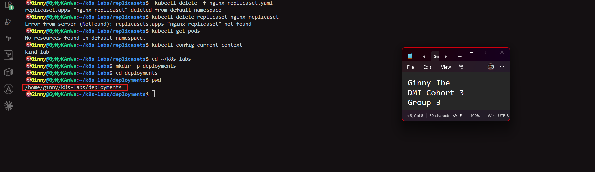

---

# Task 2 — Create the Basic Deployment

## Goal

Create a two-replica NGINX Deployment and verify the automatically managed ReplicaSet and Pods.

### Evidence

#### Screenshot 02 — Completed basic `nginx-deployment.yaml` showing two replicas and the initial NGINX image

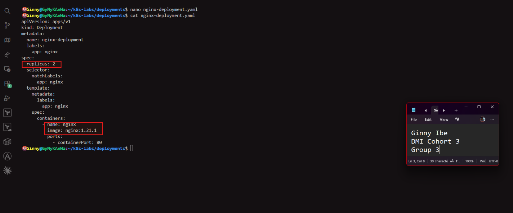

---

#### Screenshot 03 — Successful apply output and verification output showing the Deployment, its automatically created ReplicaSet, and two Pods with `1/1` under `READY` and `Running` under `STATUS`

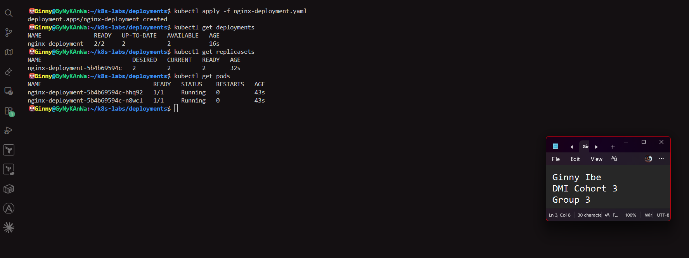

---

# Task 3 — Configure the RollingUpdate Strategy

## Goal

Configure RollingUpdate to maintain the desired available replica count during an image update.

### Evidence

#### Screenshot 04 — Updated YAML showing `RollingUpdate`, `maxSurge: 1`, and `maxUnavailable: 0`

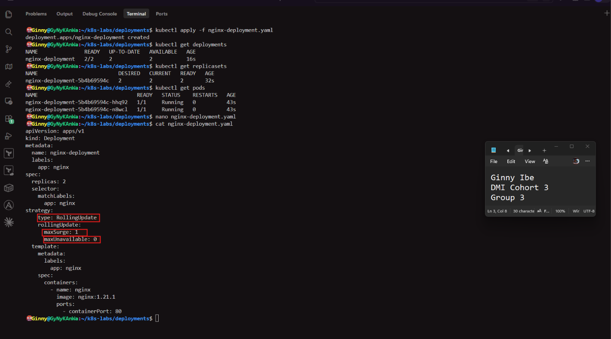

---

#### Screenshot 05 — Successful apply output and Deployment details showing the configured rolling-update strategy

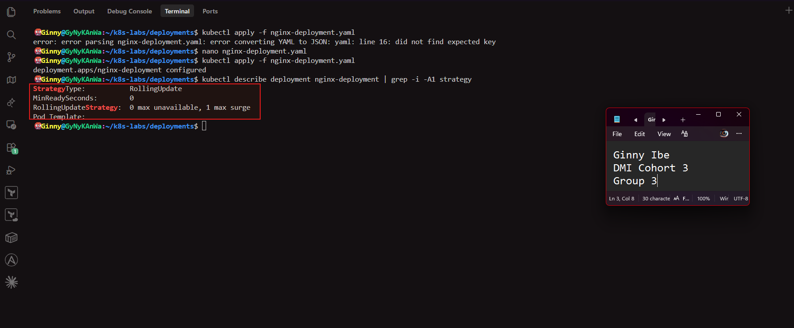

---

# Task 4 — Perform and Roll Back an Image Update

## Goal

Update NGINX to 1.23.1, observe the rollout, and return to the previous stable revision.

### Evidence

#### Screenshot 06 — Image-update command and rollout status showing successful completion

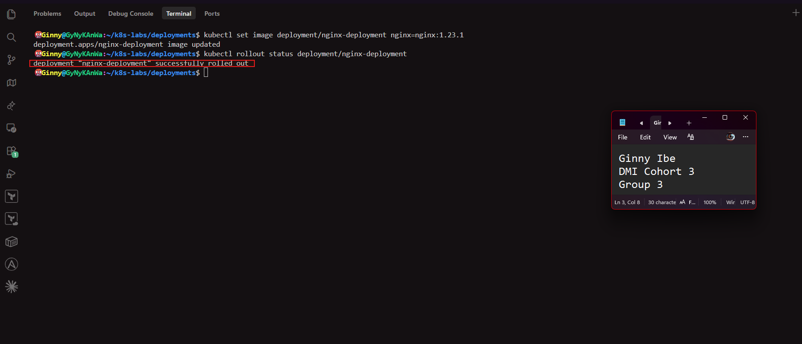

---

#### Screenshot 07 — ReplicaSet output showing the previous and updated ReplicaSets, and Deployment details showing `nginx:1.23.1`

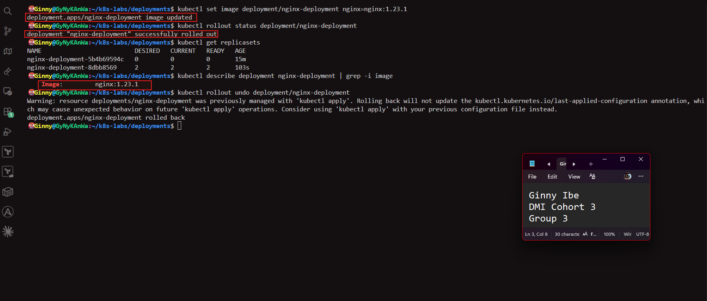

---

#### Screenshot 08 — Rollback command and rollout status showing successful completion

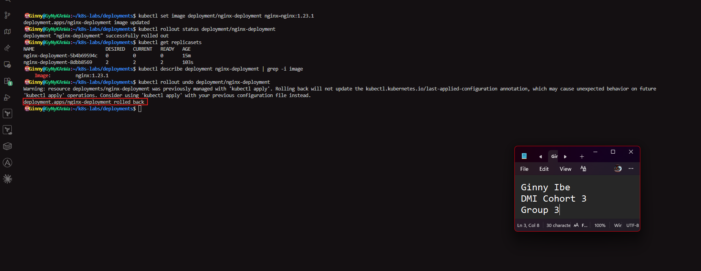

**ps...The warning above appeared because the Deployment was created with kubectl apply and rollout undo doesn't update the stored configuration.**

---

#### Screenshot 09 — Rollout history and Deployment details showing the restored `nginx:1.21.1` image

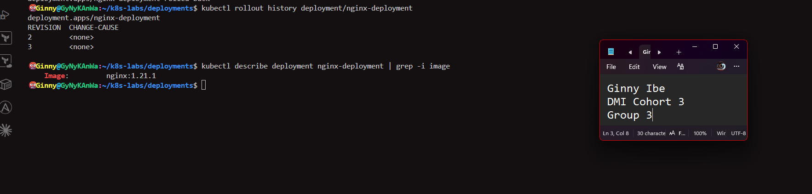

---

# Task 5 — Scale the Deployment

## Goal

Scale the workload to five replicas and return it to two.

### Evidence

#### Screenshot 10 — Scale-up command and output showing five Pods with `1/1` under `READY` and `Running` under `STATUS`

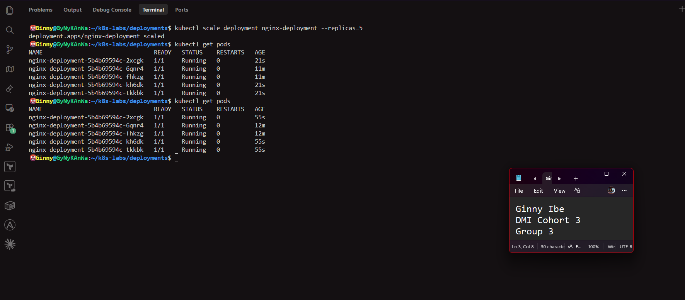

---

#### Screenshot 11 — Scale-down command and output showing the final two Pods with `1/1` under `READY` and `Running` under `STATUS`

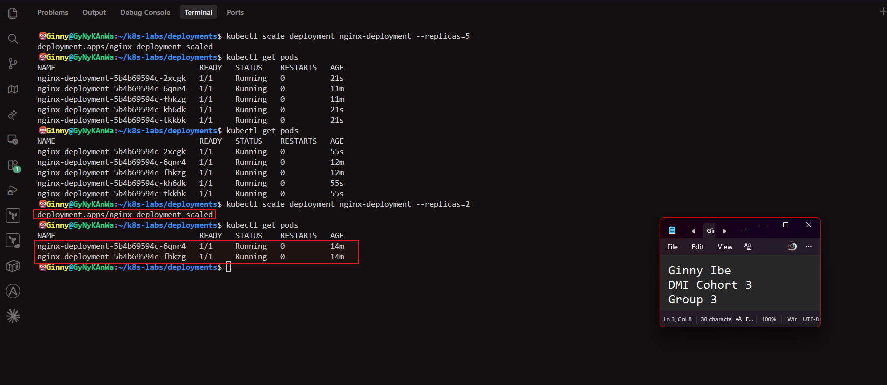

PS - Scaling changes only the replica count. No new ReplicaSet is created and no new revision is added to the rollout history.
kubectl scale doesn't edit your YAML, which still says replicas: 2. If you scaled up and then ran kubectl apply, the file's value would reset the count. In real projects, make scaling changes in the manifest so the repository matches the cluster.

---

# Task 6 — Share Your Kubernetes Deployment Progress on WhatsApp Status

## Goal

Share your Kubernetes Deployment learning progress on WhatsApp Status, including your generated DMI leaderboard progress link.

### Steps

1. Go to the DMI Leaderboard.
2. Find your name and select **Share your progress**.
3. Click the **WhatsApp icon**.
4. Copy the automatically generated leaderboard message containing your rank and progress link.
5. Open WhatsApp and go to **Updates**.
6. Create a new text Status.
7. Copy and paste the message below.
8. Insert the generated leaderboard message in the indicated place.
9. Review and publish your Status.

### WhatsApp Status Message

I practiced Kubernetes Deployments as part of my DevOps learning journey! 🚀

Today, I deployed NGINX, configured rolling updates, updated the container image, and rolled back to the previous version.

I also scaled my Deployment from two Pods to five and back to two!

https://api.whatsapp.com/send/?text=I+just+completed+12%2F14+weeks+of+the+DevOps+Micro+Internship+%E2%80%94+Cohort+3+%C2%B7+Live%21+%EF%BF%BD+https%3A%2F%2Fdmi.pravinmishra.com%2Fs%2FGinny-Ibe.html%3Futm_source%3Ddmi%26utm_medium%3Dshare%26utm_campaign%3Dbadge-share-hero-whatsapp&type=custom_url&app_absent=0

#DMIByPravinMishra #DevOps #Kubernetes

### Evidence

#### Screenshot 12 — Published WhatsApp Status showing your Kubernetes Deployment message and generated DMI leaderboard progress link

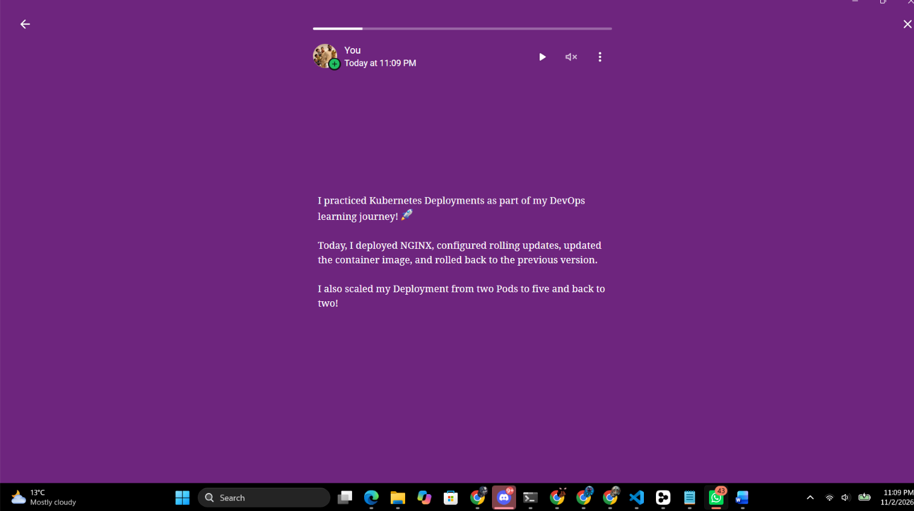

A draft or editing screen is not sufficient.

---

# Lab Summary

Write a short note explaining how Deployments manage ReplicaSets, perform rolling updates and rollbacks, and scale Pods.

- A Deployment is the top layer of a three-level chain: Deployment → ReplicaSet → Pods. I created only the Deployment, and Kubernetes created the ReplicaSet and the Pods for me. The ReplicaSet keeps the desired number of identical Pods running. The Deployment manages the ReplicaSets and adds update and rollback control on top of that. The hash in the ReplicaSet name identifies the version of the Pod template it belongs to.

- Rolling updates: When I changed the image from nginx:1.21.1 to nginx:1.23.1, the Pod template changed, so the Deployment created a new ReplicaSet and moved Pods across gradually. I configured maxSurge: 1 and maxUnavailable: 0. Kubernetes started one new Pod, waited for it to be ready, then removed an old one. At least two Pods were serving at every moment, so there was no downtime. The old ReplicaSet was kept at zero replicas rather than deleted.

- Rollbacks: Because the old ReplicaSet was kept, kubectl rollout undo could scale it back up and the new one down, using the same gradual process. The Pods returned to nginx:1.21.1. The rollout history showed revisions 2 and 3, because a rollback records the old template as the newest revision. kubectl warned that the stored apply configuration wasn't updated, which was harmless here because my YAML still matched.

- Scaling: kubectl scale changed the desired replica count to 5, and the ReplicaSet created three more Pods. Scaling back to 2 removed three. Scaling doesn't change the Pod template, so no new ReplicaSet or revision is created. It also doesn't edit the YAML file, so a later kubectl apply would reset the count. In real projects, scaling changes belong in the manifest.

- Takeaway: Deployments give you the self-healing of a ReplicaSet, plus safe zero-downtime updates, quick rollbacks and simple scaling.

---

# Submission Instructions

- Include all required screenshots, numbered 01–12.
- Ensure screenshots are clear and readable.
- Submit the final `nginx-deployment.yaml` containing two replicas, the initial NGINX image, and the configured RollingUpdate strategy.
- Complete the Lab Summary in your own words.
- Include evidence of your published WhatsApp Status.
- Do not expose passwords, tokens, private keys, or kubeconfig credentials.

---

# Completion Checklist

- [x] Completed Task 0
- [x] Created the deployments directory (Screenshot 01)
- [x] Created the basic two-replica NGINX Deployment manifest (Screenshot 02)
- [x] Applied the Deployment and verified its ReplicaSet and two running Pods (Screenshot 03)
- [x] Added RollingUpdate with `maxSurge: 1` and `maxUnavailable: 0` (Screenshot 04)
- [x] Applied and verified the rolling-update strategy (Screenshot 05)
- [x] Updated NGINX to 1.23.1 and confirmed rollout completion (Screenshot 06)
- [x] Inspected the ReplicaSets and verified the updated image (Screenshot 07)
- [x] Rolled back the update and confirmed rollout completion (Screenshot 08)
- [x] Reviewed rollout history and verified the restored image (Screenshot 09)
- [x] Scaled to five running Pods (Screenshot 10)
- [x] Scaled back to two running Pods (Screenshot 11)
- [x] Published the WhatsApp Status with the generated leaderboard progress link (Screenshot 12)
- [x] Submitted the final `nginx-deployment.yaml`
- [x] Included screenshots 01–12
- [x] Completed the Lab Summary
- [x] No sensitive data exposed

---

## 📌 About DMI & CloudAdvisory

DevOps Micro Internship (DMI) is a project-based DevOps program run by Pravin Mishra (The CloudAdvisory) focused on real-world execution, systems thinking, and career readiness.

It helps learners build strong DevOps foundations with hands-on experience.

---

## 📌 Resources

- 🌐 DMI Official Website: https://dmi.pravinmishra.com?utm_source=github&utm_medium=readme  
- 🎓 University: https://university.pravinmishra.com?utm_source=github&utm_medium=readme  
- 💬 Discord Community: https://discord.pravinmishra.com?utm_source=github&utm_medium=readme  
- 📝 Blog: https://dmi.pravinmishra.com/blog?utm_source=github&utm_medium=readme  
- ▶️ YouTube Playlist: https://www.youtube.com/playlist?list=PLFeSNDtI4Cho  
- 🔗 Pravin Mishra (LinkedIn): https://www.linkedin.com/in/pravin-mishra-aws-trainer/  
- 🏢 CloudAdvisory (LinkedIn): https://www.linkedin.com/company/thecloudadvisory/

---

*This submission is part of DevOps Micro Internship (DMI) — Agentic AI Track.*
