# Assignment 4 — Auto-Scaling & Auto-Healing: Let Kubernetes React for You

Part of the DevOps Micro Internship (DMI) with Agentic AI

---

## Purpose

Create Deployments, test Pod auto-healing, configure CPU requests and limits, verify Metrics Server, and create a Horizontal Pod Autoscaler.

Optionally generate CPU load to observe how the HPA responds.

---

# Task 0 — Check the Existing Cluster Resources

## Goal

Confirm that you are connected to your learning cluster and inspect existing Deployments and HPAs.

### Evidence

No screenshots required.

---

# Task 1 — Set Up Your Lab Directory

## Goal

Create and enter a dedicated directory for the auto-scaling lab.

### Evidence

#### Screenshot 1 — Terminal showing that you are working inside `~/k8s-labs/autoscaling`

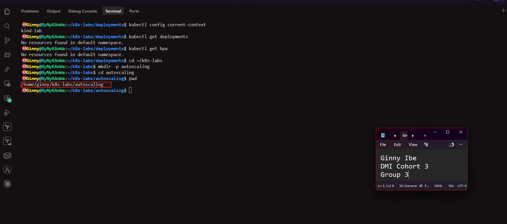

---

### Notes

**1. What is the difference between auto-healing and auto-scaling?**

- Auto-healing restores the desired number of Pods when the actual number falls below it, for example when a Pod is deleted or crashes. It never changes the desired number. A ReplicaSet does this.
   - Auto-scaling changes the desired number of Pods itself, up or down, in response to load such as CPU usage. A Horizontal Pod Autoscaler does this.
   - In short, healing keeps the count you set, and scaling changes the count to match demand.

---

**2. Which Kubernetes feature will you use for CPU-based auto-scaling?**

- The Horizontal Pod Autoscaler (HPA). It reads CPU usage from Metrics Server and adjusts the replica count of a Deployment between a minimum and a maximum.

---

# Task 2 — Test Auto-Healing with a Deployment

## Goal

Create a Deployment with two replicas, delete one Pod, and observe Kubernetes create a replacement Pod.

### Evidence

#### Screenshot 2 — Completed `autohealing-deployment.yaml` manifest

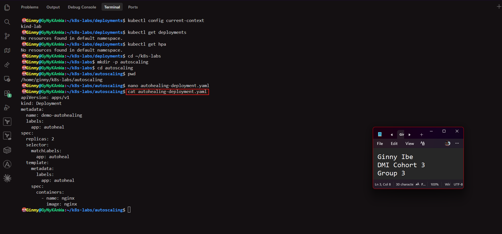

---

#### Screenshot 3 — Output of `kubectl get pods` showing two running Pods before deletion

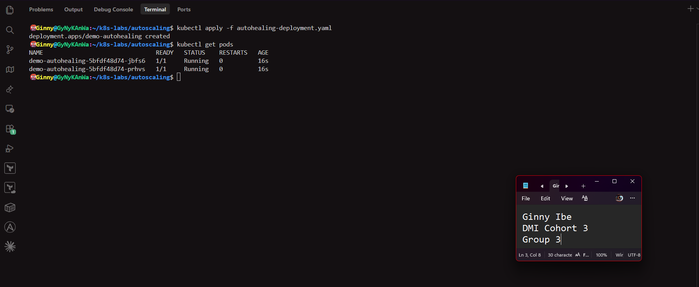

---

#### Screenshot 4 — Output of the `kubectl delete pod` command

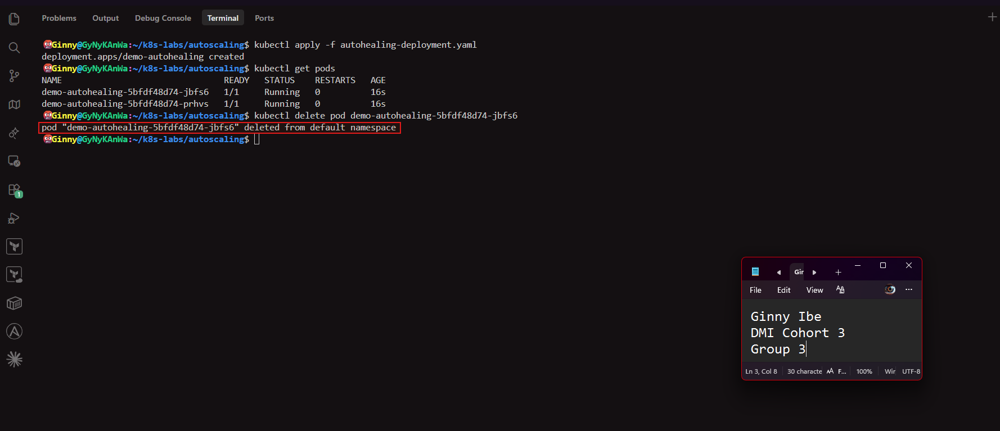

---

#### Screenshot 5 — Output of `kubectl get pods` showing the replacement Pod and two running Pods

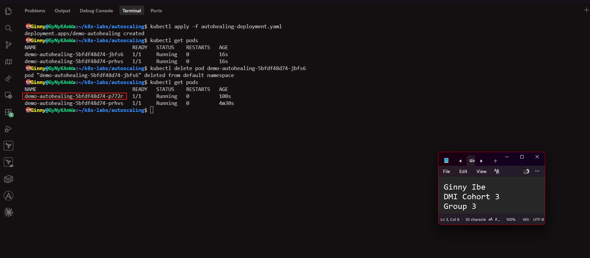

---

### Notes

**1. What happened after you deleted one Pod?**

- Only one Pod was left against a desired two. Kubernetes immediately created a replacement from the Deployment's template. The deleted Pod briefly showed Terminating, and the new Pod went through ContainerCreating to Running.

---

**2. What Kubernetes resource maintains the desired replica count for this Deployment?**

- The ReplicaSet. The Deployment creates a ReplicaSet, and the ReplicaSet runs a reconciliation loop that compares the desired count (2) with the number of matching Pods and creates or removes Pods to match.

---

**3. What proves that auto-healing worked?**

- The Pod count returned to two 1/1 Running Pods. The replacement has a different name from the deleted Pod and a much smaller AGE than the untouched Pod, and I ran no create command myself.

---

# Task 3 — Create a Deployment for HPA

## Goal

Create a Deployment with CPU resource requests and limits so that HPA can calculate CPU utilization.

### Evidence

#### Screenshot 6 — Completed `hpa-deployment.yaml` manifest showing CPU requests and limits

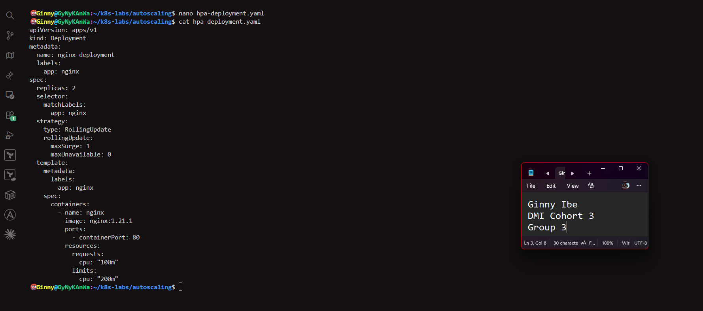

---

#### Screenshot 7 — Output showing `nginx-deployment` and its running Pods

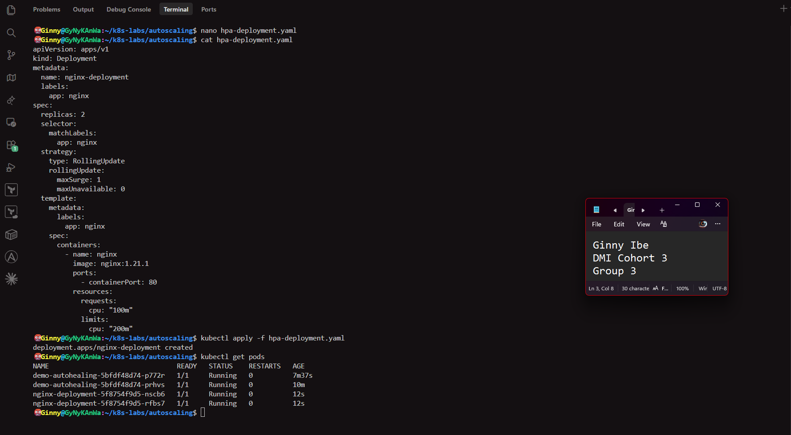

---

### Notes

**1. What does `cpu: "100m"` mean?**

- The m stands for millicores. 100m is 100 thousandths of one CPU core, or 0.1 of a core.

---

**2. What is the difference between a CPU request and a CPU limit?**

- A request is the amount of CPU the container is guaranteed. The scheduler uses it to decide where to place the Pod, and HPA uses it as the baseline for utilization.
 - A limit is the maximum CPU the container may use. If it tries to use more, Kubernetes throttles it. Here the request is 100m and the limit is 200m.

---

**3. Why does CPU-based HPA require CPU requests?**

- HPA calculates utilization as current usage divided by the requested amount. For example, 50m used against a 100m request is 50%. Without a request there is no baseline, so the percentage can't be calculated and the HPA shows `<unknown>`.

---

# Task 4 — Enable and Verify Metrics Server

## Goal

Ensure the cluster can collect resource metrics for the HPA.

### Evidence

#### Screenshot 8 — Output showing Metrics Server running, or `kubectl top pods` displaying Pod metrics

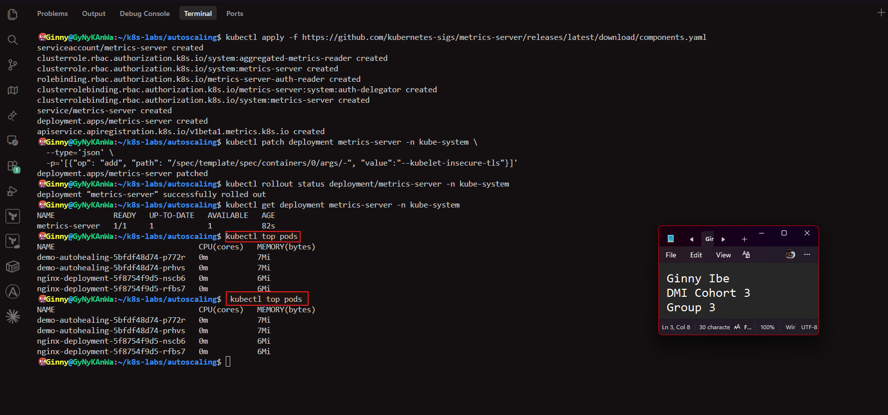

---

### Notes

**1. Why does HPA need Metrics Server?**

- Metrics Server collects CPU and memory usage from the nodes and exposes it through the Kubernetes metrics API. HPA reads those numbers to compare current usage with its target. Without a source of usage data, HPA can't decide whether to scale.

---

**2. What issue can occur if Metrics Server is not working?**

- HPA can't read CPU usage, so the TARGETS column shows `<unknown>`/50% and no scaling happens. kubectl top also fails with an error like "metrics not available."

---

**3. What does `kubectl top pods` help you check?**

- It shows the current CPU (in millicores) and memory usage of each Pod. It confirms the metrics pipeline works, and it lets you see actual usage compared with the CPU request, which is what HPA uses.

---

# Task 5 — Create a Horizontal Pod Autoscaler

## Goal

Create an HPA that keeps at least two Pods running and can scale up to five Pods when average CPU utilization exceeds 50%.

### Evidence

#### Screenshot 9 — The imperative command output OR completed `hpa-nginx.yaml` manifest

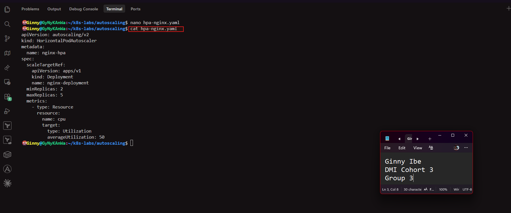

---

#### Screenshot 10 — Output of `kubectl get hpa` and the relevant `kubectl describe hpa` command

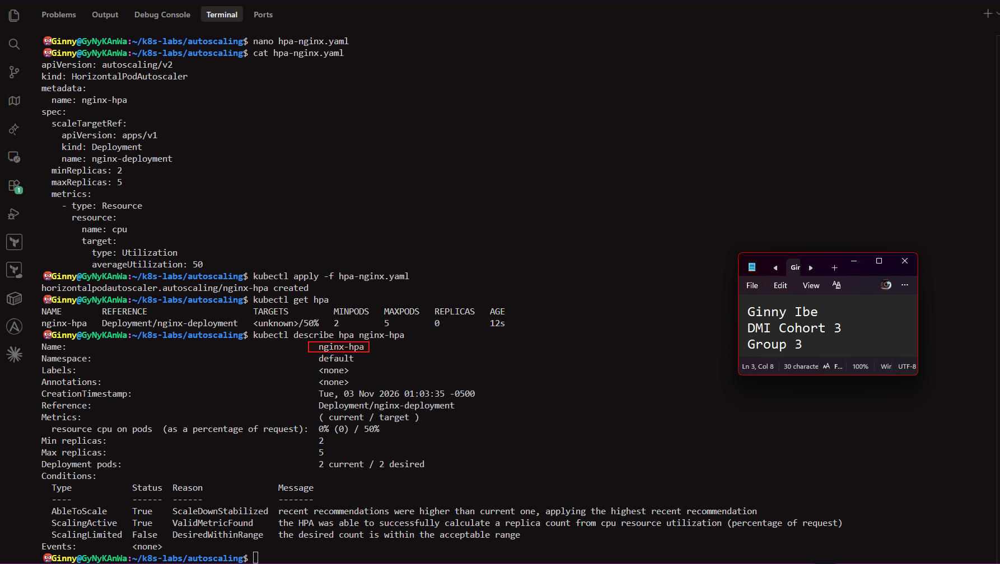

---

### Notes

**1. What does `minReplicas: 2` mean?**

The HPA will never scale the Deployment below two Pods, even when CPU usage is very low.

---

**2. What does `maxReplicas: 5` mean?**

- The HPA will never scale the Deployment above five Pods, even under heavy load. It caps resource use.

---

**3. What does `averageUtilization: 50` mean?**

- The HPA aims to keep the average CPU usage across all Pods at 50% of their CPU request. Since the request is 100m, that's about 50m per Pod. Above 50% it adds Pods, and well below it, it removes them.

---

**4. Why should only one HPA manage a Deployment at a time?**

- Two HPAs would each calculate their own desired replica count and keep overwriting each other's changes. The replica count would flip back and forth unpredictably, so scaling would be unstable.

---

# Task 6 — Optional: Generate CPU Load and Observe Scaling

## Goal

Generate CPU load in one NGINX Pod and observe how HPA responds.

### Evidence

If you skip this task, write “Not completed — optional” and leave the remaining Task 6 placeholders blank.

Task status: Completed — CPU load was generated and the HPA scaled the Deployment (Screenshots 11–12).

#### Screenshot 11 — Terminal showing the CPU-load command running inside the selected Pod

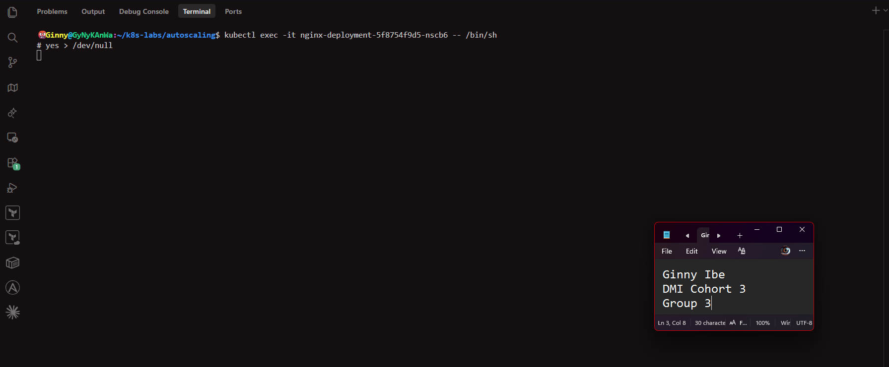

---

#### Screenshot 12 — Output of `kubectl get hpa` and `kubectl get pods` while HPA evaluates or changes the replica count

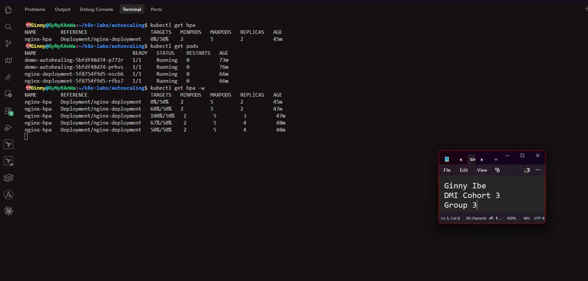
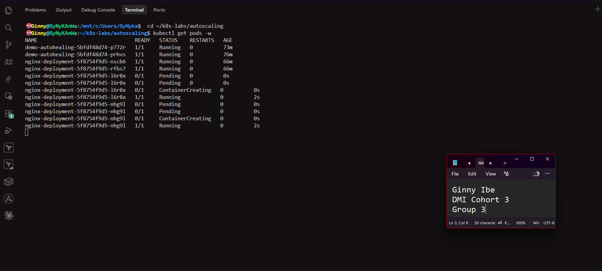

---

### Notes

Complete these answers only if you perform the optional test.

**1. Did the HPA change the number of Pods? Explain what you observed.**

- Yes. At the start, kubectl get hpa showed 0%/50% with 2 replicas. After I started yes > /dev/null inside one nginx-deployment Pod, CPU utilization rose to 68%/50% and then 100%/50%, well above the 50% target. The HPA raised the replica count from 2 to 3 and then to 4, with no kubectl scale command from me.

- In the Pod watch, two new Pods appeared. Each went from Pending to ContainerCreating to 1/1 Running within a few seconds. As the new Pods joined, the average CPU fell to 67%/50% and then settled at 50%/50%, and the HPA stopped at 4 replicas, below the maximum of 5. Only one Pod was running the load, so adding idle Pods brought the average down to the target.

---

**2. If scaling did not happen, what are two possible reasons?**

Not applicable — scaling occurred.

If it hadn't, two likely reasons would be:
- Metrics Server wasn't working, so the HPA couldn't read CPU usage and TARGETS would show <unknown>.
- The Deployment had no CPU request, so utilization couldn't be calculated.

---

**3. Why is automatic scale-down useful after traffic decreases?**

- It removes Pods that are no longer needed, which frees CPU and memory and lowers cost. It also keeps the Deployment at its minimum of 2 replicas, so availability is preserved without manual work. Scale-down is deliberately slower than scale-up, with a stabilization window of about 5 minutes, so short dips in traffic don't cause constant scaling up and down.

---

# LinkedIn Requirement

### Evidence

#### Screenshot 13 — Published LinkedIn post showing your name, the required explanation, and the attached Kubernetes screenshot

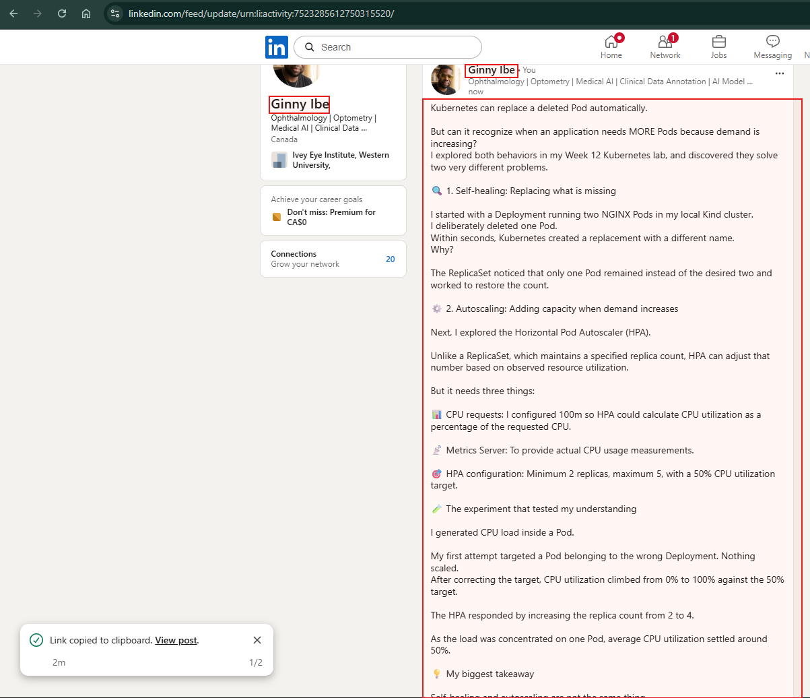

#### Linkedin Post Link

**https://www.linkedin.com/posts/dr-ginny-ibe_dmibypravinmishra-kubernetes-devops-ugcPost-7523285609487003648-irNw/?utm_source=share&utm_medium=member_desktop&rcm=ACoAAGTqulMBvpSBQMnxbzFBrJkA0C9nlWM_uqM**

---

# Submission Instructions

- Include required Screenshots 1–10 and Screenshot 13.
- Include Screenshots 11–12 only if you complete Task 6.
- Full Name must be visible in required screenshots.
- Ensure screenshots are clear and readable.
- Include the completed `autohealing-deployment.yaml` and `hpa-deployment.yaml` files.
- Include `hpa-nginx.yaml` if you selected the declarative HPA method.
- Complete the Notes sections for Tasks 1–5 in your own words.
- Complete Task 6 notes only if you perform the optional test.
- Do not expose passwords, tokens, private keys, kubeconfig files, or account IDs.

---

# Completion Checklist

- [x] Checked the active context and existing cluster resources
- [x] Created the autoscaling working directory (Screenshot 1)
- [x] Created `autohealing-deployment.yaml` (Screenshot 2)
- [x] Confirmed two auto-healing Pods were running (Screenshot 3)
- [x] Deleted one managed Pod (Screenshot 4)
- [x] Confirmed that the Pod was automatically replaced (Screenshot 5)
- [x] Created `hpa-deployment.yaml` with CPU requests and limits (Screenshot 6)
- [x] Verified `nginx-deployment` and its running Pods (Screenshot 7)
- [x] Verified Metrics Server and confirmed Pod metrics are available (Screenshot 8)
- [x] Created one HPA using the selected method (Screenshot 9)
- [x] Verified minimum replicas of 2, maximum replicas of 5, and a CPU target of 50% (Screenshot 10)
- [x] Completed Notes for Tasks 1–5
- [x] Completed Task 6 evidence and notes, or marked it “Not completed — optional”
- [x] Stopped the CPU-load command and exited the container shell, if Task 6 was completed
- [x] Published the LinkedIn post with the required explanation and attached screenshot (Screenshot 13)
- [x] Included the required manifest files
- [x] No sensitive data exposed

---

## 📌 About DMI & CloudAdvisory

DevOps Micro Internship (DMI) is a project-based DevOps program run by Pravin Mishra (The CloudAdvisory) focused on real-world execution, systems thinking, and career readiness.

It helps learners build strong DevOps foundations with hands-on experience.

---

## 📌 Resources

- 🌐 DMI Official Website: https://dmi.pravinmishra.com?utm_source=github&utm_medium=readme  
- 🎓 University: https://university.pravinmishra.com?utm_source=github&utm_medium=readme  
- 💬 Discord Community: https://discord.pravinmishra.com?utm_source=github&utm_medium=readme  
- 📝 Blog: https://dmi.pravinmishra.com/blog?utm_source=github&utm_medium=readme  
- ▶️ YouTube Playlist: https://www.youtube.com/playlist?list=PLFeSNDtI4Cho  
- 🔗 Pravin Mishra (LinkedIn): https://www.linkedin.com/in/pravin-mishra-aws-trainer/  
- 🏢 CloudAdvisory (LinkedIn): https://www.linkedin.com/company/thecloudadvisory/

---

*This submission is part of DevOps Micro Internship (DMI) — Agentic AI Track.*
