# Assignment 5 — Kubernetes Health Probes (Readiness)

Part of the DevOps Micro Internship (DMI) with Agentic AI

---

## Purpose

In this assignment, you will configure and test a Kubernetes readiness probe. You will create a baseline NGINX Deployment, add an HTTP readiness probe, intentionally break it, observe a stalled rollout, and restore the working configuration.

You will also demonstrate how readiness probes protect rolling updates.

---

# Task 0 — Prepare the Lab Environment

## Goal

Confirm that you are connected to your learning cluster and remove the previous assignment’s HPA and NGINX Deployment before starting this lab.

No screenshot or written notes are required for this pre-check.

---

# Task 1 — Set Up Your Lab Directory

## Goal

Create and enter a dedicated directory for the readiness-probe lab.

### Evidence

#### Screenshot 1 — Terminal showing that you are working inside `~/k8s-labs/health-probes-readiness`

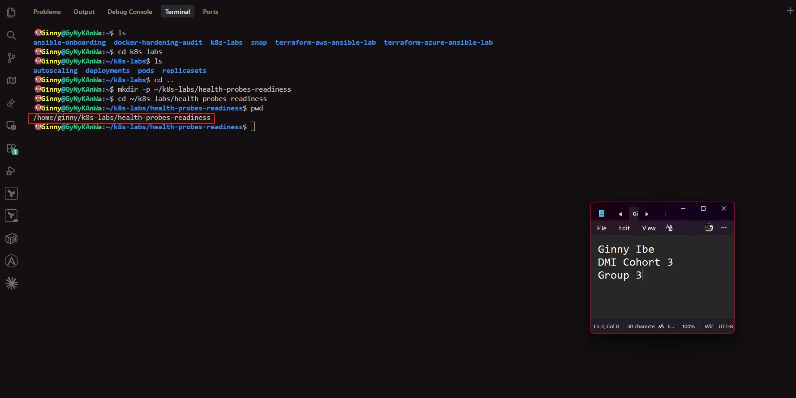

---

### Notes

**1. What is the purpose of a readiness probe?**
- A readiness probe tells Kubernetes whether a container is ready to accept traffic. While the probe fails, the Pod is marked not ready and removed from Service endpoints, so no traffic is sent to it. It doesn't restart the container. Once the probe passes again, the Pod receives traffic.

**2. Why is a Pod being Running not always enough to confirm it can serve traffic?**

- Running only means the container process has started. The application inside may still be loading, warming up, waiting for a database or other dependency, or stuck, and unable to handle requests. Sending traffic to it at that point would cause errors. The readiness probe checks that the application itself can respond.

---

# Task 2 — Create a Baseline Deployment Without Probes

## Goal

Create a baseline NGINX Deployment with two replicas and no readiness probe.

### Evidence

#### Screenshot 2 — Completed `00-nginx-deploy-baseline.yaml` manifest

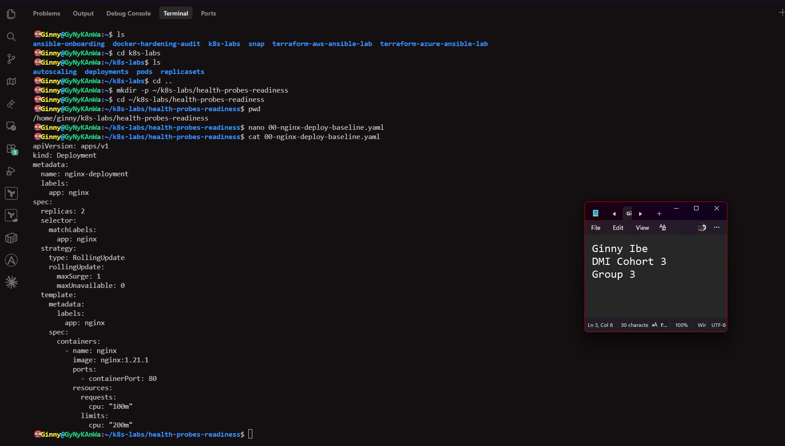

---

#### Screenshot 3 — Output showing a successful rollout and two running NGINX Pods

---

#### Screenshot 4 — Relevant output from `kubectl describe deployment nginx-deployment`

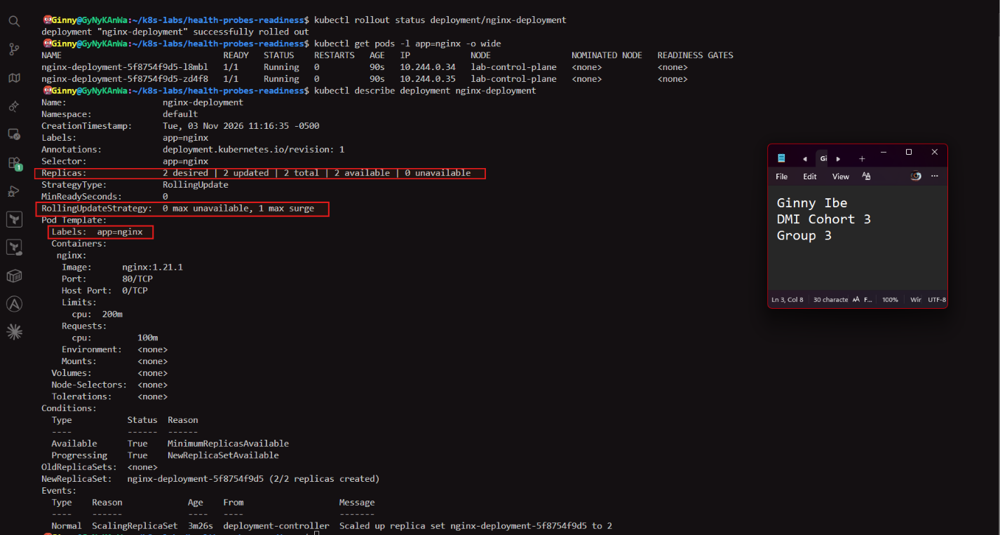

---

### Notes

**1. How many replicas does this Deployment maintain?**

- Two. spec.replicas: 2 means the Deployment, through its ReplicaSet, keeps two NGINX Pods running at all times.

**2. What does `maxUnavailable: 0` mean during a rolling update?**

 - No existing Pod may be taken out of service until its replacement is ready. Capacity never drops below the desired 2 Pods. With maxSurge: 1, Kubernetes adds one extra Pod first, waits for it to be ready, and only then removes an old one.

**3. Is a readiness probe configured in this baseline Deployment?**

- No. The Pod Template in kubectl describe has no Readiness: line. Kubernetes treats a Pod as ready as soon as its container starts, without checking whether NGINX can actually respond.

---

# Task 3 — Add a Readiness Probe

## Goal

Add an HTTP readiness probe so Kubernetes checks whether each NGINX container is ready to accept requests.

### Evidence

#### Screenshot 5 — Completed `01-nginx-deploy-readiness.yaml` manifest showing the readiness probe

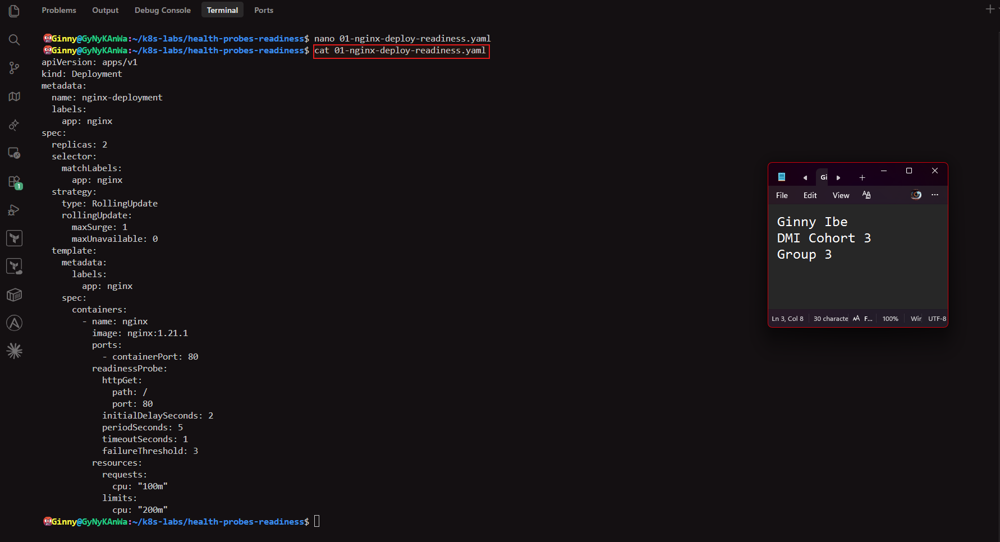

---

#### Screenshot 6 — Output of the successful rollout and ready Pods

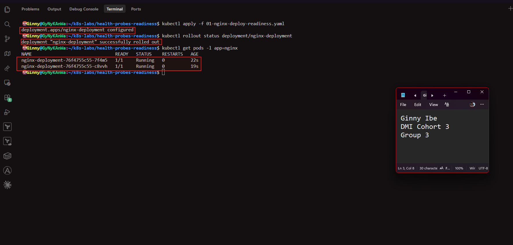

---

#### Screenshot 7 — Pod description showing readiness conditions and readiness probe details

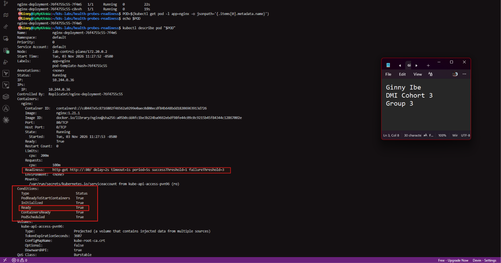
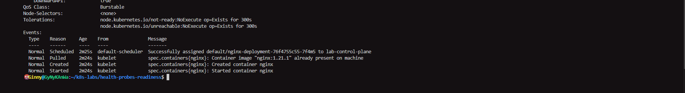

---

### Notes

**1. What path and port does the readiness probe check?**

- The path / on port 80. Kubernetes sends an HTTP GET to NGINX's root page.

**2. What does `initialDelaySeconds: 2` do?**

- Kubernetes waits 2 seconds after the container starts before running the first readiness check, so NGINX has a moment to start.

**3. What does `periodSeconds: 5` do?**

- It sets how often the probe runs. Kubernetes checks readiness every 5 seconds.

**4. What must happen before Kubernetes considers this Pod ready?**

- The container must be running and the readiness probe must succeed, meaning the HTTP request to / on port 80 returns a status from 200 to 399. Until then the Pod shows 0/1 and receives

---

# Task 4 — Break and Restore Readiness

## Goal

Intentionally fail the readiness probe, observe the NotReady behavior, and then restore the working probe configuration.

### Evidence

#### Screenshot 8 — `02-nginx-readiness-broken.yaml` showing `/does-not-exist`

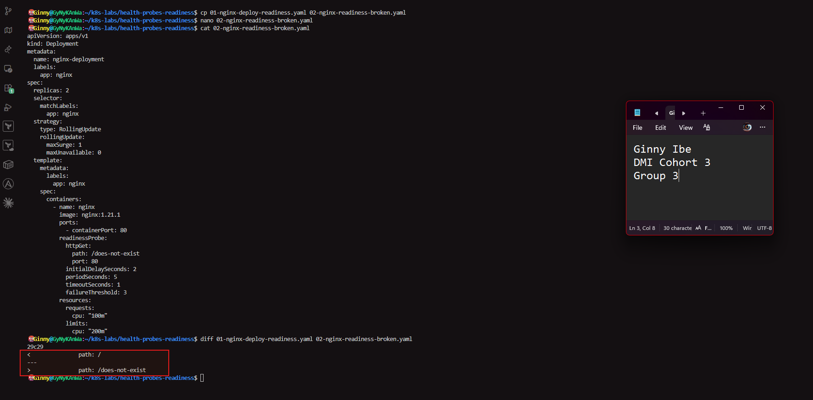

---

#### Screenshot 9 — Output showing the rollout timeout or incomplete rollout

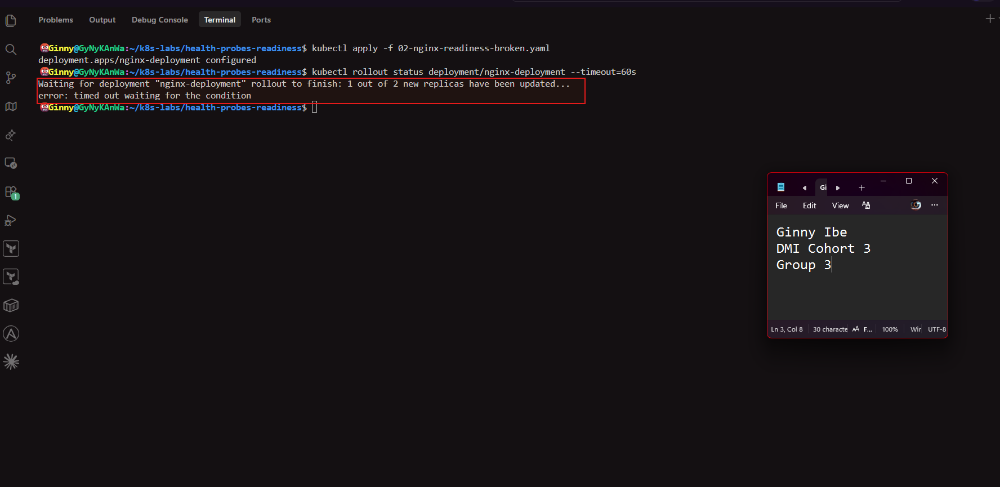

---

#### Screenshot 10 — Pod details showing `Ready: False` or readiness-probe failure events

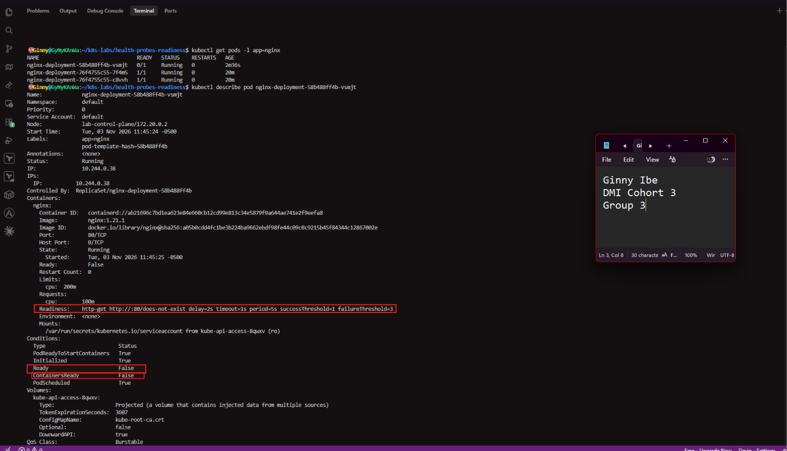
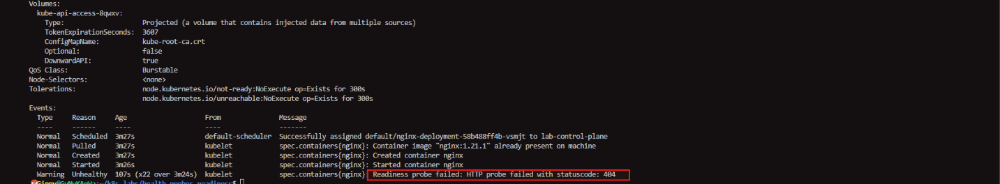

---

#### Screenshot 11 — Output showing successful rollout and ready Pods after the fix

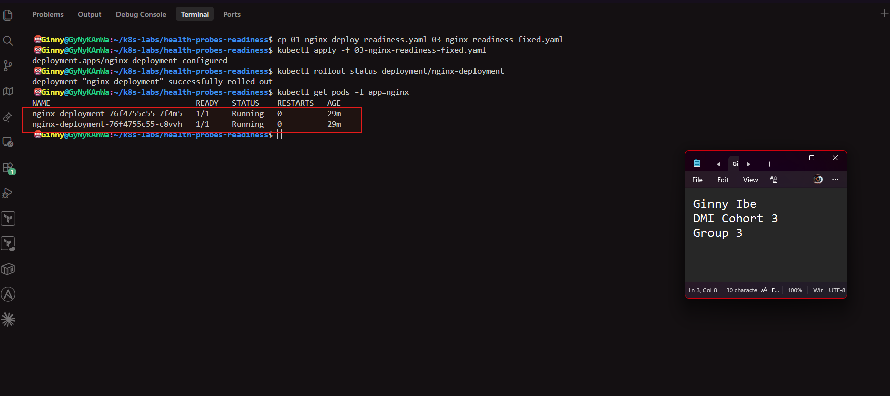

---

### Notes

**1. Why did the readiness probe fail?**

- The probe requested /does-not-exist, a page NGINX doesn't serve. NGINX returned a 404, which is outside the 200–399 success range, so every check failed.

**2. What happened to the Pod readiness status?**

- The new Pod stayed Running but showed 0/1 under READY, with Ready: False in its conditions. Kubernetes marked it not ready and kept traffic away from it. It was not restarted.

**3. Why did the rollout fail to complete?**

- With maxUnavailable: 0, Kubernetes won't remove an old Pod until its replacement is ready. The new Pod never became ready, so the old Pods were never replaced and the rollout stalled, then timed out.

**4. How did you restore the Deployment successfully?**

- I applied the original working configuration, with path: /, as 03-nginx-readiness-fixed.yaml. The Deployment rolled out new Pods that passed the probe, and the stalled update completed.

---

# Task 5 — See How Readiness Protects Rolling Updates

## Goal

Observe how readiness prevents a bad new Pod from replacing healthy Pods during a rolling update.

### Evidence

#### Screenshot 12 — Successful update command and rollout status

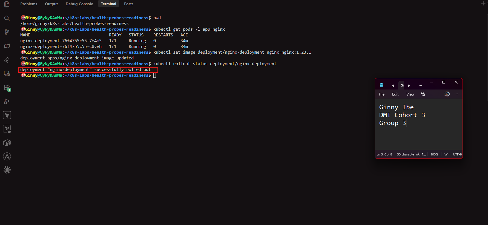

---

#### Screenshot 13 — ReplicaSets and Pods after the successful rolling update

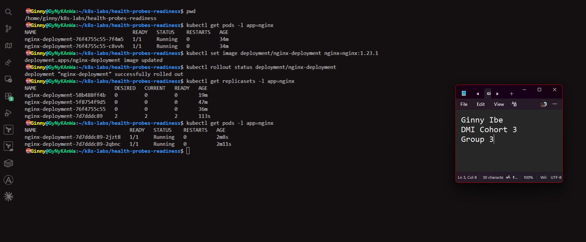

---

#### Screenshot 14 — Completed `04-readiness-broken-patch.yaml`

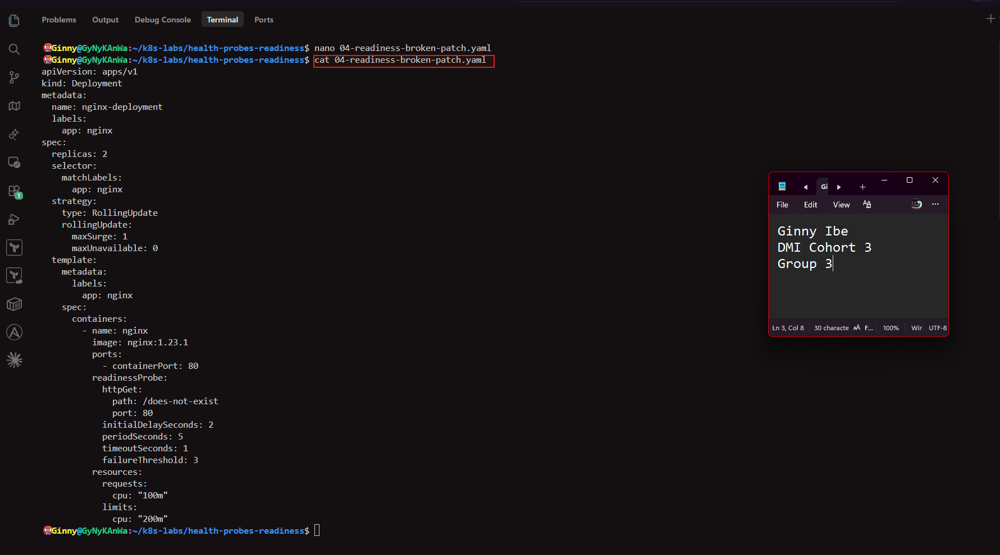

---

#### Screenshot 15 — Output showing the expected stalled rollout or timeout

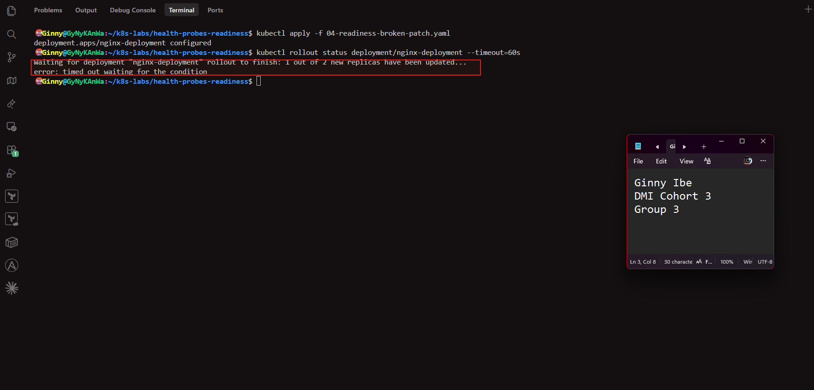

---

#### Screenshot 16 — Deployment or Pod output showing the effect of the broken readiness probe

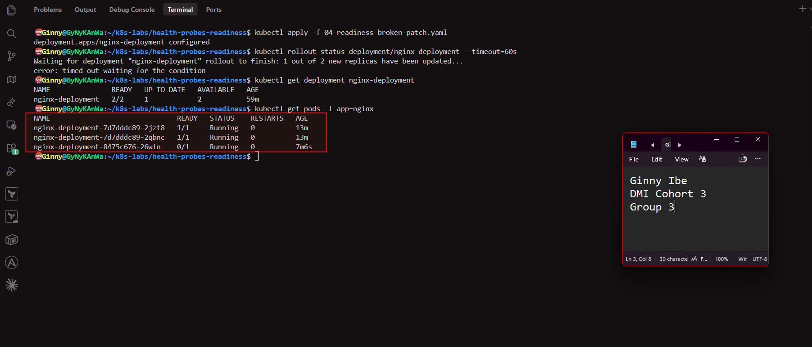

---

#### Screenshot 17 — Successful rollout status after restoring the fixed configuration

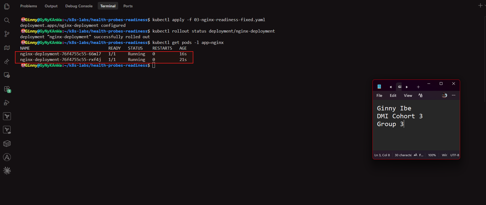

---

### Notes

**1. What happened during the successful rolling update?**

- Kubernetes started one new Pod with nginx:1.23.1, waited for its readiness probe to pass, then removed one old Pod, and repeated this once more. At least 2 Pods were ready throughout, so there was no downtime. The rollout ended with successfully rolled out.

**2. Why did Kubernetes create a new ReplicaSet?**

- Changing the image changes the Pod template, so the Deployment treats it as a new version. It creates a new ReplicaSet with a new hash for the new Pods and scales the old one down to 0, keeping it for rollback.

**3. Why were the new Pods unable to replace the existing healthy Pods after readiness was broken?**

- The new Pods were running but failed the readiness probe, with a 404 on /does-not-exist, so they never became ready. Kubernetes only removes an old Pod once its replacement is ready, so the old healthy Pods stayed in place.

**4. How does `maxUnavailable: 0` protect availability during this rollout?**

- It means no existing Pod may be taken out of service before a ready replacement exists. Since the bad Pod never became ready, both healthy Pods kept serving traffic. A bad release stalls instead of causing an outage.

---

# Task 6 — Share Your Readiness-Probe Learning on LinkedIn

## Goal

Share what you learned about Kubernetes readiness probes and how they protect rolling updates.

### Evidence

#### Screenshot 18 — Published LinkedIn post

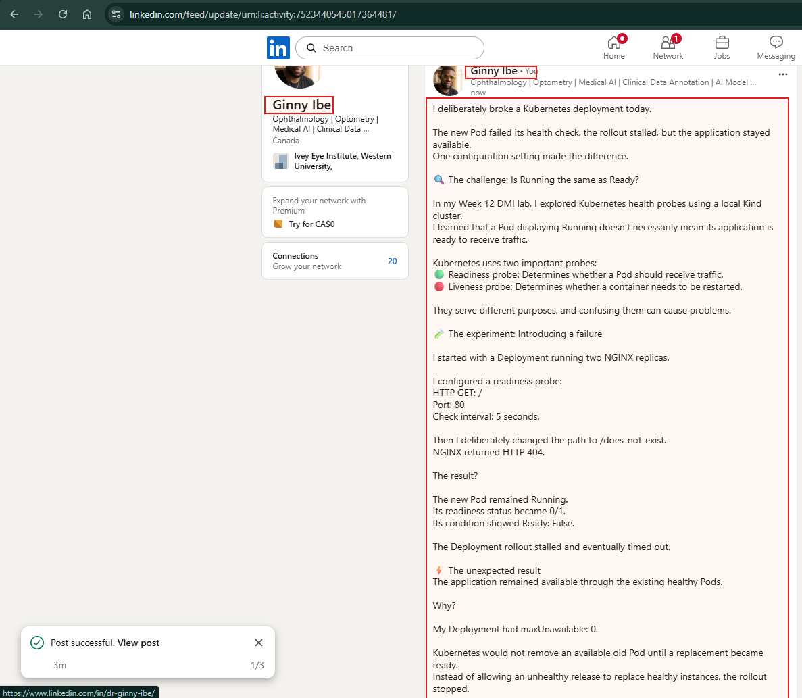

#### Linkedin post link

**https://www.linkedin.com/posts/dr-ginny-ibe_dmibypravinmishra-devops-kubernetes-share-7523440541498269696-D92T/?utm_source=share&utm_medium=member_desktop&rcm=ACoAAAaOpwIBKDeEm7KqEaRWVo6I-P1_Vo2LDAE**

---

# Submission Instructions

- Add all required screenshots numbered 1–18.
- Ensure your full name is visible in required screenshots.
- Use clear, readable screenshots showing the relevant manifest or output.
- Include the completed baseline and readiness-probe manifests in your repository.
- Answer all Notes questions for Tasks 1–5 in your own words.
- Include evidence of the intentional readiness failure and successful recovery.
- Do not expose tokens, passwords, kubeconfig files, account IDs, or other sensitive information.

---

# Completion Checklist

- [x] Learning cluster confirmed and previous assignment resources removed where applicable
- [x] Readiness-probe lab directory created (Screenshot 1)
- [x] Baseline Deployment created successfully (Screenshot 2)
- [x] Two baseline Pods running and successful rollout verified (Screenshot 3)
- [x] Baseline Deployment details reviewed (Screenshot 4)
- [x] Readiness probe added successfully (Screenshot 5)
- [x] Successful readiness rollout verified (Screenshot 6)
- [x] Pod readiness conditions and probe details inspected (Screenshot 7)
- [x] Broken readiness configuration created (Screenshot 8)
- [x] Stalled rollout or timeout observed (Screenshot 9)
- [x] NotReady status or readiness-probe failure events captured (Screenshot 10)
- [x] Working readiness configuration restored (Screenshot 11)
- [x] Successful image update completed (Screenshot 12)
- [x] ReplicaSets and Pods inspected after the update (Screenshot 13)
- [x] Broken-readiness patch created (Screenshot 14)
- [x] Stalled rollout observed after the patch (Screenshot 15)
- [x] Effect of broken readiness captured (Screenshot 16)
- [x] Final recovery completed (Screenshot 17)
- [x] LinkedIn post published (Screenshot 18)
- [x] Notes for Tasks 1–5 completed
- [x] Required manifests included
- [x] All screenshots are clear and readable
- [] No sensitive data exposed

---

## 📌 About DMI & CloudAdvisory

DevOps Micro Internship (DMI) is a project-based DevOps program run by Pravin Mishra (The CloudAdvisory) focused on real-world execution, systems thinking, and career readiness.

It helps learners build strong DevOps foundations with hands-on experience.

---

## 📌 Resources

- 🌐 DMI Official Website: https://dmi.pravinmishra.com?utm_source=github&utm_medium=readme  
- 🎓 University: https://university.pravinmishra.com?utm_source=github&utm_medium=readme  
- 💬 Discord Community: https://discord.pravinmishra.com?utm_source=github&utm_medium=readme  
- 📝 Blog: https://dmi.pravinmishra.com/blog?utm_source=github&utm_medium=readme  
- ▶️ YouTube Playlist: https://www.youtube.com/playlist?list=PLFeSNDtI4Cho  
- 🔗 Pravin Mishra (LinkedIn): https://www.linkedin.com/in/pravin-mishra-aws-trainer/  
- 🏢 CloudAdvisory (LinkedIn): https://www.linkedin.com/company/thecloudadvisory/

---

*This submission is part of DevOps Micro Internship (DMI) — Agentic AI Track.*
