# Assignment 6 — Kubernetes Health Probes (Liveness)

Part of the DevOps Micro Internship (DMI) with Agentic AI

---

## Purpose

In this assignment, you will configure and test a Kubernetes liveness probe. You will create a baseline NGINX Deployment, add an HTTP liveness probe, intentionally make it fail, observe container restarts, and restore the working configuration.

---

# Task 0 — Prepare the Lab Environment

## Goal

Confirm that you are connected to your learning cluster and remove the previous HPA and NGINX Deployment before starting this lab.

No screenshot or written notes are required for this pre-check.

---

# Task 1 — Set Up Your Lab Directory

## Goal

Create and enter a dedicated directory for the liveness-probe lab.

### Evidence

#### Screenshot 1 — Terminal showing that you are working inside `~/k8s-labs/health-probes-liveness`

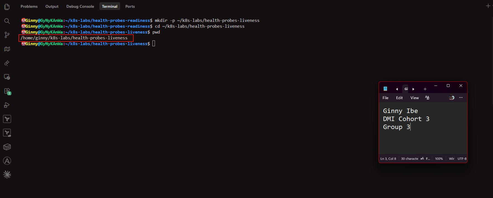

---

### Notes

**1. What problem does a liveness probe solve?**

- A container can be running but stuck: deadlocked, hung, or unable to respond, while its process stays alive. Kubernetes can't tell from the process alone. A liveness probe checks health periodically, and if it fails repeatedly, Kubernetes restarts the container. This recovers from failures that wouldn't otherwise fix themselves, without manual action.

**2. What is the key difference between a readiness probe and a liveness probe?**

  - A readiness probe decides whether a Pod should receive traffic. If it fails, the Pod is removed from the Service endpoints but is not restarted.
   - A liveness probe decides whether the container is still healthy. If it fails repeatedly, Kubernetes restarts the container.
   - In short, readiness controls traffic and liveness controls restarts.

---

# Task 2 — Create a Baseline Deployment Without Probes

## Goal

Create a baseline NGINX Deployment with two replicas and no health probes.

### Evidence

#### Screenshot 2 — Completed `00-nginx-deploy-baseline.yaml` manifest

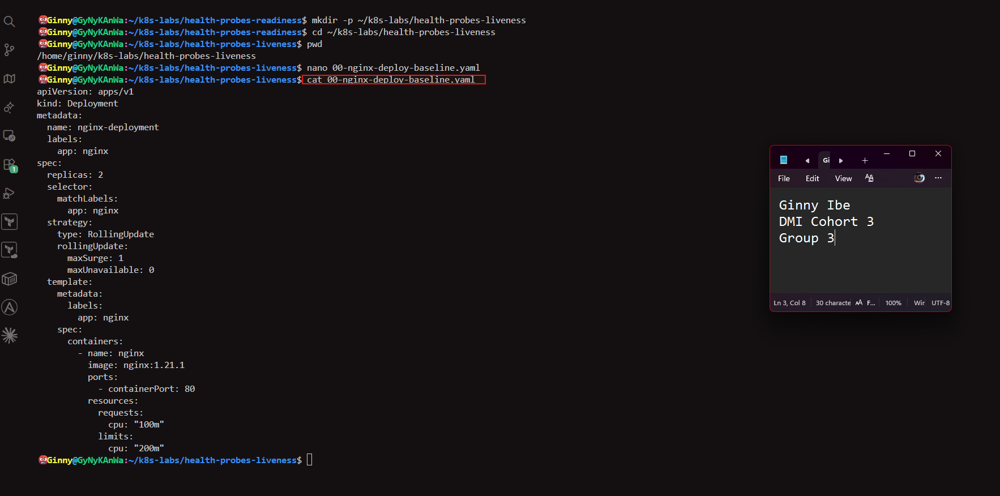

---

#### Screenshot 3 — Output showing a successful rollout and two running NGINX Pods

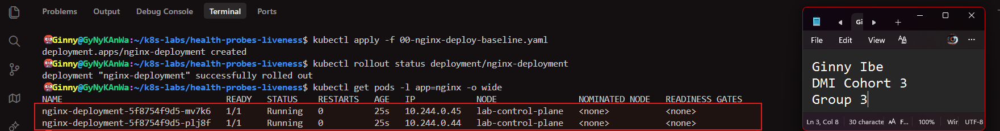

---

#### Screenshot 4 — Relevant output from `kubectl describe deployment nginx-deployment`

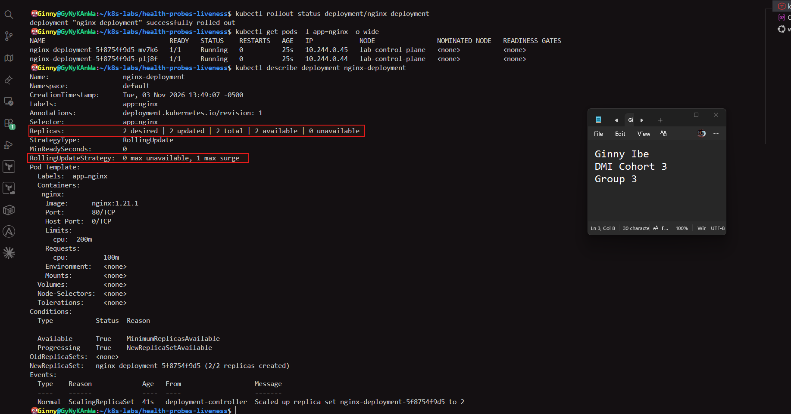

---

### Notes

**1. How many replicas does this Deployment maintain?**

- Two. spec.replicas: 2 means the Deployment, through its ReplicaSet, keeps two NGINX Pods running.

**2. Are any health probes configured in the baseline Deployment?**

- No. The Pod Template in kubectl describe has no Liveness: or Readiness: line, so Kubernetes only checks that the container process is running.

**3. Why is a baseline useful before adding a liveness probe?**

- It's a comparison point. I can see the Pods' normal behavior (no restarts, no probe lines) before the change, so afterwards I can tell exactly what the probe added. It also confirms the cluster and manifest work before I introduce new variables.

---

# Task 3 — Add a Liveness Probe

## Goal

Add an HTTP liveness probe so Kubernetes can periodically check whether the NGINX container is still responsive.

### Evidence

#### Screenshot 5 — Completed `01-nginx-deploy-liveness.yaml` manifest showing the liveness probe

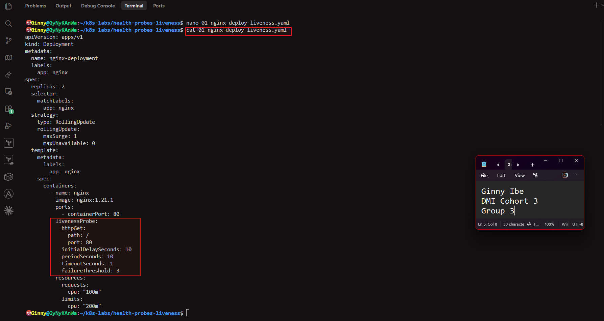

---

#### Screenshot 6 — Output showing successful rollout and running Pods

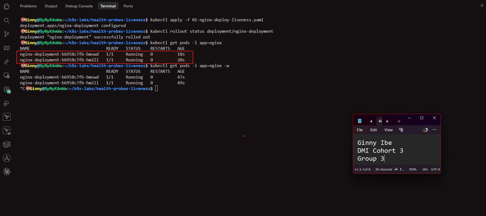

---

#### Screenshot 7 — Pod description showing liveness-probe details

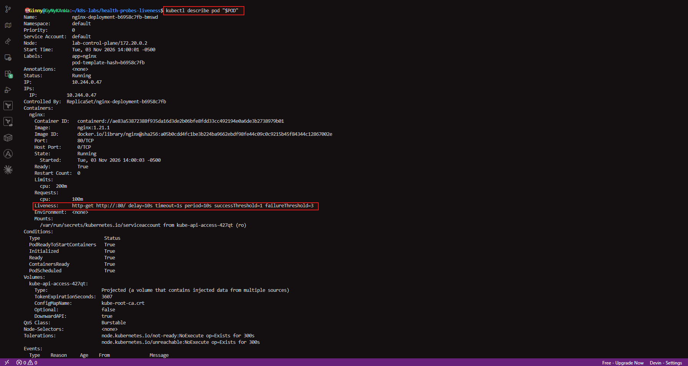

---

### Notes

**1. What path and port does the liveness probe check?**

- The path / on port 80. Kubernetes sends an HTTP GET to NGINX's root page. A status from 200 to 399 counts as healthy.

**2. What does `initialDelaySeconds: 10` do?**

- Kubernetes waits 10 seconds after the container starts before running the first liveness check, so a slow-starting app isn't restarted too early.

**3. What does `failureThreshold: 3` mean?**

- Three consecutive failed checks are needed before Kubernetes treats the container as unhealthy and restarts it. A single failure isn't enough.

**4. Does a successful liveness probe control whether a Pod receives traffic? Explain briefly.**

- No. Liveness only decides whether to restart the container. Whether a Pod receives traffic is controlled by the readiness probe.

---

# Task 4 — Trigger and Observe a Liveness Restart

## Goal

Intentionally make the liveness probe fail and observe Kubernetes restart the unhealthy container.

### Evidence

#### Screenshot 8 — `02-nginx-liveness-broken.yaml` showing `/does-not-exist`

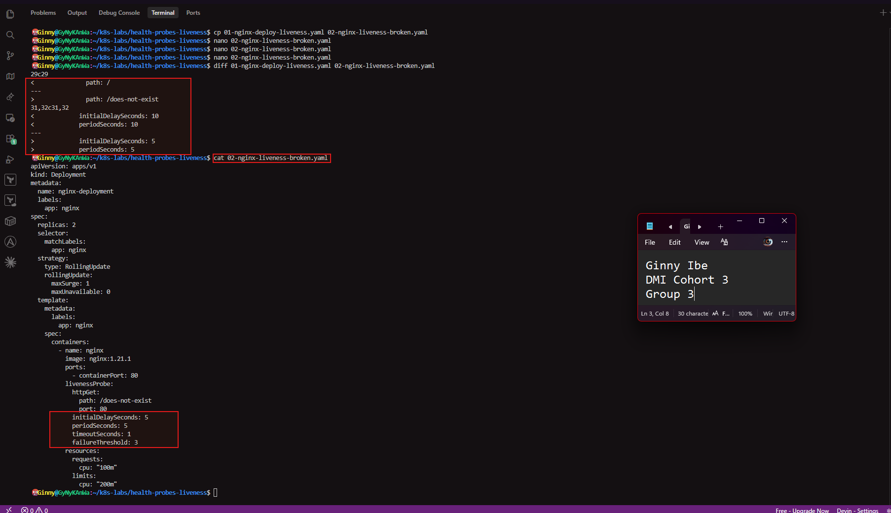

---

#### Screenshot 9 — Pod output showing an increased RESTARTS count

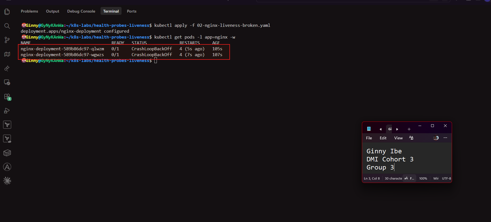

---

#### Screenshot 10 — Pod description showing liveness-probe failure events or restart details

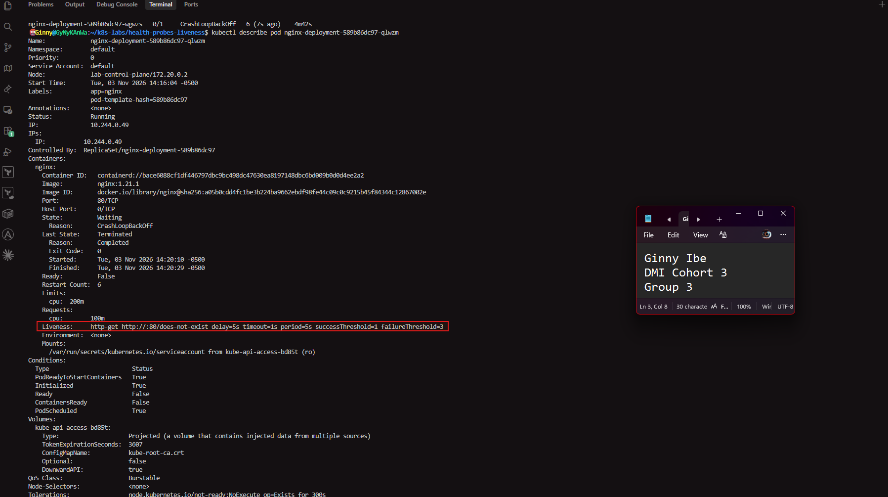
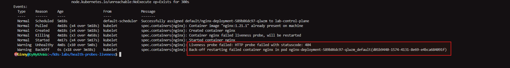

---

#### Screenshot 11 — Output showing stable running Pods after applying the fixed configuration

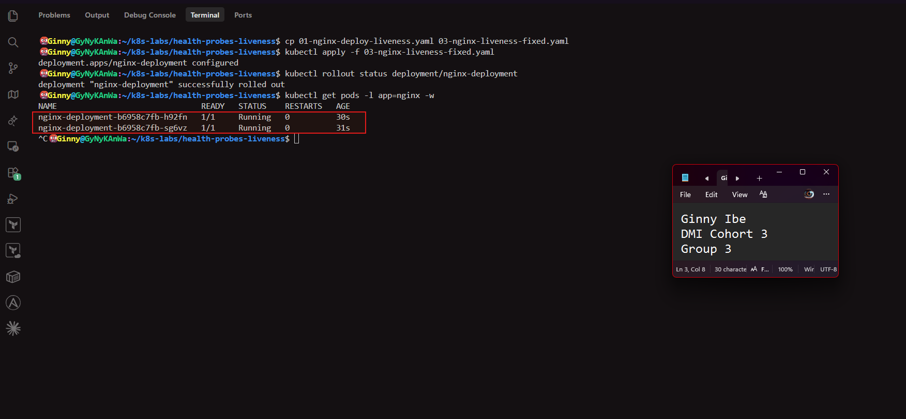

---

### Notes

**1. Why did the liveness probe fail?**

- The probe requested /does-not-exist, a page NGINX doesn't serve. NGINX returned a 404, which is outside the 200–399 success range, so every check failed.

**2. What happened after Kubernetes detected repeated liveness-probe failures?**

- After three failures in a row, Kubernetes killed the container and restarted it. The new container failed the same probe, so the cycle repeated. The restart count kept rising, and the Pods eventually went into CrashLoopBackOff, where Kubernetes waits longer between restarts.

**3. What does the RESTARTS column prove?**

- It shows how many times Kubernetes restarted the container in that Pod. A rising number proves the liveness probe was failing and Kubernetes was automatically acting on it. A healthy Pod stays at 0.

**4. How did you restore the Deployment to a stable state?**

Add - I applied the original working probe (path: /) as 03-nginx-liveness-fixed.yaml. The Deployment rolled out new Pods that passed the probe. They stayed at 1/1 Running with no further restarts.

---

# Task 5 — Optional: Observe a Restart Loop

## Goal

Observe why overly aggressive or incorrectly configured liveness probes can create restart loops.

Complete this section only if you attempt Task 5. Otherwise, mark it as “Not attempted.”

**Task status:** Completed 

### Evidence

#### Optional Screenshot — Pod output showing the RESTARTS count increasing during the restart-loop observation

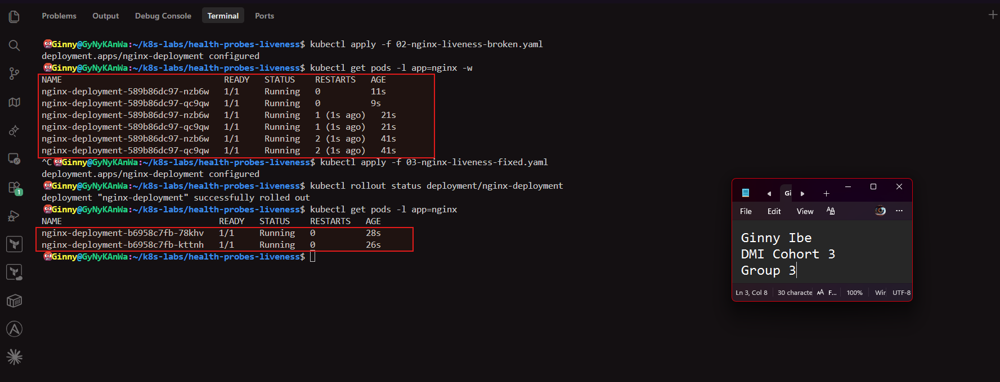

PS: What it above shows
- Broken manifest applied: deployment.apps/nginx-deployment configured, then the watch starts.
- Restart loop: both Pods start at 0 restarts and 1/1 Running. Their RESTARTS go to 1 (1s ago) at about 21s and 2 (1s ago) at about 41s. That's about 20 seconds per restart, which matches 5 seconds of delay plus three failed checks 5 seconds apart. The red box highlights this well.
- Fix applied: 03-nginx-liveness-fixed.yaml shows configured, and the rollout says successfully rolled out.
- Stable result: two new Pods (nginx-deployment-b6958c7fb-...) are 1/1 Running with 0 restarts, aged 26–28 seconds.

No specific restart count or CrashLoopBackOff status is required.

---

### Notes — Answer Only If Attempted

**1. What is a restart loop?**

- A restart loop happens when a container starts, fails its health check, gets restarted by Kubernetes, and then fails the same check again, repeating indefinitely. The RESTARTS count keeps rising, and Kubernetes adds growing delays between restarts, shown as CrashLoopBackOff.
- a container starts, fails its probe, is restarted by Kubernetes, and fails again. This screenshot shows it forming. RESTARTS rose from 0 to 1 and then 2 about every 20 seconds.

**2. Why can an aggressive liveness probe be harmful?**

- If the probe checks too early, too often or with too little tolerance, it can fail a healthy container. For example, an app that needs 30 seconds to start but has a 5-second delay and three failures would be killed before it's ready. Kubernetes then restarts a healthy container, and the app never finishes starting. A short busy period can also trigger needless restarts.
- Recovery: once the working probe was applied, the Pods stayed at 0 restarts.

**3. Why should liveness checks be lightweight and carefully tuned?**

- A liveness check runs constantly, so it should be a cheap, simple test, such as a basic HTTP request, that doesn't add load or depend on slow external services. Delays, timeouts and the failure threshold should allow for normal startup and brief slowdowns. A badly tuned probe causes outages by restarting healthy Pods.

---

# Task 6 — Share Your Liveness-Probe Learning on LinkedIn

## Goal

Share what you learned about Kubernetes liveness probes, container restarts, and the difference between readiness and liveness.

### Evidence

#### Screenshot 12 — Published LinkedIn post

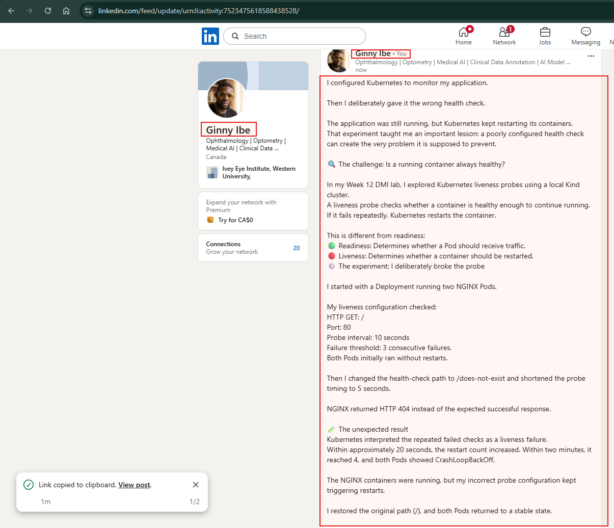

#### Linkedin post URL

**https://www.linkedin.com/posts/dr-ginny-ibe_dmibypravinmishra-devops-kubernetes-ugcPost-7523475616696893441-ER3i/?utm_source=share&utm_medium=member_desktop&rcm=ACoAAGTqulMBvpSBQMnxbzFBrJkA0C9nlWM_uqM**

---

# Submission Instructions

- Add all required screenshots numbered 1–12.
- Include the optional Task 5 screenshot only if you attempt that task.
- Ensure your full name is visible in required screenshots.
- Use clear, readable screenshots showing the relevant manifest or output.
- Include the completed baseline and liveness-probe manifests in your repository.
- Answer all Notes questions for Tasks 1–4 in your own words.
- If you attempt Task 5, complete its Notes and restore the working configuration afterward.
- Do not expose tokens, passwords, kubeconfig files, account IDs, or other sensitive information.

---

# Completion Checklist

- [X] Learning cluster confirmed and previous assignment resources removed where applicable
- [x] Liveness-probe lab directory created (Screenshot 1)
- [x] Baseline Deployment manifest completed (Screenshot 2)
- [x] Successful rollout and two baseline Pods verified (Screenshot 3)
- [x] Baseline Deployment details reviewed (Screenshot 4)
- [x] Liveness probe added successfully (Screenshot 5)
- [x] Successful liveness-probe rollout verified (Screenshot 6)
- [x] Liveness-probe details inspected (Screenshot 7)
- [x] Broken liveness configuration created (Screenshot 8)
- [x] Increased container restart count observed (Screenshot 9)
- [x] Liveness-probe failure events or restart details captured (Screenshot 10)
- [x] Working liveness configuration restored and stable Pods verified (Screenshot 11)
- [x] Optional Task 5 evidence and Notes completed, if attempted
- [x] Working configuration restored after Task 5, if attempted
- [x] LinkedIn post published (Screenshot 12)
- [x] Notes for Tasks 1–4 completed
- [x] Required manifests included
- [x] All required screenshots are clear and readable
- [x] No sensitive data exposed

---

## 📌 About DMI & CloudAdvisory

DevOps Micro Internship (DMI) is a project-based DevOps program run by Pravin Mishra (The CloudAdvisory) focused on real-world execution, systems thinking, and career readiness.

It helps learners build strong DevOps foundations with hands-on experience.

---

## 📌 Resources

- 🌐 DMI Official Website: https://dmi.pravinmishra.com?utm_source=github&utm_medium=readme  
- 🎓 University: https://university.pravinmishra.com?utm_source=github&utm_medium=readme  
- 💬 Discord Community: https://discord.pravinmishra.com?utm_source=github&utm_medium=readme  
- 📝 Blog: https://dmi.pravinmishra.com/blog?utm_source=github&utm_medium=readme  
- ▶️ YouTube Playlist: https://www.youtube.com/playlist?list=PLFeSNDtI4Cho  
- 🔗 Pravin Mishra (LinkedIn): https://www.linkedin.com/in/pravin-mishra-aws-trainer/  
- 🏢 CloudAdvisory (LinkedIn): https://www.linkedin.com/company/thecloudadvisory/

---

*This submission is part of DevOps Micro Internship (DMI) — Agentic AI Track.*
