# Assignment 7 — Kubernetes Services (ClusterIP)

Part of the DevOps Micro Internship (DMI) with Agentic AI

---

## Purpose

In this assignment, you will create and test a Kubernetes ClusterIP Service. You will connect it to a healthy NGINX Deployment, access it using DNS and its ClusterIP, break and restore its selector, and observe how readiness affects Service routing.

---

# Task 0 — Prepare the Lab Environment

## Goal

Confirm your learning-cluster context and remove previous lab resources where applicable before starting this assignment.

No screenshot or written notes are required for this pre-check.

---

# Task 1 — Set Up Your Lab Directory

## Goal

Create and enter a dedicated directory for the ClusterIP Service lab.

### Evidence

#### Screenshot 1 — Terminal showing that you are working inside `~/k8s-labs/services/clusterip`

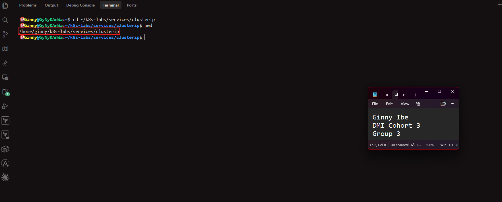

---

### Notes

**1. Why is it not reliable to communicate with an application using a Pod IP address?**

- Pod IPs are temporary. When a Pod is deleted, crashes or is replaced, for example during a rolling update or auto-healing, the new Pod gets a different IP. Anything that depended on the old address would break. With several replicas, a single Pod IP also points at only one of them, so there's no load spreading.

**2. What Kubernetes resource provides a stable internal address for a group of Pods?**

- A Service. A ClusterIP Service gives a group of Pods one stable internal IP address and DNS name, and routes traffic to whichever matching Pods are ready.

---

# Task 2 — Create a Healthy NGINX Deployment

## Goal

Create an NGINX Deployment with labels, readiness probes, and liveness probes that can act as the backend for a Service.

### Evidence

#### Screenshot 2 — Completed `00-nginx-deploy.yaml` manifest

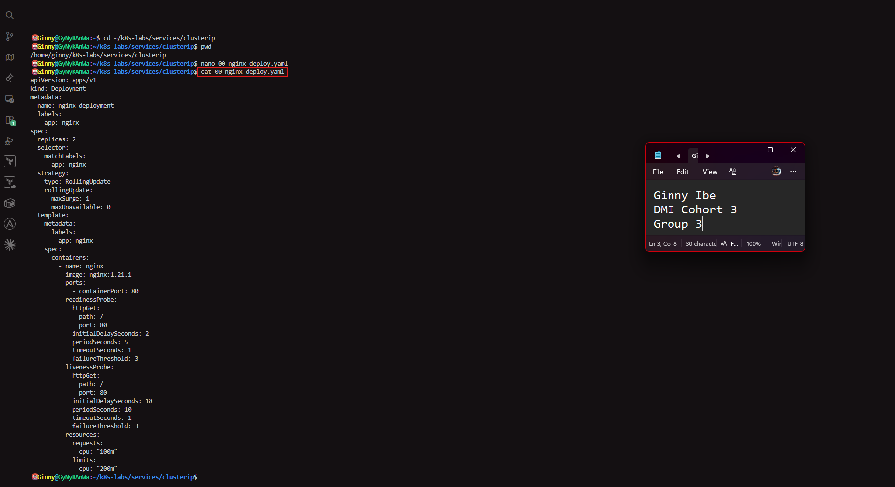

---

#### Screenshot 3 — Output showing successful rollout and two ready NGINX Pods

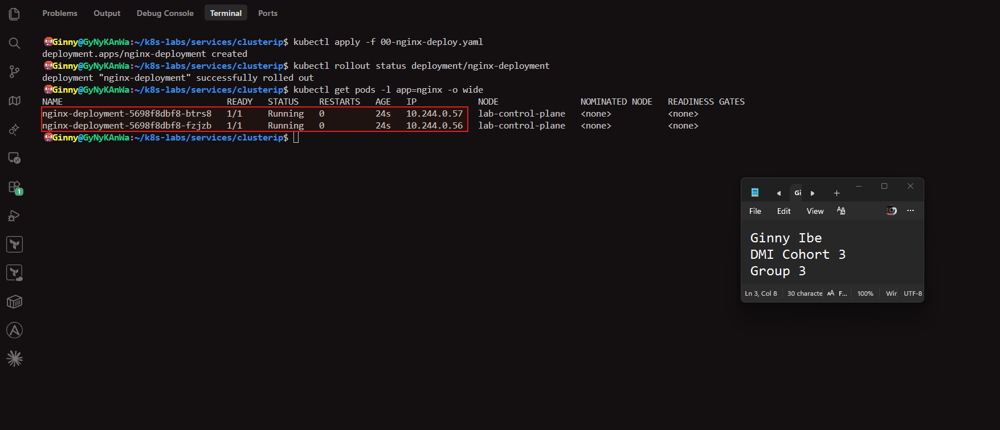

---

### Notes

**1. Which label will the Service use to find these Pods?**

- app: nginx. The Pod template carries this label, and the Service selector will match it.

**2. Why is readiness important before connecting Pods to a Service?**

- A Service sends traffic only to Pods that are ready. The readiness probe confirms that NGINX can actually answer requests before any traffic arrives. Without it, a Pod that has started but isn't ready could receive requests and return errors.

**3. What port does the NGINX container listen on?**

- Port 80, set by containerPort: 80.

---

# Task 3 — Create a ClusterIP Service

## Goal

Create a stable internal Service that routes traffic to the NGINX Pods.

### Evidence

#### Screenshot 4 — Completed `01-nginx-svc-clusterip.yaml` manifest

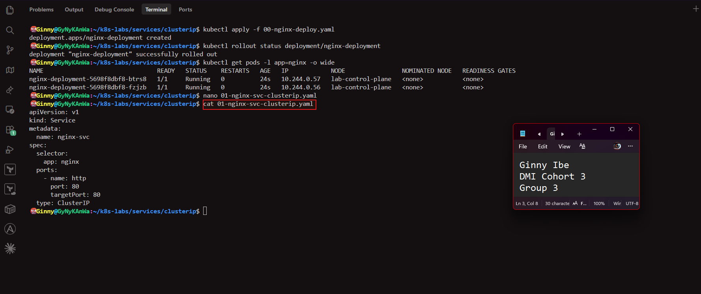

---

#### Screenshot 5 — Output showing the ClusterIP Service, endpoints, or EndpointSlices

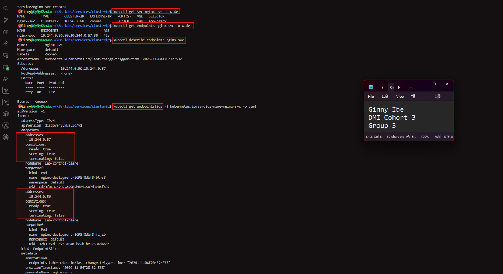

---

### Notes

**1. What is the purpose of a ClusterIP Service?**

- It gives a group of Pods one stable internal IP address and DNS name that works only inside the cluster. Other Pods use it instead of individual Pod IPs, and it spreads requests across the ready Pods.

**2. What is the difference between `port` and `targetPort`?**

- port is the port the Service itself listens on, the one clients connect to. targetPort is the port on the Pods that traffic is forwarded to. Here both are 80, but they can differ, for example port: 80 forwarding to targetPort: 8080.

**3. Why must the Service selector match the Pod labels?**

- The selector is how the Service finds its backend Pods. It doesn't store Pod IPs. If the selector (app: nginx) doesn't match the Pod labels, no Pods are selected, the endpoints are empty, and the Service has nothing to send traffic to.

**4. What information do EndpointSlices contain?**

- They list the current backends of the Service: the Pod IP addresses and ports, plus each endpoint's status (ready, serving, terminating) and a reference to the target Pod. Kubernetes updates them automatically as Pods come and go.

---

# Task 4 — Access the Service from Inside the Cluster

## Goal

Create a client Pod and access the NGINX Service using DNS and its ClusterIP.

### Evidence

#### Screenshot 6 — Output showing the `tester` Pod running

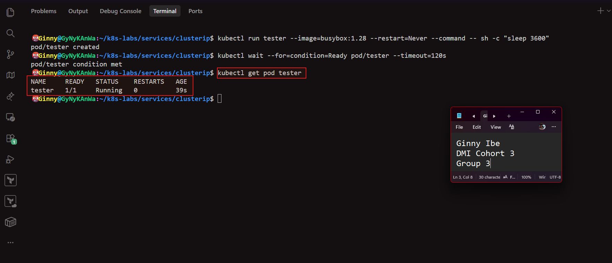

---

#### Screenshot 7 — Successful Service request using DNS name and ClusterIP

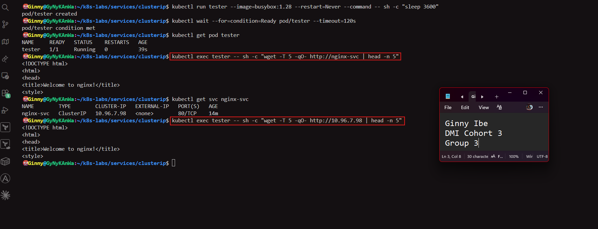

---

#### Screenshot 8 — Successful DNS lookup for the Service

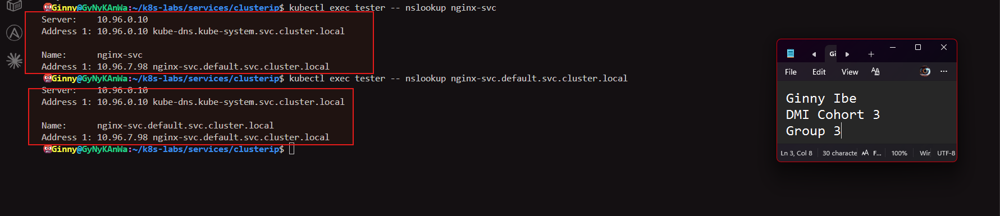

---

### Notes

**1. Why should an application use `nginx-svc` instead of a Pod IP address?**

- The Service name stays the same, while Pod IPs change whenever Pods are replaced. The name resolves to the Service's stable address, and Kubernetes forwards traffic to whichever Pods are currently ready. The app also gets load spreading across replicas.

**2. What does the DNS name `nginx-svc.default.svc.cluster.local` represent?**

- It's the full DNS name of the Service. nginx-svc is the Service name, default is its namespace, svc marks it as a Service, and cluster.local is the cluster's DNS domain. From the same namespace you can use just nginx-svc.

**3. Why can the client access the Service even if the backend Pod IPs change?**

- The client talks to the Service's stable ClusterIP and DNS name, not to the Pods. The EndpointSlice updates automatically when Pods are replaced, so the Service always forwards to the current ready Pods.

---

# Task 5 — Break and Restore the Label-Selector Contract

## Goal

Break the Service selector, observe that usable endpoints disappear, and then restore the correct selector.

### Evidence

#### Screenshot 9 — `02-nginx-svc-selector-broken.yaml` showing the incorrect selector

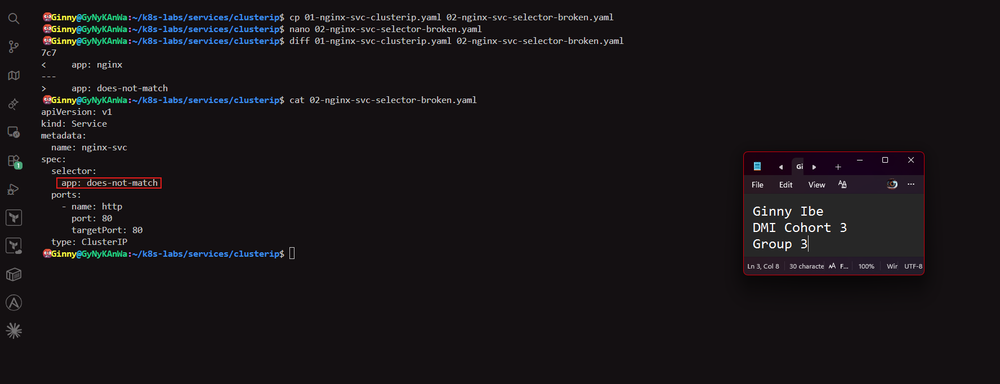

---

#### Screenshot 10 — Empty endpoints or EndpointSlice output after applying the broken selector

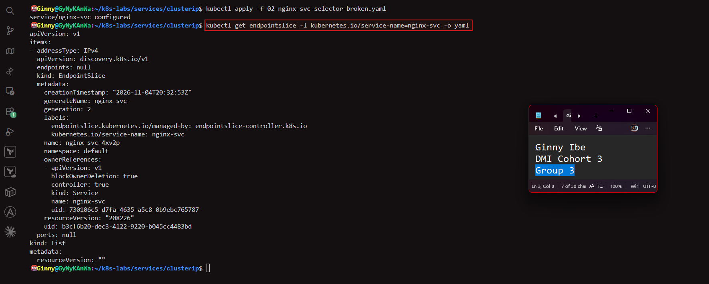

---

#### Screenshot 11 — Failed request output from the `tester` Pod

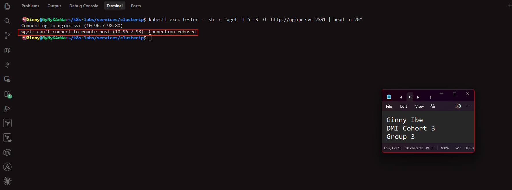

---

#### Screenshot 12 — Restored endpoints and successful Service request

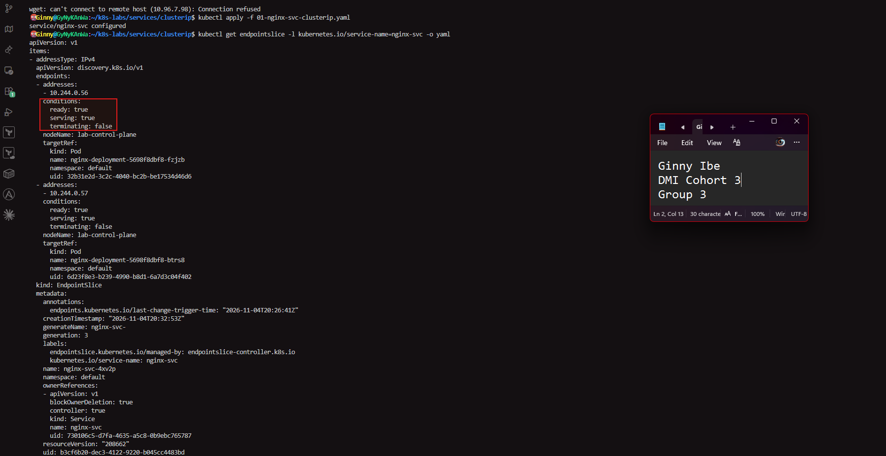
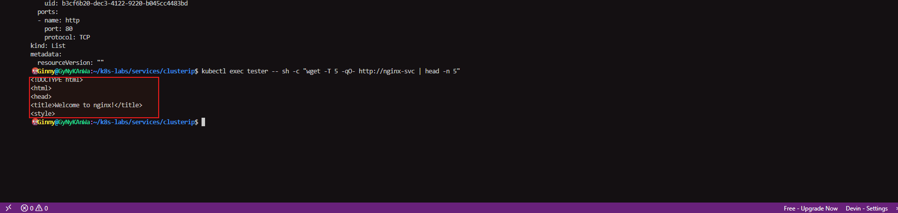

---

### Notes

**1. Why did the Service endpoints become empty?**

- The Service selector app: does-not-match matches no Pod labels, because the Pods carry app: nginx. The Service doesn't store Pod IPs. It finds backends through the selector, so with no matches, the EndpointSlice had no endpoints.

**2. What caused the request from the client Pod to fail?**

- There were no backend endpoints for the Service to forward to. The name nginx-svc still resolved to the ClusterIP, but with nothing behind it the connection was refused or timed out, even though the NGINX Pods were healthy.

**3. How did you restore connectivity to the NGINX Pods?**

- I re-applied the original 01-nginx-svc-clusterip.yaml with the selector app: nginx. The Service matched the Pods again, the EndpointSlice repopulated with both Pod IPs, and the request returned the NGINX page.

---

# Task 6 — Observe How Readiness Affects Service Routing

## Goal

Observe how a new Pod that fails readiness is excluded from ready Service backends while the existing healthy Pod continues serving traffic.

### Evidence

#### Screenshot 13 — Output showing the Deployment scaled to one ready Pod

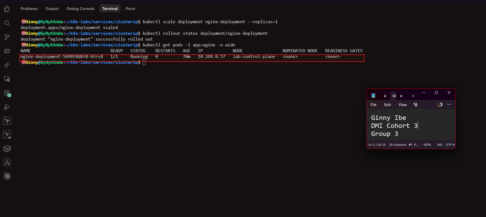

---

#### Screenshot 14 — Completed `03-readiness-broken.yaml` patch file

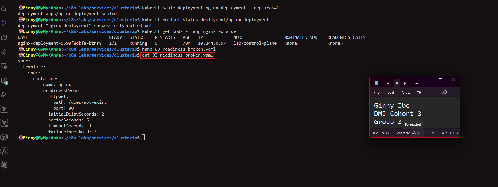

---

#### Screenshot 15 — Output showing the expected incomplete rollout or NotReady Pod

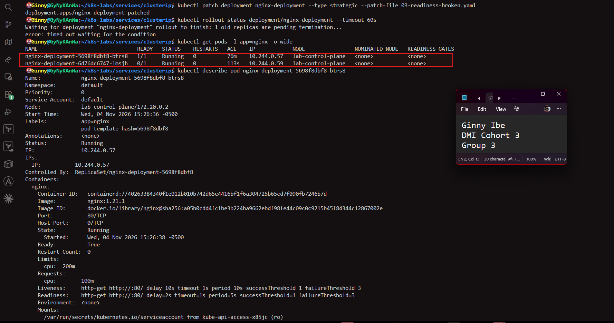

---

#### Screenshot 16 — EndpointSlice output showing the healthy Pod with `ready: true` and the new NotReady Pod with `ready: false`

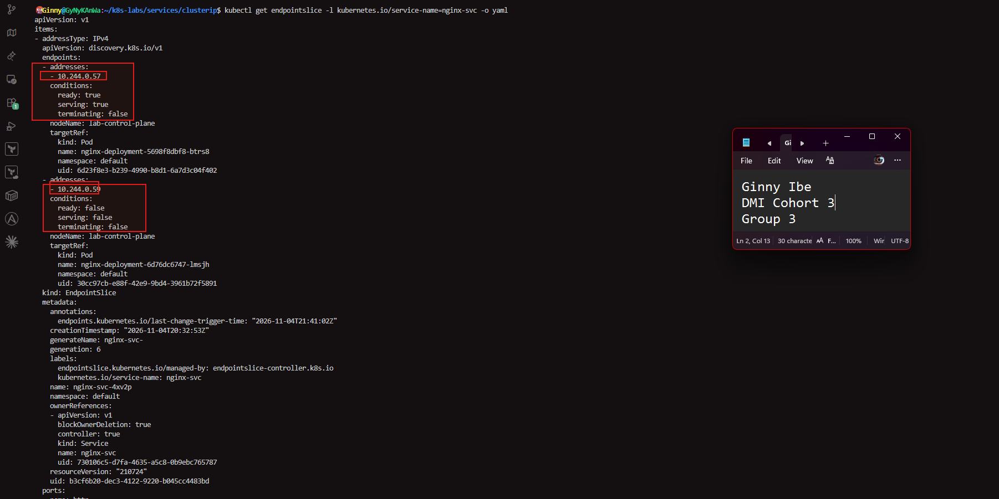
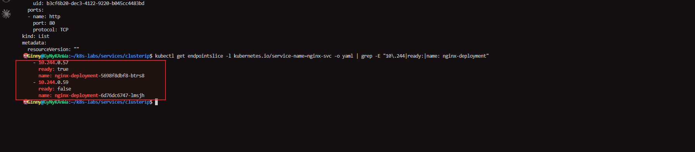

---

#### Screenshot 17 — Service EndpointSlice output showing ready backends after restoring the Deployment

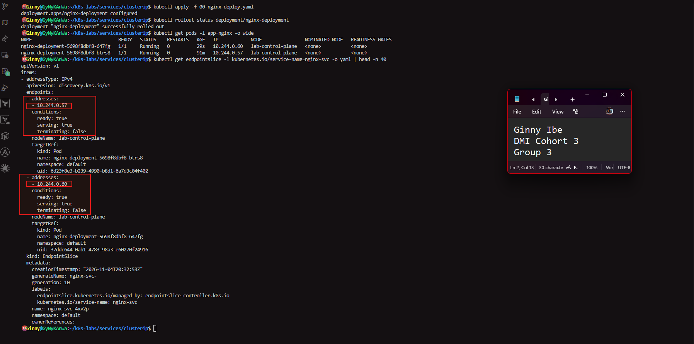

---

### Notes

**1. Why was the new NotReady Pod excluded from ready Service backends?**

- Its readiness probe failed, because NGINX returned 404 for /does-not-exist, so Kubernetes marked it not ready. The EndpointSlice records it as ready: false, and a Service sends traffic only to ready endpoints.

**2. What is the relationship between readiness probes and Service routing?**

- The readiness probe decides whether a Pod is ready. The Service uses that status through the EndpointSlice and only routes to Pods that are ready. A failing probe removes the Pod from the Service without restarting it, and a passing probe adds it back.

**3. Why does this behavior protect users from unhealthy application instances?**

- Users never reach a Pod that can't serve requests. Their traffic keeps going to the healthy Pod, and maxUnavailable: 0 keeps that old Pod in place until a working replacement is ready. A bad release stalls instead of causing errors or an outage.

---

# Task 7 — Share Your ClusterIP Service Learning on LinkedIn

## Goal

Share what you learned about ClusterIP Services, Kubernetes DNS, selectors, and readiness-aware Service routing.

### Evidence

#### Screenshot 18 — Published LinkedIn post

**https://www.linkedin.com/posts/dr-ginny-ibe_dmibypravinmishra-kubernetes-devops-ugcPost-7523884158536830976-LnCI/?utm_source=share&utm_medium=member_desktop&rcm=ACoAAGTqulMBvpSBQMnxbzFBrJkA0C9nlWM_uqM**

#### Linkedin post link

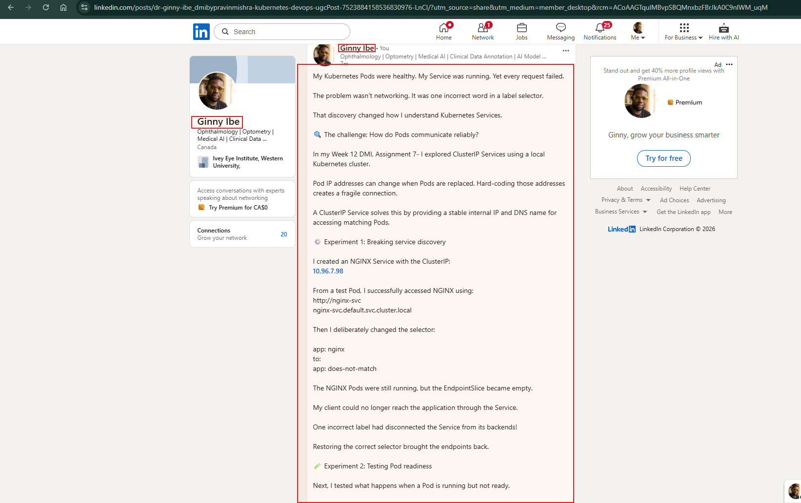

---

# Submission Instructions

- Add all required screenshots numbered 1–18.
- Ensure your full name is visible in required screenshots.
- Use clear, readable screenshots showing the relevant manifest or output.
- Include the completed NGINX Deployment and ClusterIP Service manifests in your repository.
- Answer all Notes questions for Tasks 1–6 in your own words.
- Include evidence of the intentional failures and successful recovery.
- Do not expose tokens, passwords, kubeconfig files, account IDs, or other sensitive information.

---

# Completion Checklist

- [x] Learning-cluster context confirmed and previous lab resources removed where applicable
- [x] ClusterIP lab directory created (Screenshot 1)
- [x] Healthy NGINX Deployment manifest completed (Screenshot 2)
- [x] Successful rollout and two ready NGINX Pods verified (Screenshot 3)
- [x] ClusterIP Service manifest completed (Screenshot 4)
- [x] Service and backend endpoints or EndpointSlices verified (Screenshot 5)
- [x] Client Pod created and running (Screenshot 6)
- [x] Service accessed using DNS name and ClusterIP (Screenshot 7)
- [x] Service DNS resolution verified (Screenshot 8)
- [x] Broken selector manifest created (Screenshot 9)
- [x] Empty endpoints observed (Screenshot 10)
- [x] Failed Service request captured (Screenshot 11)
- [x] Original selector restored and connectivity verified (Screenshot 12)
- [x] Deployment scaled to one ready Pod (Screenshot 13)
- [x] Broken readiness patch created (Screenshot 14)
- [x] Incomplete rollout or NotReady Pod observed (Screenshot 15)
- [x] Readiness effect on Service backends verified (Screenshot 16)
- [x] Deployment restored and ready Service backends verified (Screenshot 17)
- [x] LinkedIn post published (Screenshot 18)
- [x] Notes for Tasks 1–6 completed
- [x] Required manifests included
- [x] All required screenshots are clear and readable
- [x] No sensitive data exposed

---

## 📌 About DMI & CloudAdvisory

DevOps Micro Internship (DMI) is a project-based DevOps program run by Pravin Mishra (The CloudAdvisory) focused on real-world execution, systems thinking, and career readiness.

It helps learners build strong DevOps foundations with hands-on experience.

---

## 📌 Resources

- 🌐 DMI Official Website: https://dmi.pravinmishra.com?utm_source=github&utm_medium=readme  
- 🎓 University: https://university.pravinmishra.com?utm_source=github&utm_medium=readme  
- 💬 Discord Community: https://discord.pravinmishra.com?utm_source=github&utm_medium=readme  
- 📝 Blog: https://dmi.pravinmishra.com/blog?utm_source=github&utm_medium=readme  
- ▶️ YouTube Playlist: https://www.youtube.com/playlist?list=PLFeSNDtI4Cho  
- 🔗 Pravin Mishra (LinkedIn): https://www.linkedin.com/in/pravin-mishra-aws-trainer/  
- 🏢 CloudAdvisory (LinkedIn): https://www.linkedin.com/company/thecloudadvisory/

---

*This submission is part of DevOps Micro Internship (DMI) — Agentic AI Track.*
