# Assignment 8 — Kubernetes Services (NodePort)

Part of the DevOps Micro Internship (DMI) with Agentic AI

---

## Purpose

Create a healthy NGINX Deployment, expose it through a NodePort Service, test access using a node IP and NodePort, and observe how the Service behaves when a backend Pod is replaced.

---

# Task 1 — Set Up Your Lab Directory

## Goal

Create and enter a dedicated directory for the NodePort Service lab.

### Evidence

#### Screenshot 1 — Terminal showing that you are working inside `~/k8s-labs/services/nodeport`

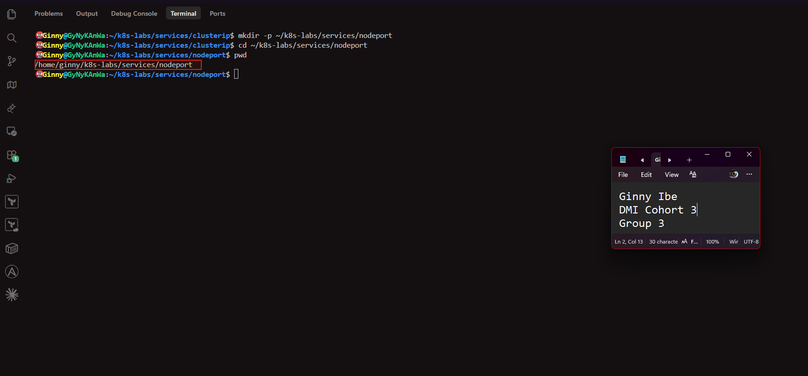

### Notes

**1. What is the difference between ClusterIP and NodePort?**

   - A ClusterIP Service gets a stable internal IP that works only inside the cluster. It's the default type.
 - A NodePort Service includes a ClusterIP and also opens a port, in the 30000–32767 range by default, on every node. That makes the application reachable from outside the cluster at `<node-ip>:<nodePort>`.

**2. What does a NodePort Service allow users to do?**

   - It lets users and clients outside the cluster reach the application through any node's IP address and the NodePort, without needing a cloud load balancer. Kubernetes forwards the request to one of the ready Pods behind the Service.

---

# Task 2 — Create a Healthy NGINX Deployment

## Goal

Create a healthy NGINX Deployment that can act as the backend for the NodePort Service.

### Evidence

#### Screenshot 2 — Completed `00-nginx-deploy.yaml` manifest

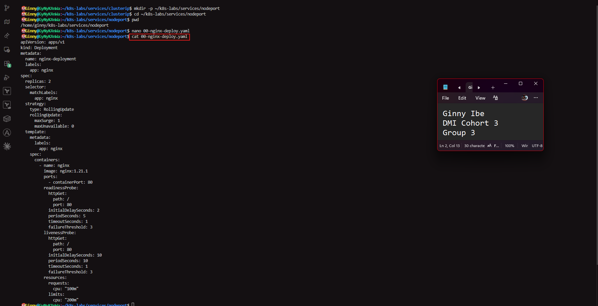

---

#### Screenshot 3 — Output showing successful rollout and two ready NGINX Pods

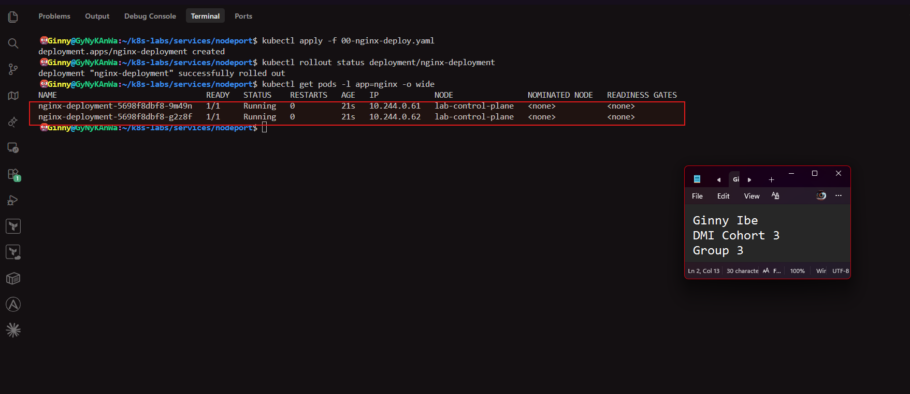

### Notes

**1. Which label will the NodePort Service use to find the NGINX Pods?**

 - app: nginx. The Pod template carries this label, and the Service selector will match it.

**2. Why must the Pods be ready before they can receive Service traffic?**

 - A Service only sends traffic to Pods that pass their readiness probe. That keeps requests away from Pods that have started but can't yet answer, so users don't get errors. A Pod that fails readiness is left out of the Service's endpoints until it passes.

**3. What port does the NGINX container listen on?**

 - Port 80, set by containerPort: 80.

---

# Task 3 — Create the NodePort Service

## Goal

Create a NodePort Service that exposes the NGINX application through a port on every cluster node.

### Evidence

#### Screenshot 4 — Completed `01-nginx-svc-nodeport.yaml` manifest

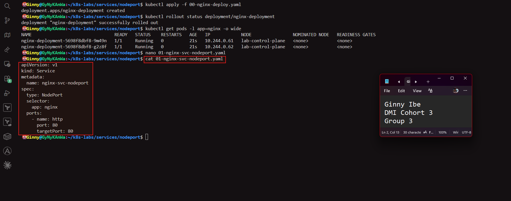

---

#### Screenshot 5 — Output showing the NodePort Service and its endpoints or EndpointSlices

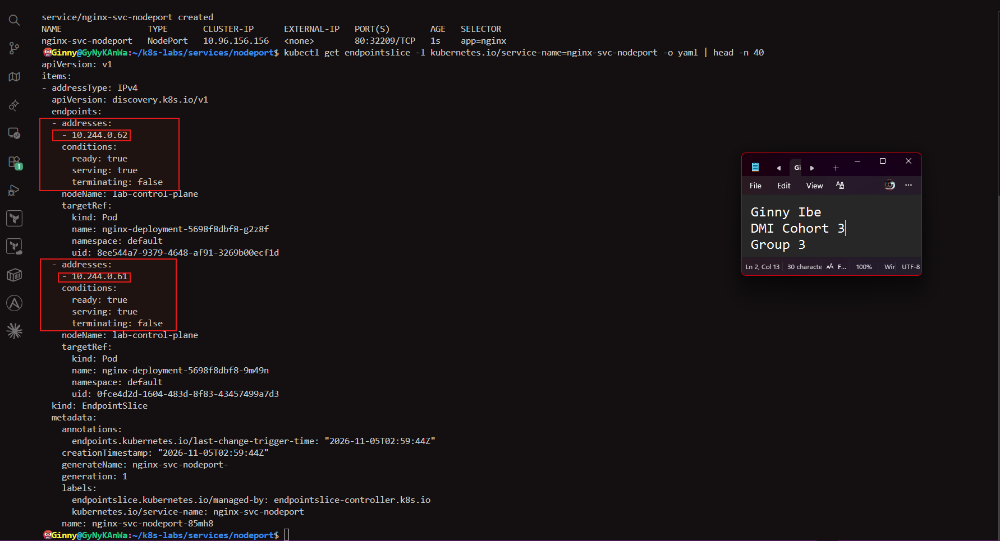

### Notes

**1. What is the purpose of `type: NodePort`?**

   - It exposes the Service outside the cluster by opening the same port on every node, in addition to the Service's internal ClusterIP. Clients can reach the application at `<node-ip>:<nodePort>` 

**2. What is the difference between `port`, `targetPort`, and `nodePort`?**

   - port is the port the Service listens on inside the cluster, here 80.
   - targetPort is the port on the Pods that traffic is forwarded to, here 80.
   - nodePort is the port opened on every node for outside access, in the 30000–32767 range. Here Kubernetes picked it automatically.

**3. What NodePort was assigned or selected in your environment?**

- 32209

**4. Why do Service endpoints need ready Pods?**

- The Service sends traffic only to endpoints marked ready. A Pod that isn't ready is excluded, so users aren't sent to an instance that can't answer. With no ready Pods, the Service has no usable backends and requests fail.

---

# Task 4 — Find a Node IP and Test the NodePort

## Goal

Find a reachable node IP and access the NodePort Service.

### Evidence

#### Screenshot 6 — Output of `kubectl get nodes -o wide`

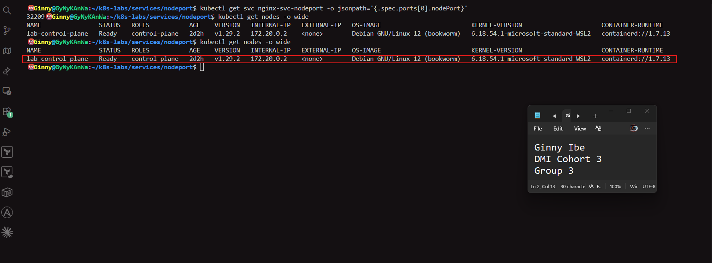

---

#### Screenshot 7 — Output showing the `tester` Pod running

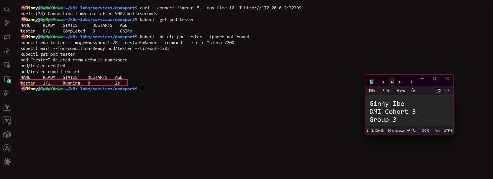

---

#### Screenshot 8 — Successful NodePort response from the laptop or the `tester` Pod

If neither route is supported by your environment, include the failed request output and ready endpoint evidence, and explain the limitation in your Notes.

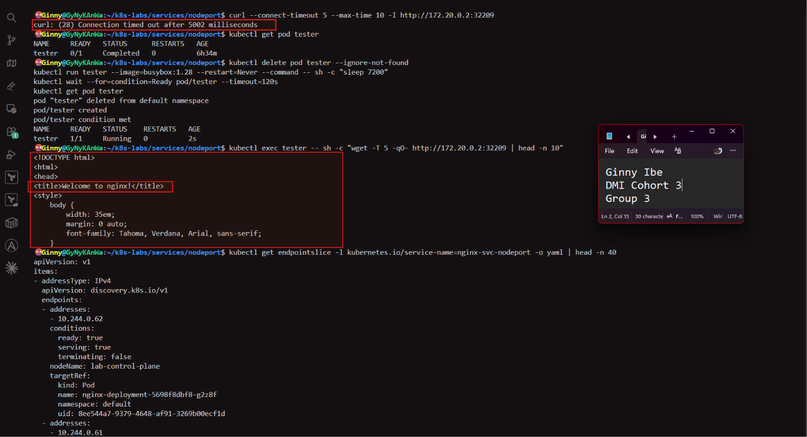

### Notes

**1. Which node IP and NodePort did you test?**

- 172.20.0.2 and 32209.

**2. Was your laptop able to reach the NodePort directly? Explain your result.**

- No. I ran curl from my WSL terminal against the node's INTERNAL-IP and the NodePort (http://172.20.0.2:32209), and it timed out after 5 seconds. This doesn't mean the Service was broken. The Service had ready endpoints, and the same request from the tester Pod inside the cluster returned the NGINX welcome page. In Kind, the node runs as a Docker container on a private Docker network, and its address isn't directly reachable from my laptop. The limitation is the network path to the node, not the NodePort Service.

**3. Why can external NodePort access behave differently in Minikube, kind, Docker Desktop, and cloud clusters?**

Each environment runs its nodes differently, so whether  `<node-ip>:<nodePort>` is reachable from outside depends on how the node is networked.

- Minikube: the node is a VM or container with its own private IP. The host often can't reach the NodePort unless you use minikube service or minikube ip, or configure port forwarding.
- Kind: each node is a Docker container on a private Docker network, so its IP may not be reachable from the host, especially under WSL. Access usually needs extra port mappings in the cluster config or kubectl port-forward.
- Docker Desktop: Kubernetes runs inside Docker Desktop's own VM and networking layer, so NodePorts are often reachable at localhost, but this depends on the setup.
- Cloud clusters: nodes have real IPs, and NodePorts can be reached if the node has a public address and the firewall or security-group rules allow the NodePort range (30000–32767).

So the same NodePort Service can work in one place and time out in another, even though the Kubernetes configuration is identical.

---

# Task 5 — Optional: Test the Label-Selector Contract

## Goal

Break the Service selector, observe that usable endpoints disappear, and restore the correct selector.

Complete the Evidence and Notes below only if you attempted this optional task.

### Evidence

#### Screenshot 9 — `02-nginx-svc-selector-broken.yaml` showing the incorrect selector

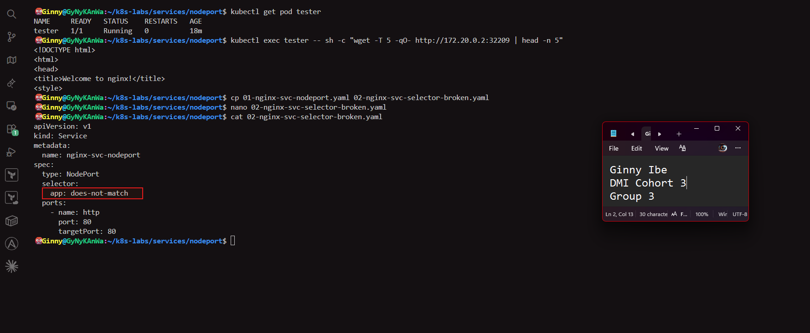

---

#### Screenshot 10 — Empty endpoints or EndpointSlice output after applying the broken selector

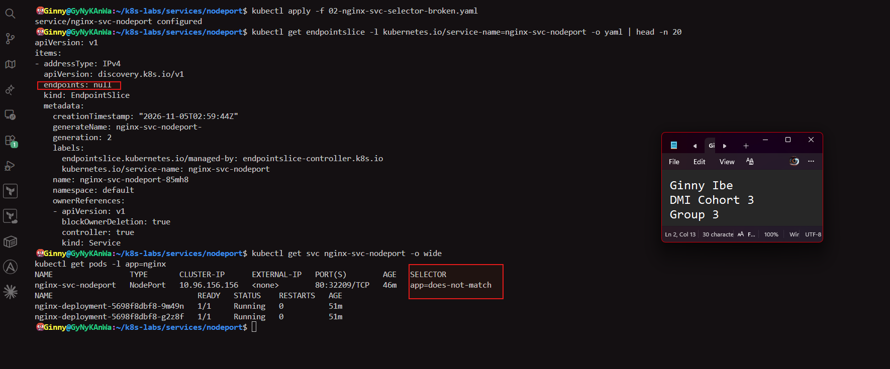

---

#### Screenshot 11 — Restored endpoints or EndpointSlices after applying the original Service manifest

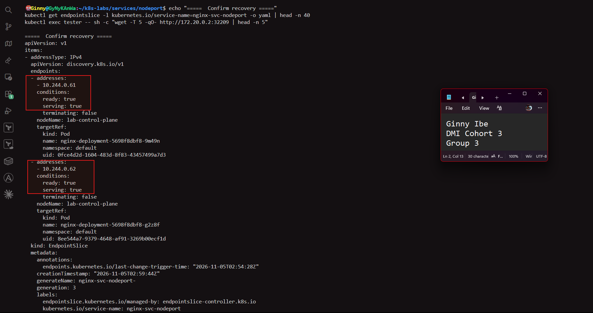
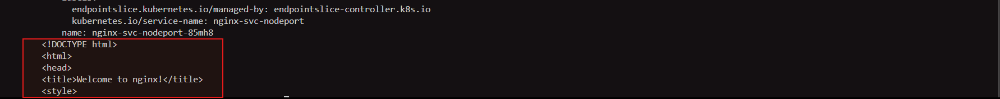

### Notes

**1. Why did the Service endpoints become empty?**

- The selector app: does-not-match matches none of the Pod labels, because the Pods carry app: nginx. A Service finds its backends through the selector, not a saved list of IPs, so with no matching Pods the EndpointSlice had no endpoints.

**2. Why is NodePort only useful when matching ready Pods exist?**

- A NodePort opens a port on the node, but it only forwards traffic to the Service's ready endpoints. If no Pods match the selector, or none are ready, there's nothing behind the port, and requests fail even though the node, port and Pods all exist.

**3. How did you restore the backend connectivity?**
- I re-applied the original 01-nginx-svc-nodeport.yaml, which restored the selector app: nginx. The EndpointSlice controller found the two NGINX Pods again, they showed ready: true, and the request returned the NGINX page. No Pod restart was needed.

---

# Task 6 — Observe Resilience During Pod Churn

## Goal

Delete one NGINX Pod and observe its replacement while the Service continues routing traffic to available Pods.

### Evidence

#### Screenshot 12 — Output of the Pod deletion command

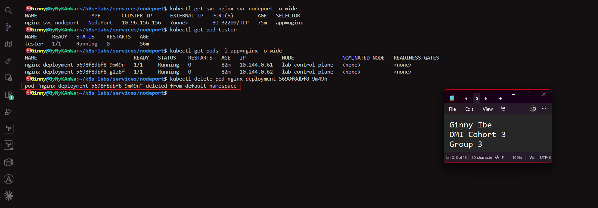

---

#### Screenshot 13 — Output showing the replacement Pod and two running, ready Pods

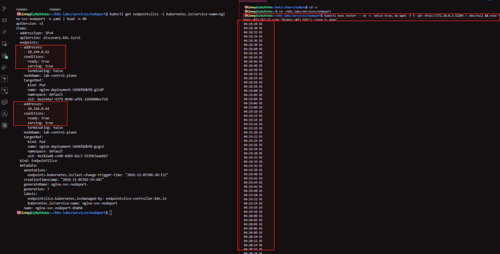

### Notes

**1. What happened after you deleted one Pod?**

Before the deletion, two NGINX Pods were 1/1 Running with 0 restarts: nginx-deployment-5698f8dbf8-9m49n (10.244.0.61) and nginx-deployment-5698f8dbf8-g2z8f (10.244.0.62). The NodePort Service nginx-svc-nodeport had the selector app=nginx and the port 80:32209/TCP. A request loop was running from the tester Pod, sending a request to http://172.20.0.2:32209 every two seconds.

I deleted nginx-deployment-5698f8dbf8-9m49n, and Kubernetes confirmed pod "nginx-deployment-5698f8dbf8-9m49n" deleted from default namespace. The Pod went into Terminating and was removed from the Service's endpoints. Kubernetes then created a replacement Pod, nginx-deployment-5698f8dbf8-gcgv2, with the new IP 10.244.0.64. It kept the same template hash, 5698f8dbf8, because it was built from the same Pod template, but it was a completely new Pod with a new name and address.

The other Pod, nginx-deployment-5698f8dbf8-g2z8f (10.244.0.62), stayed ready and kept handling requests the whole time. The request loop printed OK every two seconds from 04:18:28 to 04:20:18, with no FAIL lines, so the Service never stopped responding.

Afterwards, the EndpointSlice listed two endpoints, both with ready: true and serving: true. One was the surviving Pod at 10.244.0.62 and the other was the replacement at 10.244.0.64. The deleted Pod's address, 10.244.0.61, was gone. The NodePort (32209), the node IP (172.20.0.2) and the ClusterIP (10.96.156.156) never changed.

**2. Which Kubernetes resource created the replacement Pod?**

The ReplicaSet created the replacement Pod. That ReplicaSet belongs to the nginx-deployment Deployment.

The Deployment doesn't create Pods directly. It creates and manages a ReplicaSet, and the ReplicaSet creates the Pods. The ownership chain is:

Deployment (nginx-deployment)
   ↓ manages
ReplicaSet (nginx-deployment-5698f8dbf8)
   ↓ creates
Pods (nginx-deployment-5698f8dbf8-xxxxx)

The ReplicaSet keeps comparing the desired number of Pods (replicas: 2) with the number of Pods that match its selector (app: nginx). When nginx-deployment-5698f8dbf8-9m49n was deleted, only one Pod was left. The ReplicaSet saw the gap and created nginx-deployment-5698f8dbf8-gcgv2 from its Pod template to bring the count back to two.

The Pod names show this. Every Pod name starts with nginx-deployment-5698f8dbf8, which is the ReplicaSet's name: the Deployment name plus the Pod template hash. The last five characters (gcgv2) are a random suffix the ReplicaSet adds to each new Pod. The replacement has the same hash because it came from the same ReplicaSet and template. The Deployment's own role is to keep that ReplicaSet in place.

**3. Why can the NodePort Service continue working during Pod churn?**

The NodePort Service keeps working because clients connect to a stable Service address, not to individual Pods. Kubernetes updates the list of Pods behind that address automatically as Pods come and go.

Several mechanisms work together:

- The Service address never changes. Clients send traffic to the node IP and NodePort, 172.20.0.2:32209. The NodePort and the ClusterIP (10.96.156.156) belong to the Service, not to any Pod. Deleting a Pod changes neither, so clients never need to know which Pod IPs exist.
- The Service finds Pods by label, not by IP. The selector app=nginx matches any Pod with that label. The Service doesn't store fixed Pod addresses. The replacement Pod, nginx-deployment-5698f8dbf8-gcgv2, was created from the same template, so it carried the app: nginx label and the Service picked it up automatically.
- The EndpointSlice is kept up to date. The EndpointSlice controller removed the deleted Pod's address (10.244.0.61) as soon as it started terminating. It added the replacement's address (10.244.0.64) once that Pod was ready. Traffic only goes to addresses in this list, so it wasn't sent to the Pod that was shutting down.
- The readiness probe holds traffic back from a Pod that isn't ready yet. The replacement Pod was added as a ready endpoint only after its readiness probe passed. Requests weren't sent to it while NGINX was still starting.
- A second healthy Pod was available. The Deployment runs two replicas. While one Pod was being replaced, nginx-deployment-5698f8dbf8-g2z8f (10.244.0.62) stayed ready and handled every request. If there had been only one replica, there would have been a short gap with no backend.
- The ReplicaSet restored the replica count. It replaced the deleted Pod right away, so the Service had two ready backends again within moments.

The evidence matches this. The request loop printed OK every two seconds from 04:18:28 to 04:20:18, with no FAIL lines. Afterwards the EndpointSlice listed 10.244.0.62 and 10.244.0.64, both with ready: true.

---

# Task 7 — Share Your NodePort Learning on LinkedIn

## Goal

Share what you learned about NodePort Services, backend Pods, and network access in your Kubernetes environment.

### Evidence

#### Screenshot 14 — Published LinkedIn post about your NodePort Service lab

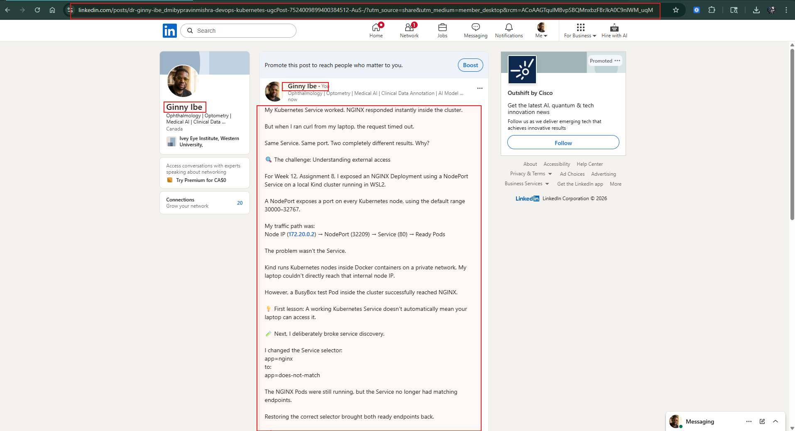

#### Linkedin post link

**https://www.linkedin.com/posts/dr-ginny-ibe_dmibypravinmishra-devops-kubernetes-ugcPost-7524009899400384512-AuS-/?utm_source=share&utm_medium=member_desktop&rcm=ACoAAGTqulMBvpSBQMnxbzFBrJkA0C9nlWM_uqM**

---

# Submission Instructions

- Include the completed YAML manifests created during the lab.
- Add all required screenshots: Screenshots 1–8 and 12–14.
- Include Screenshots 9–11 only if you attempted optional Task 5.
- Complete the Notes for Tasks 1–4 and Task 6.
- Complete Task 5 Notes only if you attempted that task.
- Use clear, readable screenshots showing the relevant commands and outputs.
- Ensure your full name is visible in the required screenshots.
- If NodePort access is restricted by your environment, include the failed request output, ready endpoint evidence, and an explanation.
- Do not expose passwords, access tokens, private keys, kubeconfig contents, or account IDs.

---

# Completion Checklist

- [x] Created and entered `~/k8s-labs/services/nodeport` (Screenshot 1)
- [x] Created and applied the NGINX Deployment manifest (Screenshot 2)
- [x] Confirmed successful rollout and two ready NGINX Pods (Screenshot 3)
- [x] Created the NodePort Service manifest (Screenshot 4)
- [x] Verified the Service and its endpoints or EndpointSlices (Screenshot 5)
- [x] Recorded the assigned or selected NodePort
- [x] Identified a node IP (Screenshot 6)
- [x] Confirmed that the `tester` Pod is running (Screenshot 7)
- [x] Tested NodePort access, or documented the environment limitation with evidence (Screenshot 8
- [x] Optional: Tested and restored the Service selector (Screenshots 9–11)
- [x] Deleted one NGINX Pod (Screenshot 12)
- [x] Confirmed the replacement Pod and two running, ready Pods (Screenshot 13)
- [x] Completed all required Notes
- [x] Published the LinkedIn post (Screenshot 14)
- [x] No sensitive data exposed

---

## 📌 About DMI & CloudAdvisory

DevOps Micro Internship (DMI) is a project-based DevOps program run by Pravin Mishra (The CloudAdvisory) focused on real-world execution, systems thinking, and career readiness.

It helps learners build strong DevOps foundations with hands-on experience.

---

## 📌 Resources

- 🌐 DMI Official Website: https://dmi.pravinmishra.com?utm_source=github&utm_medium=readme  
- 🎓 University: https://university.pravinmishra.com?utm_source=github&utm_medium=readme  
- 💬 Discord Community: https://discord.pravinmishra.com?utm_source=github&utm_medium=readme  
- 📝 Blog: https://dmi.pravinmishra.com/blog?utm_source=github&utm_medium=readme  
- ▶️ YouTube Playlist: https://www.youtube.com/playlist?list=PLFeSNDtI4Cho  
- 🔗 Pravin Mishra (LinkedIn): https://www.linkedin.com/in/pravin-mishra-aws-trainer/  
- 🏢 CloudAdvisory (LinkedIn): https://www.linkedin.com/company/thecloudadvisory/

---

*This submission is part of DevOps Micro Internship (DMI) — Agentic AI Track.*
