# Assignment 09 — Kubernetes Services: LoadBalancer on AKS

Part of the DevOps Micro Internship (DMI) with Agentic AI

---

## Purpose

Deploy a healthy NGINX application to Azure Kubernetes Service (AKS), expose it publicly using a LoadBalancer Service, observe readiness behavior, and scale the application behind the same public endpoint.

---

# Task 1 — Create or Connect to an AKS Cluster

## Goal

Create a small AKS cluster for this lab, or connect to an existing approved AKS lab cluster.

### Evidence

#### Screenshot 1 — Output of `kubectl get nodes` showing ready AKS node(s)

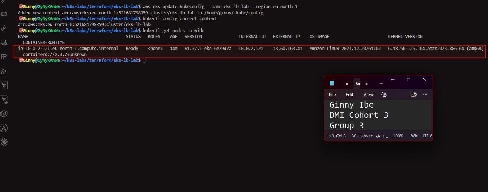

### Notes

**1. Why does this lab use a cloud-capable Kubernetes environment such as AKS for the LoadBalancer Service?**

- A LoadBalancer Service doesn't create a load balancer by itself. It asks the cloud provider to build one. Managed clusters such as AKS and EKS have a cloud controller that creates a real load balancer with a public address when a type: LoadBalancer Service is applied. A local Kind cluster has no cloud provider behind it, so the Service would stay at EXTERNAL-IP  `<pending>` and never be reachable from the internet.
- I completed this lab on AWS EKS instead of AKS. I used Terraform to create the cluster eks-lb-lab in eu-north-1, with a VPC, two public subnets and one managed worker node. My AWS Free plan rejected t3.medium, so I used the Free Tier eligible c7i-flex.large. kubectl get nodes -o wide showed the node ip-10-0-2-121.eu-north-1.compute.internal as Ready, running Kubernetes v1.37.1-eks on Amazon Linux 2023.

**2. What Azure resources can Kubernetes provision when a LoadBalancer Service is created?**

On AKS, a LoadBalancer Service can provision or configure:
- an Azure Load Balancer (or a new front-end on the cluster's existing one)
- a public IP address
- load-balancing rules that forward traffic to the cluster nodes
- health probes that check which nodes can receive traffic
- Network Security Group (NSG) rules that allow the inbound traffic

On EKS, AWS creates the equivalents: an Elastic Load Balancer with a public DNS hostname (.elb.amazonaws.com), a listener, health checks and security group rules.

**3. Why is it important to delete unused AKS resources after the lab?**

Cloud resources are billed for as long as they exist, whether or not anyone is using them. The worker node, the load balancer, the public address and (on EKS) the control plane all cost money or use up credits every hour. Unused public endpoints also add security risk.

The load balancer is created by Kubernetes, not by Terraform, so I delete the Service first (kubectl delete svc nginx-svc-lb) and then run terraform destroy. Otherwise the leftover load balancer blocks the VPC from being deleted.

---

# Task 2 — Set Up Your Lab Directory

## Goal

Create and enter a dedicated directory for the LoadBalancer Service manifests.

### Evidence

#### Screenshot 2 — Terminal showing the output of `pwd` confirming that you are working inside `~/k8s-labs/services/loadbalancer`

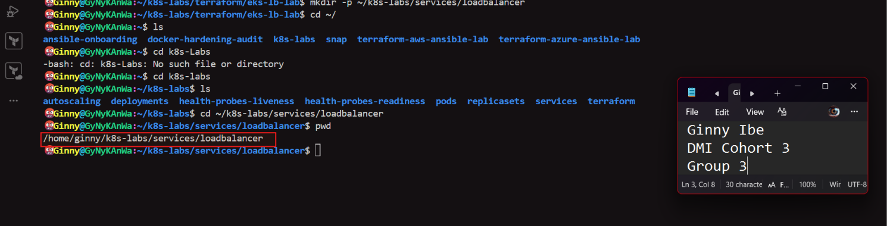

### Notes

**1. Why is it useful to keep Kubernetes manifests organized in dedicated directories?**

A dedicated directory keeps each lab's manifests together and separate from other labs. That matters because several labs reuse the same file names, such as 00-nginx-deploy.yaml, and keeping them apart prevents applying the wrong file to the wrong cluster. It also makes a whole set of resources easy to find, review, reapply or delete. The numbered prefixes (00-, 01-, 02-) show the order the files should be applied in.

I created the directory with mkdir -p ~/k8s-labs/services/loadbalancer. The -p flag creates any missing parent folders and doesn't fail if the folder already exists. I moved into it with cd and confirmed the location with pwd. It also sits apart from my Terraform folder (~/k8s-labs/terraform/eks-lb-lab), so the infrastructure code and the Kubernetes manifests stay separate. This mirrors real projects, where manifests are kept in organized directories under version control as the documented desired state of the application.

**2. What are the names of the main Deployment and LoadBalancer Service YAML files you will create in this assignment?**

- Deployment: 00-nginx-deploy.yaml
- LoadBalancer Service: 01-nginx-svc-loadbalancer.yaml

---

# Task 3 — Deploy a Healthy NGINX Application

## Goal

Create a healthy NGINX Deployment with readiness and liveness probes.

### Evidence

#### Screenshot 3 — Completed `00-nginx-deploy.yaml` manifest

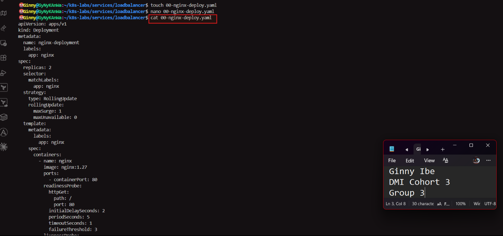
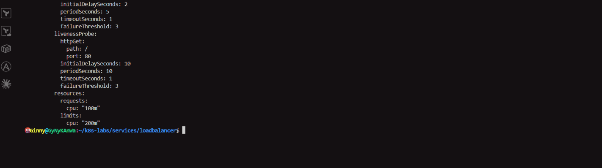

---

#### Screenshot 4 — Output showing successful rollout and two ready NGINX Pods

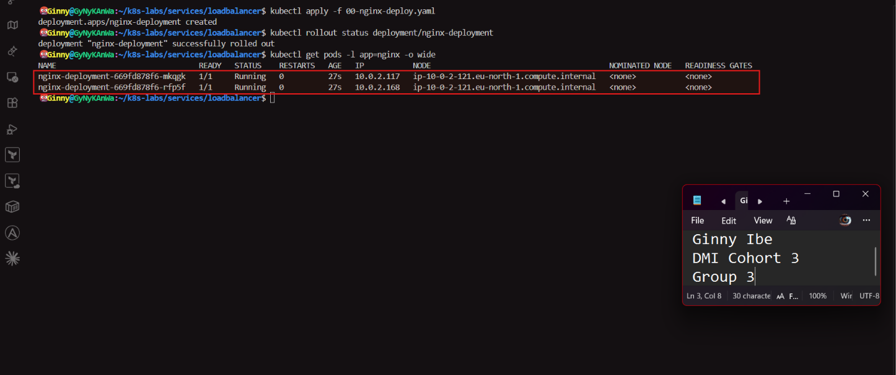

### Notes

**1. Why must Pods be ready before they should receive public traffic?**
A container can be running before the application inside it can handle requests. It may still be starting up, loading configuration or connecting to something it depends on. On a public LoadBalancer, the traffic comes from real users on the internet. If it reached a Pod that wasn't ready, those users would get errors, timeouts or incomplete pages. Kubernetes avoids this by sending Service traffic only to Pods marked Ready.

When I applied 00-nginx-deploy.yaml, Kubernetes returned deployment.apps/nginx-deployment created, and kubectl rollout status reported successfully rolled out. kubectl get pods -l app=nginx -o wide showed two Pods: nginx-deployment-669fd878f6-mkqgk (10.0.2.117) and nginx-deployment-669fd878f6-rfp5f (10.0.2.168). Both were 1/1 Running with 0 restarts on the node ip-10-0-2-121.eu-north-1.compute.internal. The 1/1 READY value appeared only after NGINX passed its readiness check, and only from then would each Pod be eligible to receive traffic from the load balancer.

On EKS, the Pod IPs come from the same VPC subnet as the node. The AWS VPC CNI plugin gives each Pod a real VPC address, unlike the separate internal range Kind used in my earlier labs.

**2. What is the role of the readiness probe in this Deployment?**

The readiness probe decides whether a Pod should receive traffic. Kubernetes sends an HTTP GET request to / on port 80, starting 2 seconds after the container starts (initialDelaySeconds: 2) and repeating every 5 seconds (periodSeconds: 5). Any response from 200 to 399 counts as a pass. If there's no reply within 1 second (timeoutSeconds: 1), the check fails. After 3 consecutive failures (failureThreshold: 3), the Pod is marked not ready and removed from the Service's ready endpoints, but the container is not restarted.

The probe also controls rollouts. With maxUnavailable: 0, Kubernetes won't remove an old Pod until its replacement passes readiness. Task 5 relies on this.

**3. What is the role of the liveness probe in this Deployment?**

The liveness probe decides whether a container is still healthy enough to keep running. It also sends an HTTP GET to / on port 80, but it waits longer before the first check (initialDelaySeconds: 10) so NGINX has time to start, and then checks every 10 seconds. If it fails 3 times in a row, the kubelet restarts the container. This recovers an application that is frozen or stuck but hasn't crashed.

In short, readiness controls traffic (whether the Pod gets requests) and liveness controls restarts (whether the container is recreated). Using both means users only reach healthy Pods, and broken containers are repaired automatically.

---

# Task 4 — Create and Test the LoadBalancer Service

## Goal

Create a public LoadBalancer Service and verify that the NGINX application is reachable from the internet.

### Evidence

#### Screenshot 5 — Completed `01-nginx-svc-loadbalancer.yaml` manifest

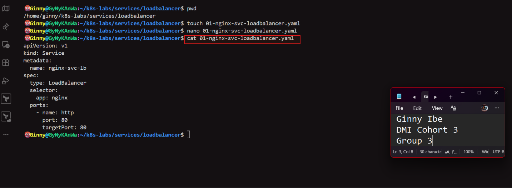

---

#### Screenshot 6 — Output showing the Service with an assigned EXTERNAL-IP

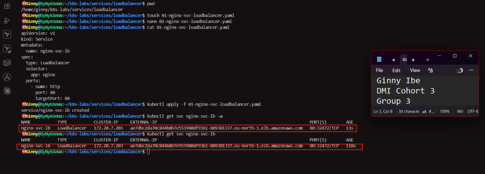

---

#### Screenshot 7 — Successful curl output from the public IP

*PS:The curl -I 200 OK and the HTML. For a tidier image, add -s to the second curl (curl -s --connect-timeout ...) to hide the progress meter.*
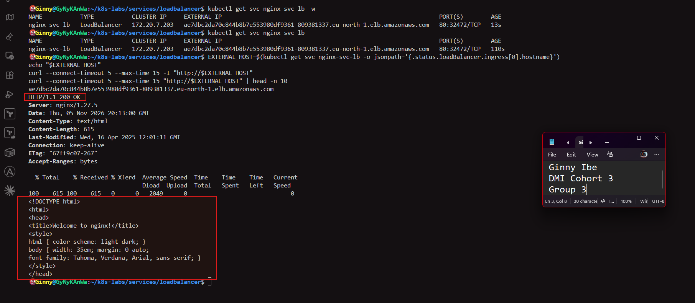

### Notes

**1. What does `type: LoadBalancer` instruct AKS to do?**

LoadBalancer tells Kubernetes to expose the Service outside the cluster through a load balancer provided by the cloud. Kubernetes first sets up everything a ClusterIP and a NodePort Service would have: a stable internal ClusterIP and a port opened on every node. Then the cloud controller asks the cloud provider to create a real load balancer that forwards traffic to that node port. On AKS, that means an Azure Load Balancer rule with a public IP. On EKS, which I used, AWS creates an Elastic Load Balancer with a public DNS hostname. When it's ready, Kubernetes writes the address into the Service's EXTERNAL-IP field.

**2. What public IP was assigned to your Service?**

On EKS, AWS assigns a DNS hostname instead of a fixed public IP. My Service nginx-svc-lb received:

ae7dbc2da70c844b8b7e553980df9361-809381337.eu-north-1.elb.amazonaws.com

Because the address is a hostname, I read it with .status.loadBalancer.ingress[0].hostname rather than .ip, which AKS would use. Behind that name, AWS can change the load balancer's actual IP addresses without affecting clients. kubectl get svc also showed the internal ClusterIP 172.20.7.203 and the port mapping 80:32472/TCP, where 32472 is the NodePort Kubernetes created automatically. A request to http://<hostname> returned HTTP/1.1 200 OK from nginx/1.27.5, confirming the application was reachable from the internet.

**3. How does the public request eventually reach the NGINX Pods?**
curl from my laptop
  → DNS resolves ae7dbc2da70c...elb.amazonaws.com
  → AWS load balancer (listener on port 80)
  → worker node ip-10-0-2-121 on NodePort 32472
  → kube-proxy rules for nginx-svc-lb (ClusterIP 172.20.7.203)
  → one ready NGINX Pod (10.0.2.117 or 10.0.2.168) on targetPort 80

The 80:32472/TCP in the Service output shows how the pieces connect. The load balancer listens on port 80 and forwards traffic to the node on NodePort 32472, the same mechanism I tested in Assignment 08. The Service then uses its selector app: nginx and its EndpointSlice to send the request to one of the ready NGINX Pods. NGINX replies, and the response returns the same way. My curl received HTTP/1.1 200 OK and the Welcome to nginx! page.

**4. Why should you wait for EXTERNAL-IP before testing the Service?**

Creating a cloud load balancer isn't instant. While AWS builds the load balancer, listener, health checks and security rules, EXTERNAL-IP shows <pending>, and there's no address to send requests to yet. Testing too early fails because there's nothing to connect to. In my lab the hostname appeared within about 13 seconds, but having a hostname doesn't mean it's usable straight away. The DNS name has to spread, and the load balancer's health checks have to mark the node healthy, before requests succeed. Waiting avoids false failures that look like a broken Service when the cloud simply isn't finished.

---

# Task 5 — Observe How Readiness Protects Public Traffic

## Goal

Intentionally break readiness and observe how Kubernetes excludes unready Pods from ready Service backends while existing healthy Pods continue serving public traffic.

### Evidence

#### Screenshot 8 — Completed `02-readiness-broken.yaml` patch file

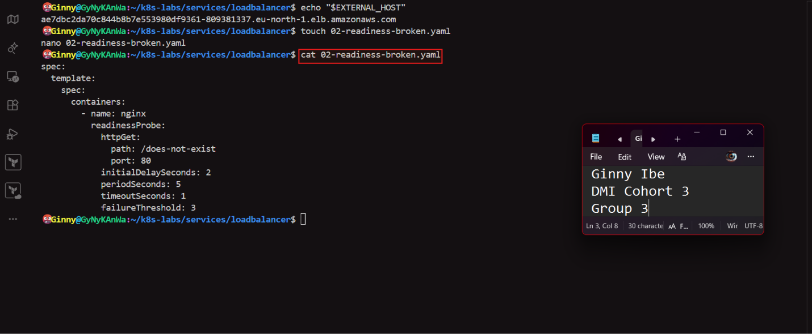

---

#### Screenshot 9 — Output showing the expected incomplete rollout or readiness failure

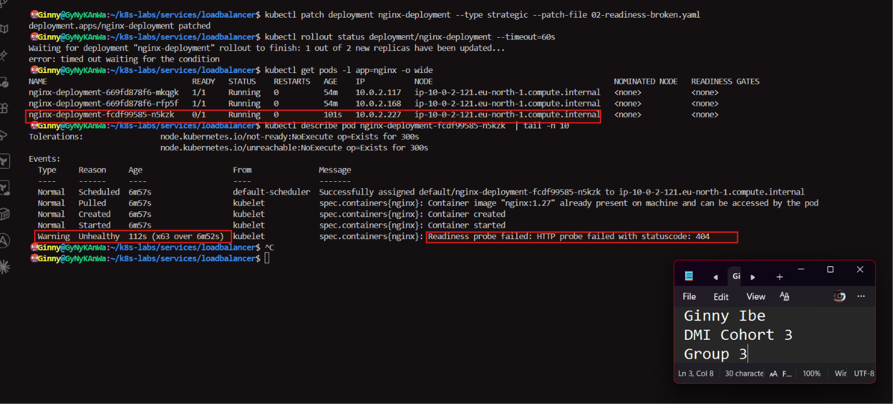

---

#### Screenshot 10 — EndpointSlice output showing ready healthy backends and the effect of the readiness failure

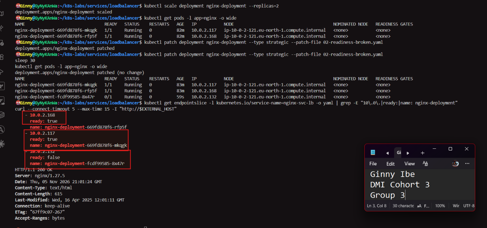

---

#### Screenshot 11 — Successful public curl response after recovery

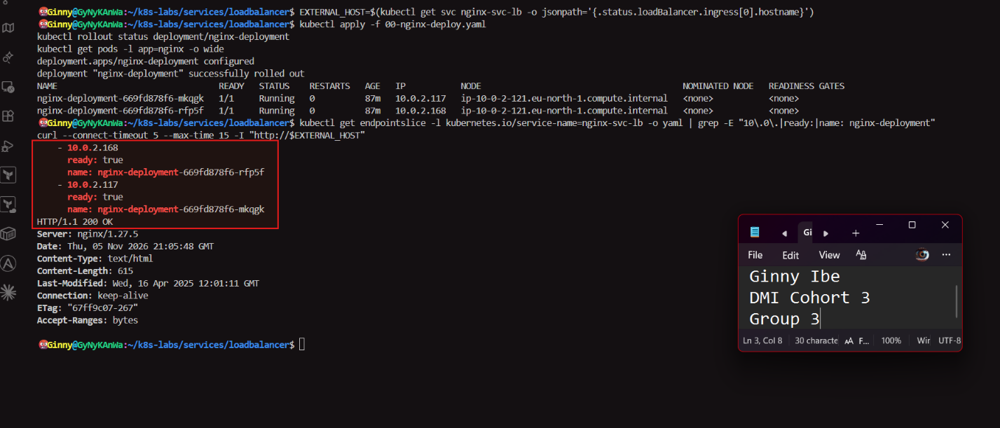

### Notes

**1. Why did the rollout not complete?**

The patch changed the readiness probe path from / to /does-not-exist. Because the Pod template changed, Kubernetes started a rolling update. It created a new ReplicaSet (hash fcdf99585, replacing the original 669fd878f6) and one new Pod, nginx-deployment-fcdf99585-n5kzk, at 10.0.2.227.

The container started normally. Its events show Pulled, Created and Started, and the image nginx:1.27 was already on the node. However, NGINX has no page at /does-not-exist, so every readiness check failed. The Pod's events showed Readiness probe failed: HTTP probe failed with statuscode: 404, repeated 63 times in about 7 minutes. The Pod stayed at 0/1 Running with 0 restarts, because a readiness failure keeps a Pod out of traffic but doesn't restart the container.

The Deployment uses maxSurge: 1 and maxUnavailable: 0. That allows one extra Pod during an update but forbids removing a healthy old Pod until its replacement is Ready. The new Pod never became Ready, so both original Pods, nginx-deployment-669fd878f6-mkqgk (10.0.2.117) and nginx-deployment-669fd878f6-rfp5f (10.0.2.168), stayed 1/1 Running. The rollout got stuck with three Pods, two ready and one not. kubectl rollout status --timeout=60s reported 1 out of 2 new replicas have been updated... and then error: timed out waiting for the condition.

**2. Why can the public endpoint still work while new Pods fail readiness?**

The Service only sends traffic to ready endpoints. The EndpointSlice marked the new Pod ready: false, so it received no traffic. The two original Pods stayed ready: true. Because of maxUnavailable: 0, Kubernetes wasn't allowed to remove them during the stalled update, so both kept serving. Requests through the AWS load balancer still reached a healthy Pod, and curl returned HTTP/1.1 200 OK. Users would see no outage even though the update was stuck.

**3. What would happen if Kubernetes routed traffic to Pods before they were ready?**

Some public requests would go to a Pod that can't serve them correctly. In this lab it would have been the Pod failing its health check. In a real application it could be a Pod still starting up, missing configuration or unable to reach its database. Those users would see errors, timeouts or broken pages, and the failures would appear random because only some requests would hit the bad Pod. A bad release could also go live for real users before anyone noticed. Readiness gating prevents this by letting a Pod receive traffic only after it has proved it can respond.

**4. How did you restore the Deployment successfully?**

I reapplied the original working manifest with kubectl apply -f 00-nginx-deploy.yaml. That file still declares the readiness probe on /, so applying it returned the Pod template to its original, healthy version. This template matched the original ReplicaSet (nginx-deployment-669fd878f6), which already had two ready Pods. Kubernetes therefore didn't need to create new Pods. It scaled the broken ReplicaSet (fcdf99585) down to zero, which removed the stuck Pod nginx-deployment-fcdf99585-n5kzk (10.0.2.227).

kubectl rollout status then reported [deployment "nginx-deployment" successfully rolled out]. kubectl get pods -l app=nginx -o wide showed [two Pods, nginx-deployment-669fd878f6-mkqgk (10.0.2.117) and nginx-deployment-669fd878f6-rfp5f (10.0.2.168), both 1/1 Running with 0 restarts]. The EndpointSlice listed [only those two addresses, both ready: true], and a final curl -I to the load balancer hostname returned [HTTP/1.1 200 OK].

The public endpoint stayed available throughout. The healthy Pods were never removed, so recovery caused no downtime. Keeping the known-good manifest in its own file meant the fix was a single command.

---

# Task 6 — Scale the Deployment Behind the Load Balancer

## Goal

Scale the NGINX Deployment and confirm that more ready Pods become available behind the same public endpoint.

### Evidence

#### Screenshot 12 — Two ready NGINX Pods verified initially; four ready Pods verified after scaling

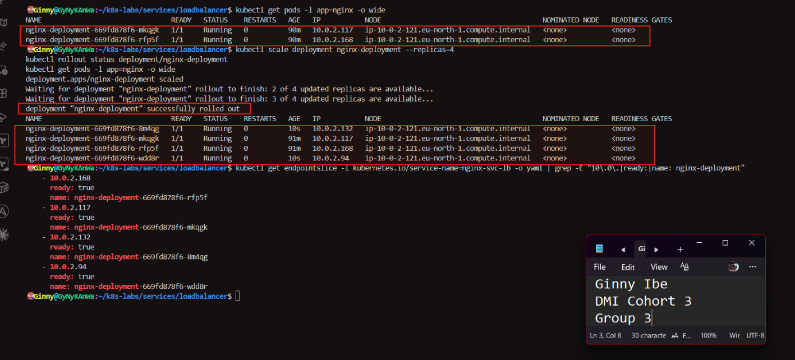

---

#### Screenshot 13 — Successful public curl response after scaling

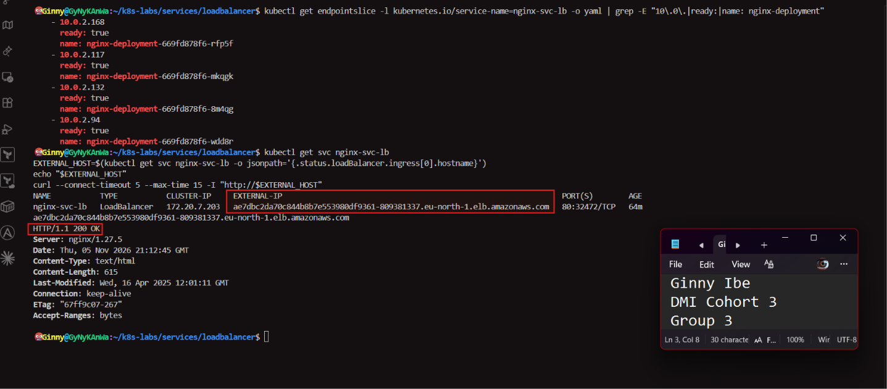

### Notes

**1. What changed after scaling the Deployment from two to four replicas?**

kubectl scale deployment nginx-deployment --replicas=4 changed the Deployment's desired replica count from 2 to 4. The Deployment passed the new count to its existing ReplicaSet (nginx-deployment-669fd878f6), which created two more Pods from the same template: the same nginx:1.27 image, the same app: nginx label, and the same readiness and liveness probes. No new ReplicaSet or rollout revision was created, because only the number of Pods changed, not the template.

Each new Pod received its own VPC IP address and was scheduled on the same node, ip-10-0-2-121. Once each one passed its readiness probe, it showed 1/1 Running, and the EndpointSlice controller added it to the Service's endpoints with ready: true. The Service went from two ready backends to four, so the load balancer now spread traffic across four Pods. [Add the two new Pod names and IPs from Step 2.]

kubectl scale doesn't edit 00-nginx-deploy.yaml, which still says replicas: 2. Reapplying that file would bring the count back to two, because the file is the declared source of truth.

**2. Did the public IP change after scaling? Explain why or why not.**

After scaling, kubectl get svc nginx-svc-lb still showed the same address: ae7dbc2da70c844b8b7e553980df9361-809381337.eu-north-1.elb.amazonaws.com. The ClusterIP 172.20.7.203 and the NodePort 32472 didn't change either. The load balancer belongs to the Service, not to any Pod. Scaling only changed the Pods behind the Service and didn't modify the Service, so Kubernetes had no reason to ask AWS for a new load balancer. A curl -I to the same hostname still returned HTTP/1.1 200 OK.

**3. Why does scaling behind a LoadBalancer Service not require users to change the URL or IP they use?**

Users only ever see the load balancer's address. They never see individual Pods. The Service doesn't keep a fixed list of Pod IPs. It uses its selector app: nginx to find matching Pods, and the EndpointSlice is updated automatically whenever ready Pods are added or removed. When I scaled from two to four replicas, the new Pods carried the app: nginx label, passed readiness and were added as endpoints, all without anyone editing the Service or the AWS load balancer.

The public entry point stays fixed while the number of Pods behind it changes. Teams can scale up for heavy traffic, scale down to save cost, or replace Pods during updates, and users keep using the same URL without noticing.

---

# Task 7 — Share Your LoadBalancer Lab on LinkedIn

## Goal

Share what you learned about exposing an NGINX application publicly through a LoadBalancer Service on AKS.

### Evidence

#### Screenshot 14 — Published LinkedIn post about your LoadBalancer lab on AKS

**https://www.linkedin.com/posts/dr-ginny-ibe_dmibypravinmishra-devops-kubernetes-ugcPost-7524227747427291137-LfSQ/?utm_source=share&utm_medium=member_desktop&rcm=ACoAAGTqulMBvpSBQMnxbzFBrJkA0C9nlWM_uqM**

#### LinkedIn post link

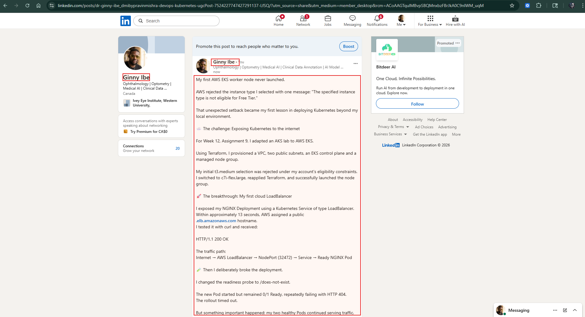

---

# Submission Instructions

- Include the completed YAML files:
  - `00-nginx-deploy.yaml`
  - `01-nginx-svc-loadbalancer.yaml`
  - `02-readiness-broken.yaml`
- Add all required screenshots, numbered 1–14, under their corresponding Evidence sections.
- Use clear, readable screenshots showing the relevant commands, configuration, and outputs.
- Ensure your full name is visible in the required screenshots.
- Complete the Notes for Tasks 1–6 in your own words.
- Capture all required evidence before cleaning up Azure resources.
- Plan or complete Azure cleanup according to your lab ownership and reuse arrangements.
- Do not expose passwords, tokens, private keys, cluster credentials, kubeconfig contents, subscription IDs, account IDs, or infrastructure details you are not permitted to share.

---

# Completion Checklist

- [x] Created or connected to an approved AKS lab cluster
- [x] Confirmed ready AKS node(s) (Screenshot 1)
- [x] Created and entered the LoadBalancer lab directory (Screenshot 2)
- [x] Created the NGINX Deployment manifest (Screenshot 3)
- [x] Verified successful rollout and two ready NGINX Pods initially (Screenshot 4)
- [x] Created the LoadBalancer Service manifest (Screenshot 5)
- [x] Verified the assigned external IP (Screenshot 6)
- [x] Verified successful public access using curl (Screenshot 7)
- [x] Created the broken readiness patch (Screenshot 8)
- [x] Observed the expected incomplete rollout or readiness failure (Screenshot 9)
- [x] Inspected EndpointSlices during the readiness failure (Screenshot 10)
- [x] Restored the healthy Deployment and verified public access (Screenshot 11)
- [x] Scaled the Deployment to four ready Pods and verified updated Service backends (Screenshot 12)
- [x] Verified public access after scaling (Screenshot 13)
- [x] Completed the Notes for Tasks 1–6
- [x] Published the LinkedIn post (Screenshot 14)
- [x] Included all required YAML files and screenshots
- [x] Planned or completed Azure cleanup
- [x] No sensitive data exposed

---

## 📌 About DMI & CloudAdvisory

DevOps Micro Internship (DMI) is a project-based DevOps program run by Pravin Mishra (The CloudAdvisory) focused on real-world execution, systems thinking, and career readiness.

It helps learners build strong DevOps foundations with hands-on experience.

---

## 📌 Resources

- 🌐 DMI Official Website: https://dmi.pravinmishra.com?utm_source=github&utm_medium=readme  
- 🎓 University: https://university.pravinmishra.com?utm_source=github&utm_medium=readme  
- 💬 Discord Community: https://discord.pravinmishra.com?utm_source=github&utm_medium=readme  
- 📝 Blog: https://dmi.pravinmishra.com/blog?utm_source=github&utm_medium=readme  
- ▶️ YouTube Playlist: https://www.youtube.com/playlist?list=PLFeSNDtI4Cho  
- 🔗 Pravin Mishra (LinkedIn): https://www.linkedin.com/in/pravin-mishra-aws-trainer/  
- 🏢 CloudAdvisory (LinkedIn): https://www.linkedin.com/company/thecloudadvisory/

---

*This submission is part of DevOps Micro Internship (DMI) — Agentic AI Track.*
