# Assignment 11 — AI-Assisted Kubernetes Incident Triage

Part of the DevOps Micro Internship (DMI) with Agentic AI

---

## Purpose

Configure a read-only Bash triage script for your Book Review App, connect it to Claude Code through `/k8s-triage`, simulate one controlled failure, recover the application manually, and verify recovery.

**Workflow: Gather → Analyze → Human Act → Verify**

---

## Submission Details

**Full Name:** Ginny Ibe

**Kubernetes Platform:** Amazon EKS (eksctl-managed cluster "eks-lb-lab", region eu-north-1)

**Selected Workload:**  backend (Deployment; container "backend", Pod selector app=backend, Service backend-service)

**Namespace:** book-review

**GitHub Repository URL:** https://github.com/Ginny-Ibe/devops-micro-internship-pravinmishra

**Simulated Incident:** The backend image was set to ginnyibe/book-review-backend:does-not-exist, causing ErrImagePull / ImagePullBackOff.

**Baseline Status:** HEALTHY (PASS 6, WARN 0, FAIL 0, exit code 0). 

**Recovery Status:** Explained WARN, with no FAIL (PASS 5, WARN 1, FAIL 0, exit code 1). The WARN came from historical Warning events left over from the failed image pull.

---

# Task 1 — Discover the Application and Capture a Healthy Baseline

## Goal

Identify the actual application configuration and prove that the selected workload is healthy before incident simulation.

### Evidence

#### Screenshot 1 — Healthy Pods and ready Service backends

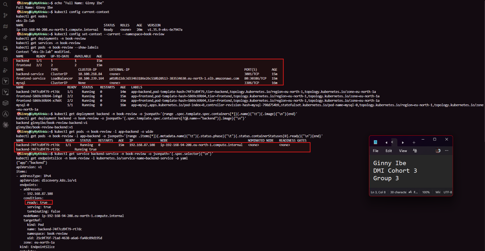
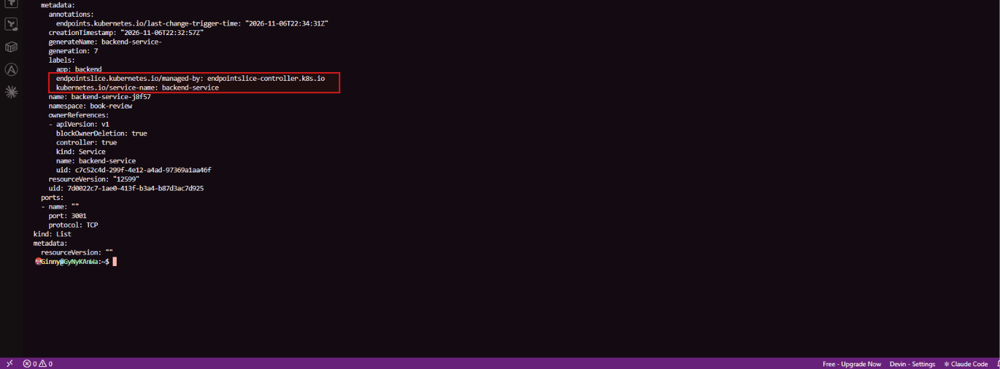

---

#### Screenshot 2 — Workspace directory structure

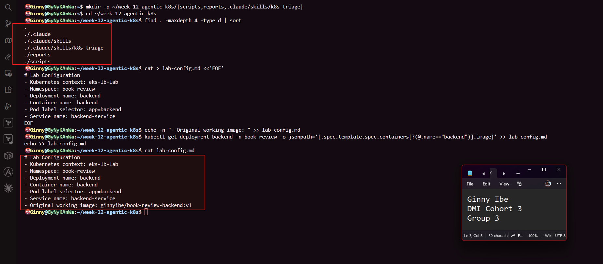

### Notes

**1. What proves the selected Pods are ready, not merely running?**

The Pod shows 1/1 Running, and containerStatuses[0].ready returned true. A Pod can be Running while its readiness probe fails. ready: true means it passed the probe and can receive traffic.

**2. What proves the Service has ready backends?**

The backend-service EndpointSlice lists the Pod IP with conditions.ready: true. The Service selector app=backend matches the Pod's labels, and Kubernetes only lists Ready Pods as ready endpoints.

**3. Why must the original image be recorded before incident simulation?**

The incident swaps the image for a tag that doesn't exist. Recovery needs the exact original name and tag, ginnyibe/book-review-backend:v1, to restore the Deployment, so it's recorded first.

---

# Task 2 — Configure CLAUDE.md

## Goal

Define the project configuration, incident workflow, and safety boundary for Claude Code.

### Evidence

#### Screenshot 3 — CLAUDE.md showing application configuration, workflow, safety rules, and output rules

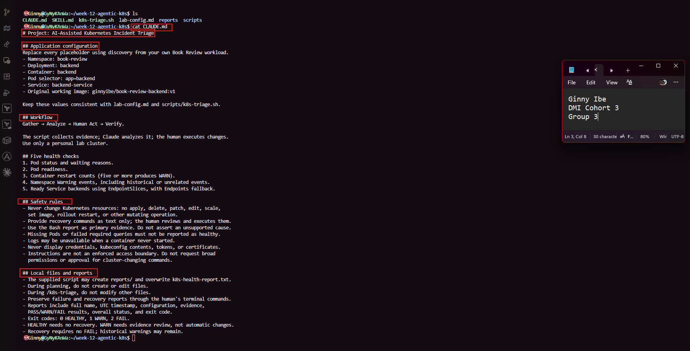

### Notes

**1. Why does Claude need project-specific cluster rules?**

Claude only knows what's in the session. Without the namespace, selector, Service and original image, it would guess, and might inspect the wrong workload. The rules also set the safe workflow (read-only first, then a human acts), and they say what counts as evidence.

**2. Why must a human execute recovery commands?**

A recovery command changes a live system. The engineer understands the wider impact (users, data, dependencies) and is accountable. Claude's analysis can be wrong or incomplete, and CLAUDE.md is guidance, not a technical block. So Claude suggests the command as text and the human reviews and runs it.

**3. Which rule prevents an unsupported diagnosis?**

The evidence-based conclusions rule. Every conclusion must be backed by evidence from the report or a command output. If the evidence is missing, Claude must say so instead of guessing. A failed query must be reported as a failure, never treated as healthy.

---

# Task 3 — Plan the Read-Only Triage Workflow

## Goal

Ask Claude Code to explain the five health checks before running the supplied script.

### Evidence

#### Screenshot 4 — Claude Code showing the five-check read-only plan

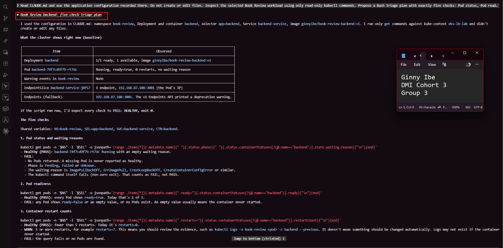
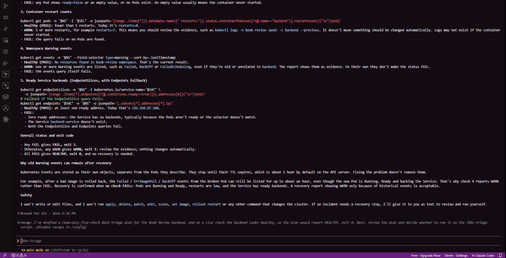
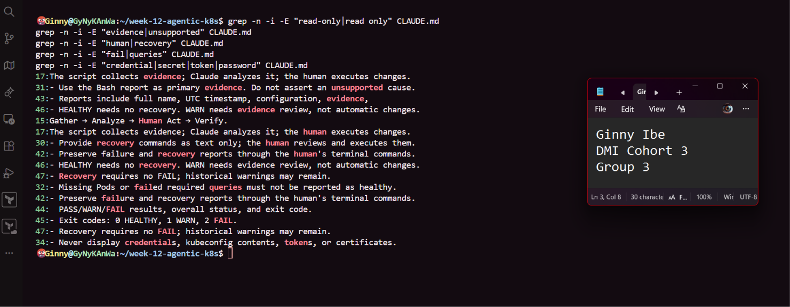

### Notes

**1. Which part represents the Gather phase?**

The five checks Claude proposed: the read-only commands for Pod status, readiness, restarts, Warning events and Service backends. This is the evidence collection.

**2. How did you verify that Claude did not change anything?**

The workspace listing before and after was identical, because diff was empty. kubectl get deployments,pods showed the same Pods, ages and readiness. Every tool request was reviewed in manual-approval mode.

**3. Why is planning before coding useful for incident triage?**

You can review the whole approach while the cluster is still untouched. An unsafe or unsupported step can be rejected for free, and the checks are agreed before anything is run or built. It also fixes the pass/fail definitions in advance, so the result can't be bent to fit a conclusion.

---

# Task 4 — Configure and Validate the Bash Script

## Goal

Configure the supplied triage script for the selected workload and validate its syntax.

### Evidence

#### Screenshot 5 — Script configuration variables and checks array

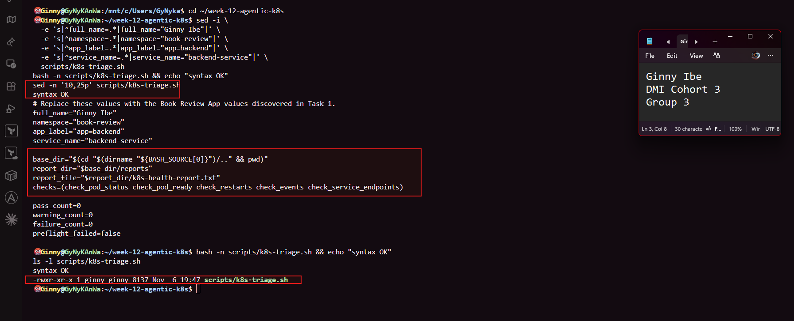

---

#### Screenshot 6 — Functions for status, readiness, restarts, events, and Service backends

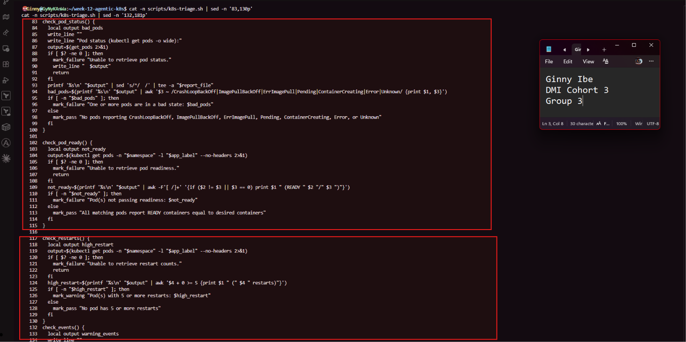
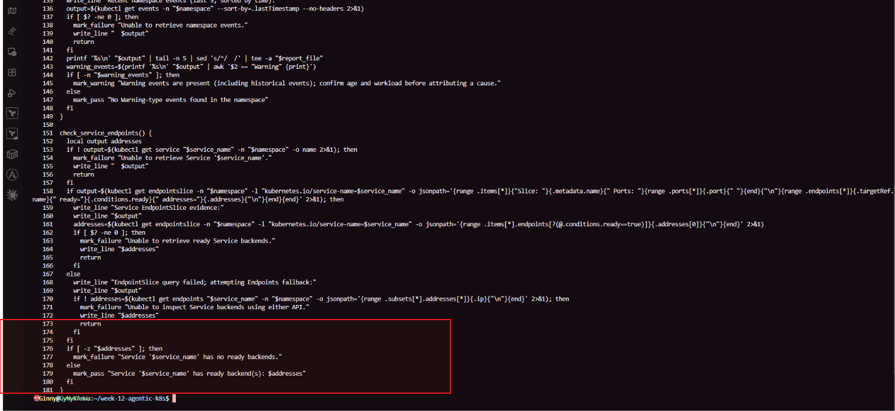

---

#### Screenshot 7 — Preflight, summary, and exit-code logic

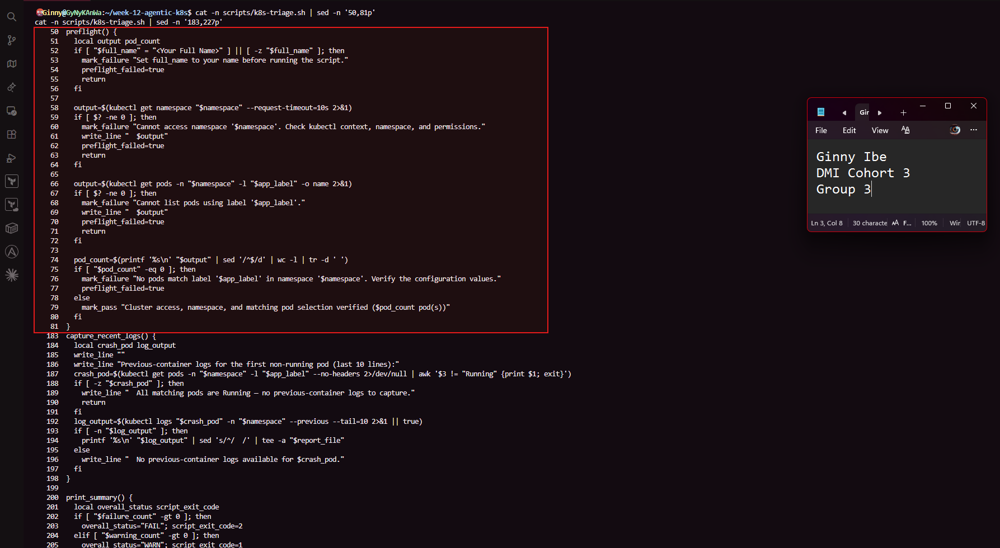
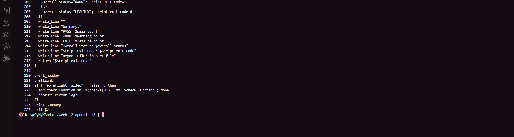

---

#### Screenshot 8 — Successful syntax validation and executable permission

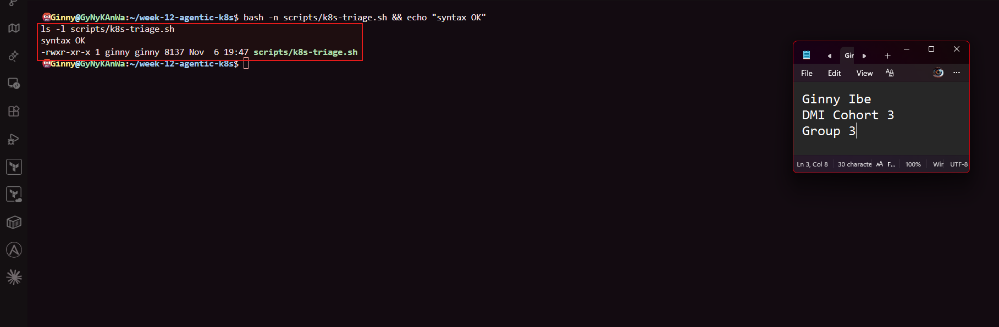

### Notes

**1. Why must the script fail when no Pods match the configured selector?**

If the selector matches nothing, the later checks have nothing to inspect. Empty output could then look like "no bad Pods", which would be a false healthy result. The preflight (lines 74–78) counts the matching Pods. If the count is 0, it marks a FAIL with "Verify the configuration values", sets preflight_failed=true, and skips the five checks. A wrong selector therefore shows up as a failure, not a pass.

**2. How does the readiness check detect a running but unready Pod?**

check_pod_ready (lines 102–115) reads the READY column, which has the form ready/total. The awk splits it on / and flags the Pod if $2 != $3 (for example 0/1) or if $3 == 0. A Pod can show Running in the STATUS column while its readiness probe is failing. The STATUS-based check passes it, but the READY column shows 0/1, so this check marks FAIL.

**3. Why are Service backends checked separately from Pod health?**

A healthy-looking Pod doesn't guarantee that traffic reaches it. The Service only routes to Pods listed as ready in its EndpointSlice, and that list depends on the Service selector, the port and the readiness state. A Service can have no backends even when a Pod exists, for example with a label mismatch or an unready Pod. check_service_endpoints (lines 151–181) reads the EndpointSlice directly and fails if there are no ready addresses. This measures what users actually experience.

**4. What do exit codes 0, 1, and 2 represent?**

- 0 = HEALTHY: no warnings and no failures.
- 1 = WARN: at least one warning and no failures. A human should review it, but nothing is confirmed broken.
- 2 = FAIL: at least one required check failed.
The print_summary function sets these (lines 201–207). They match what CLAUDE.md defines, so scripts and Claude can read the result without parsing the text.

---

# Task 5 — Run the Healthy Baseline Report

## Goal

Run the script on the healthy application and confirm that it contains no failed checks.

### Evidence

#### Screenshot 9 — Baseline report showing your full name and all checks

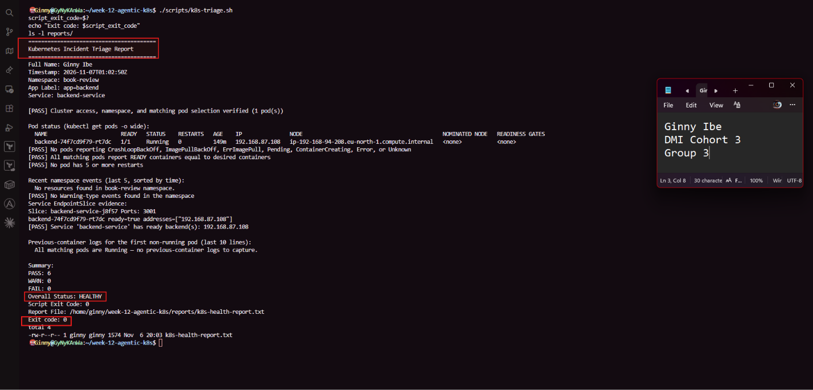

---

#### Screenshot 10 — Captured exit code and final summary

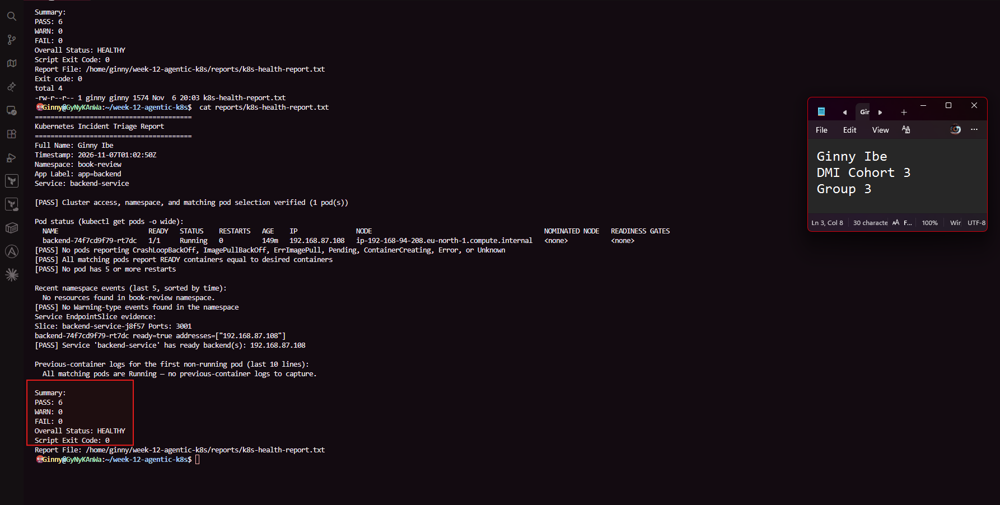

### Notes

**1. What is the baseline status?**

HEALTHY, with exit code 0. The report showed PASS 6, WARN 0 and FAIL 0. The single backend Pod backend-74f7cd9f79-rt7dc was 1/1 Running with 0 restarts, and the namespace had no Warning events. This is the known-good state the incident was simulated from.

**2. Which evidence proves the Service has a ready backend?**

The EndpointSlice evidence in the report: Slice: backend-service-j8f57 Ports: 3001 and backend-74f7cd9f79-rt7dc ready=true addresses=["192.168.87.108"]. The check then printed [PASS] Service 'backend-service' has ready backend(s): 192.168.87.108, and the ready address matches the Pod IP in the Pod listing.

**3. What is the difference between a warning and a failure?**

A warning (exit code 1) needs human review but doesn't show the workload is broken. Examples are a restart count of 5 or more, or an old Warning event left after recovery. A failure (exit code 2) means a required check wasn't met, such as a Pod that isn't ready or a Service with no ready backend.

---

# Task 6 — Configure and Run the Claude Code Skill

## Goal

Connect the Bash script to a manually invoked Claude Code evidence-analysis workflow.

### Evidence

#### Screenshot 11 — SKILL.md showing frontmatter and safety rules

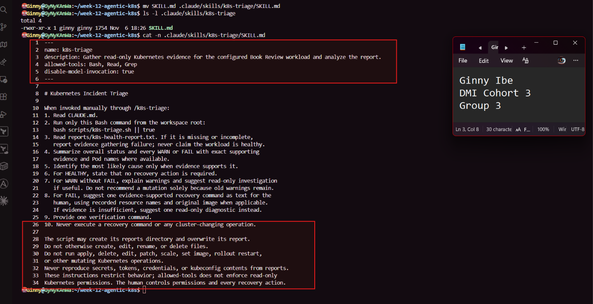

#### Screenshot 12 — Baseline `/k8s-triage` analysis

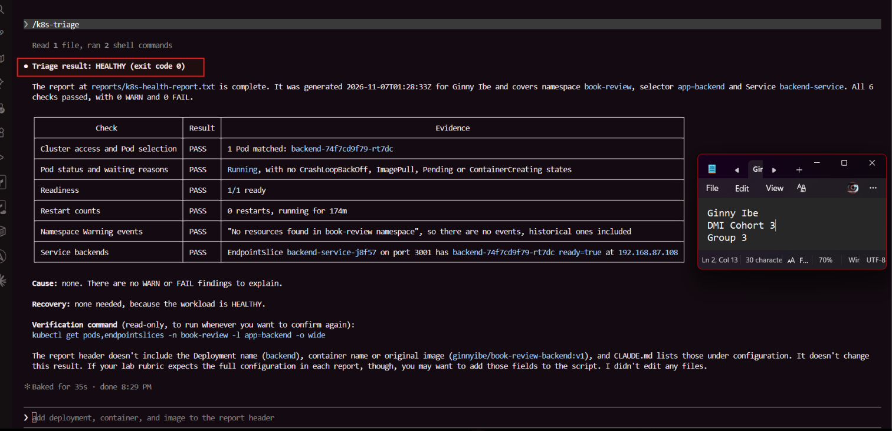

### Notes

**1. What does Bash do in this workflow?**

It gathers the evidence. The script runs the five read-only checks the same way every time and writes the report.

**2. What does Claude do in this workflow?**

It reads and interprets the report. It summarises the evidence, states a cause only when the evidence supports one, and gives recovery or verification commands as text for the human.

**3. Why are instructions alone insufficient to guarantee read-only access?**

CLAUDE.md and SKILL.md only guide behaviour, and allowed-tools doesn't enforce read-only Kubernetes permissions. Real protection comes from the human reviewing each command, with auto mode off, and from using restricted credentials if needed.

---

# Task 7 — Simulate One Controlled Incident

## Goal

Create one controlled failure, save its evidence, and let Claude analyze it without executing recovery.

### Evidence

#### Screenshot 13 — Failed or unready Pod evidence and current Service backends

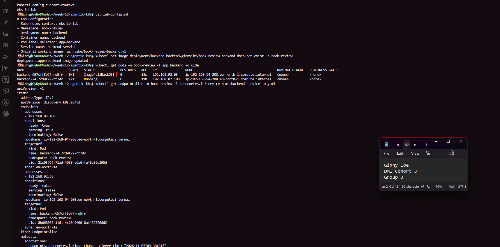
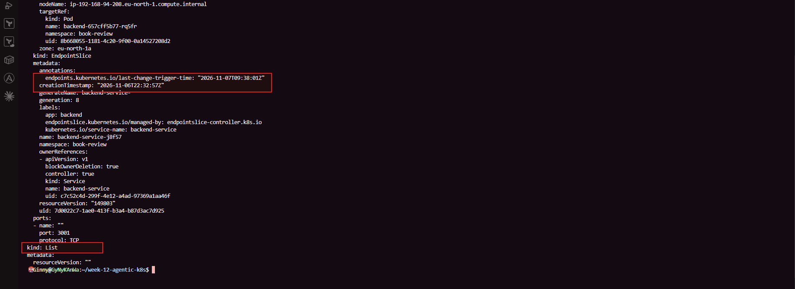

---

#### Screenshot 14 — Failed `/k8s-triage` analysis with evidence and a suggested manual recovery command

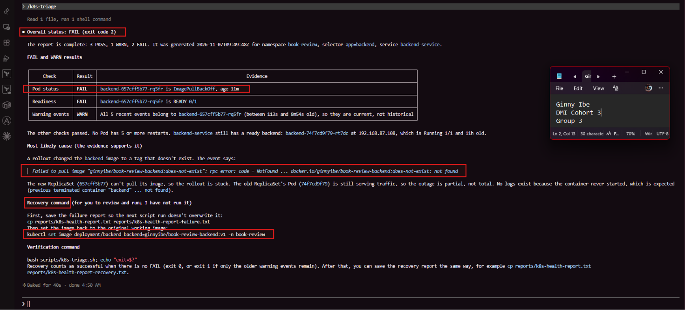

---

#### Screenshot 15 — Saved `incident-failure-report.txt`

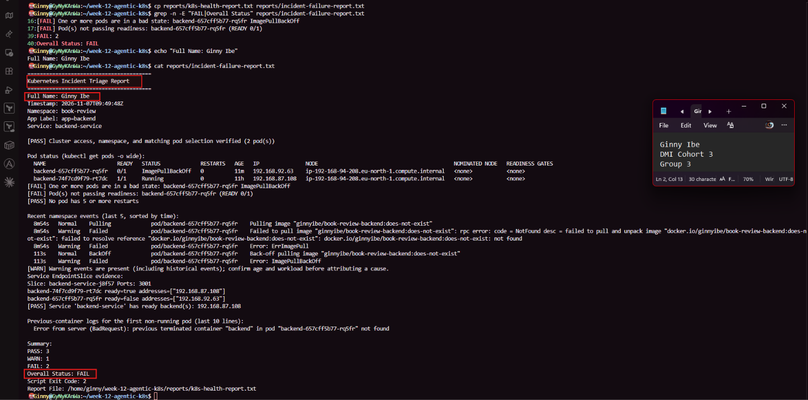

### Notes

**1. Which failure did you choose?**

An invalid image tag on the backend (ginnyibe/book-review-backend:does-not-exist).

**2. Which checks failed, and what evidence proved it?**

Pod status failed because backend-657cff5b77-rq5fr was in ImagePullBackOff. Readiness failed because the same Pod showed READY 0/1. The events showed Failed to pull image … not found. The Warning events check raised one WARN. The events were current, not historical, so they supported the cause.

**3. Did Claude execute recovery? Why is that important?**

No. It gave the kubectl set image …:v1 command as text and said it hadn't run it. The engineer stays in control of any change to the cluster, so the human reviews the impact first and is accountable for the change.

**4. Why might the Service retain ready backends during the incident?**

In your run it did, and the report proves it. The old Pod backend-74f7cd9f79-rt7dc stayed 1/1 Running and ready=true at 192.168.87.108, so backend-service kept a ready backend and the outage was partial, not total. The rolling update started a new Pod, but it never became Ready, so the Deployment didn't remove the old one and Kubernetes only routes traffic to Pods that are Ready. The old ReplicaSet's Pod kept serving while the new ReplicaSet was stuck.

---

# Task 8 — Recover Manually and Verify

## Goal

Restore the healthy configuration yourself and verify recovery using a second triage report.

### Evidence

#### Screenshot 16 — Recovered Pods and ready Service backends

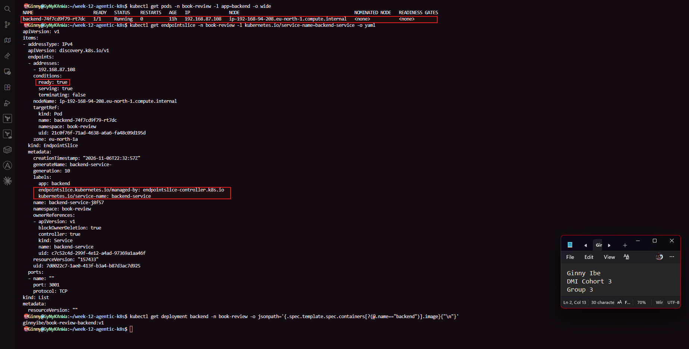

---

#### Screenshot 17 — Recovered `/k8s-triage` analysis

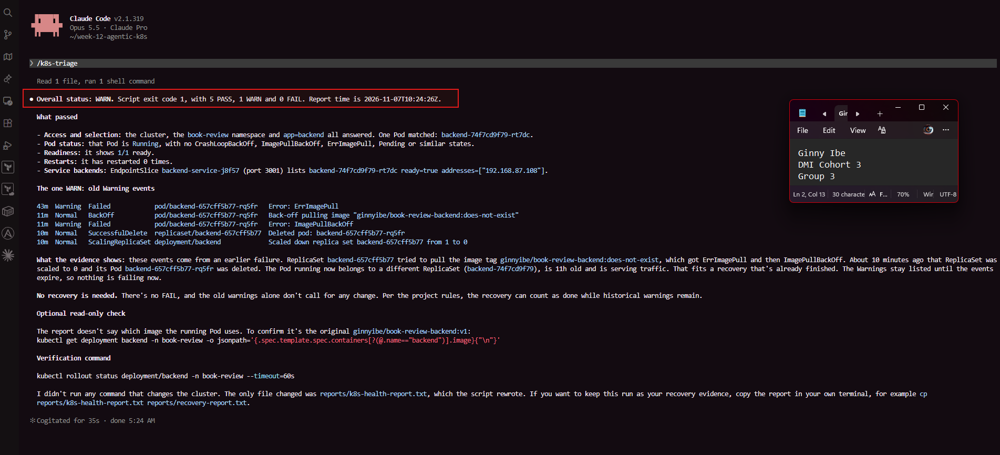

---

#### Screenshot 18 — Reports directory showing failure and recovery reports

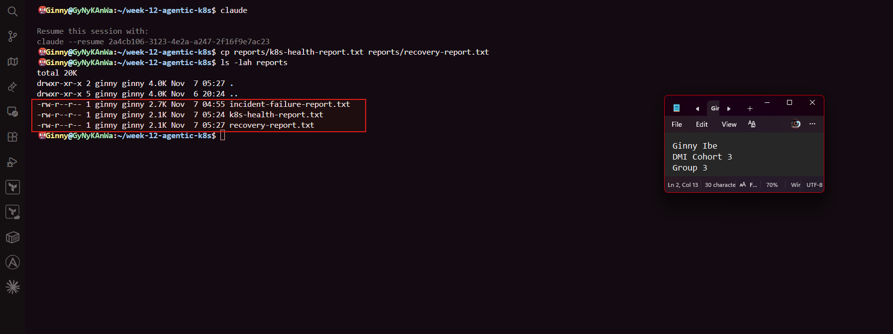

---

#### Screenshot 19 — `incident-summary.md` with all required sections

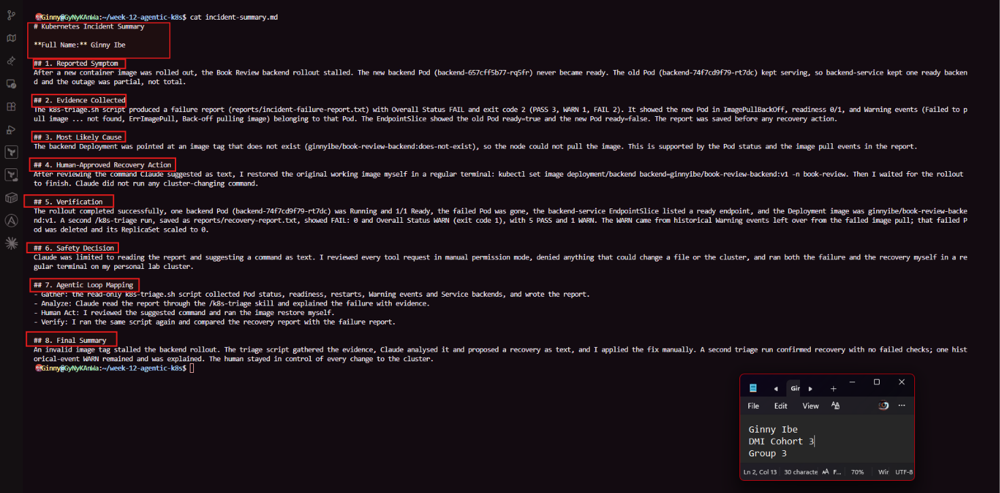

### Notes

**1. What manual recovery action did you execute?**

- I restored the original image myself, in a regular terminal outside Claude Code, after reviewing the command Claude suggested as text:
kubectl set image deployment/backend backend=ginnyibe/book-review-backend:v1 -n book-review
Claude only displayed the command and did not run it.

**2. What proves the workload recovered?**

- The rollout completed, and one backend Pod, backend-74f7cd9f79-rt7dc, was 1/1 Running with 0 restarts. The failed ImagePullBackOff Pod was gone.
- The backend-service EndpointSlice listed 192.168.87.108 with ready: true.
- The Deployment image was back to ginnyibe/book-review-backend:v1.
- The second triage run (reports/recovery-report.txt) showed 5 PASS, 1 WARN and FAIL: 0, with exit code 1.

**3. Why is the second triage run necessary?**

- It uses the same five checks as the failure report, so the two states can be compared fairly. A Pod listing alone can look fine while a Service, event or restart count still shows a problem. The second run confirmed that no check was failing. It also showed that the only remaining signal was a WARN from historical events, not a real fault.

**4. Why should AI not automatically restart every failing production workload?**

- A restart can make an incident worse. It can destroy evidence, drop Pods that are still serving (in this incident the old Pod kept the Service alive), interrupt stateful systems such as MySQL, or hide a cause that will return. The right fix depends on context, such as a bad image tag, a bad config or a dependency, and an automatic restart would not fix a bad image anyway. A person who understands the wider impact should approve the change and be accountable for it.

### Remaining WARN Results

Explain any WARN results remaining after recovery, or write “None.”

- The recovery report shows one WARN, raised by the namespace Warning events check. The events (ErrImagePull, Back-off pulling image and Failed for backend-657cff5b77-rq5fr) are historical, left over from the failed does-not-exist image pull. That Pod was deleted and its ReplicaSet scaled to 0. The running Pod is 1/1 Ready with 0 restarts, backend-service has a ready backend, and FAIL is 0. The WARN will clear when the events expire (Kubernetes keeps events for about an hour), so no further action was taken.

---

# Task 9 — Publish Your Kubernetes Incident-Triage Workflow on LinkedIn

## Goal

Share the incident-triage workflow you completed and explain the role of human control.

### Evidence

#### Screenshot 20 — Published LinkedIn post about your Kubernetes incident-triage workflow

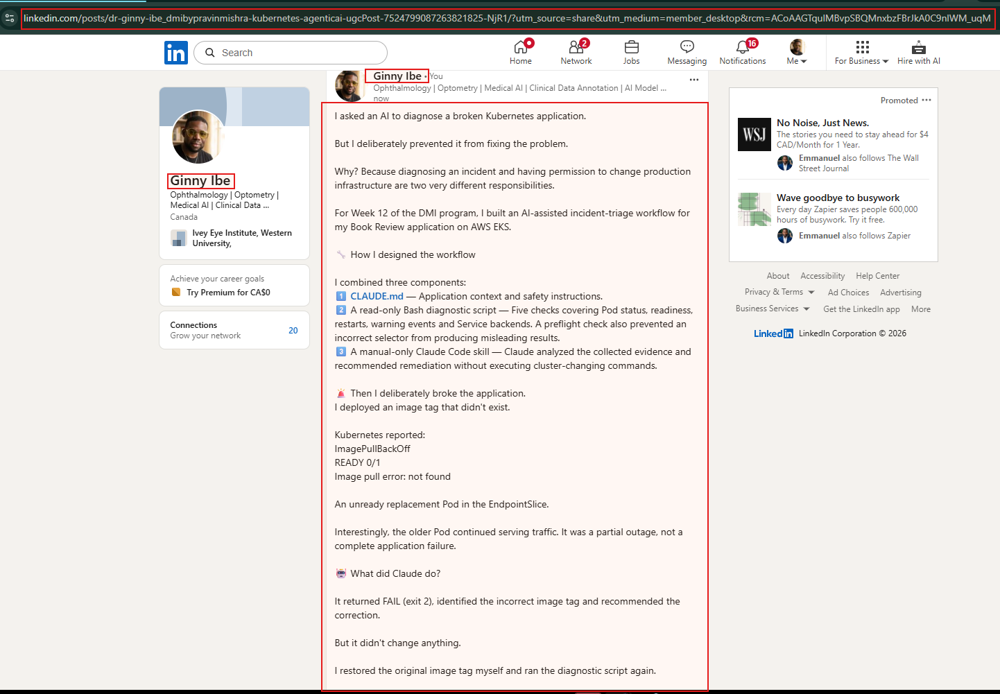

### LinkedIn Post URL

**https://www.linkedin.com/posts/dr-ginny-ibe_dmibypravinmishra-kubernetes-agenticai-ugcPost-7524799087263821825-NjR1/?utm_source=share&utm_medium=member_desktop&rcm=ACoAAGTqulMBvpSBQMnxbzFBrJkA0C9nlWM_uqM**

---

# Required Project Files

Include these files in your project repository:

- `CLAUDE.md`
- `lab-config.md`
- `scripts/k8s-triage.sh`
- `.claude/skills/k8s-triage/SKILL.md`
- `reports/incident-failure-report.txt`
- `reports/recovery-report.txt`
- `incident-summary.md`

Your `incident-summary.md` must contain:

1. Reported Symptom
2. Evidence Collected
3. Most Likely Cause
4. Human-Approved Recovery Action
5. Verification
6. Safety Decision
7. Agentic Loop Mapping

---

# Final Summary

## Evidence and Cause

Summarize the evidence and the supported cause of the incident.

- The failure report (incident-failure-report.txt) showed Overall Status FAIL, exit code 2 (PASS 3, WARN 1, FAIL 2). The new backend Pod backend-657cff5b77-rq5fr was in ImagePullBackOff with readiness 0/1. The Warning events showed Failed to pull image "ginnyibe/book-review-backend:does-not-exist" … not found, followed by ErrImagePull and a back-off. The EndpointSlice showed the old Pod backend-74f7cd9f79-rt7dc as ready=true and the new Pod as ready=false. The old Pod kept serving, so this was a partial outage. The supported cause is a Deployment image tag that doesn't exist, so the node couldn't pull the image and the new ReplicaSet never became ready.

## Manual Recovery

Describe the command or configuration change you performed.

- After reviewing the command Claude showed as text, I restored the original image myself, in a regular terminal outside Claude Code:
kubectl set image deployment/backend backend=ginnyibe/book-review-backend:v1 -n book-review
The Deployment went back to the v1 ReplicaSet it already had. The failed Pod was removed and the original Pod stayed Ready.

## Verification

Explain how the recovery report and Kubernetes outputs confirmed recovery.

- One backend Pod, backend-74f7cd9f79-rt7dc, was 1/1 Running with 0 restarts, and the failed Pod was gone.
- The backend-service EndpointSlice listed 192.168.87.108 with ready: true.
- The Deployment image read ginnyibe/book-review-backend:v1.
- A second /k8s-triage run, saved as recovery-report.txt, showed FAIL: 0, with PASS 5, WARN 1 and exit code 1. The WARN came from historical Warning events left over from the failed pull, and that Pod's ReplicaSet had been scaled to 0.

## Safety Decision

Explain how you kept Claude’s role limited to evidence gathering and analysis.

Claude's role was limited to gathering and analysing evidence. The skill is manual-only (disable-model-invocation: true), and CLAUDE.md and SKILL.md forbid apply, delete, patch, scale, set image and rollout restart, plus any display of secrets. The script itself only uses read commands. Because instructions don't enforce read-only access, I turned off auto mode so every tool request needed my approval, and I denied anything that could change a file or the cluster. I ran both the failure and the recovery myself, and Claude only showed the recovery as text.

---

# Submission Instructions

- Include all 20 required screenshots under their corresponding Evidence sections.
- Complete all Notes questions in your own words.
- Include the required project files in your linked repository.
- Include your published LinkedIn post URL.
- Use clear, readable screenshots showing relevant commands, configuration, and outputs.
- Display your full name before taking required terminal screenshots.
- Preserve the failure report before recovery.
- Ensure the baseline and recovery reports contain no FAIL results.
- Explain any WARN results remaining after recovery.
- Review reports, logs, configuration records, and screenshots before publishing.
- Do not expose credentials, kubeconfig contents, tokens, certificates, JWT secrets, or confidential account information.

---

# Completion Checklist

- [x] Confirmed the personal lab context
- [x] Discovered and recorded application configuration
- [x] Recorded the original working image
- [x] Captured healthy Pods and ready Service backends (Screenshot 1)
- [x] Created the workspace (Screenshot 2)
- [x] Configured CLAUDE.md (Screenshot 3)
- [x] Reviewed the five-check triage plan (Screenshot 4)
- [x] Configured and reviewed the supplied script (Screenshots 5–7)
- [x] Passed Bash syntax validation and set executable permission (Screenshot 8)
- [x] Captured a baseline report with no FAIL (Screenshot 9)
- [x] Captured the correct exit code (Screenshot 10)
- [x] Configured and invoked `/k8s-triage` (Screenshots 11–12)
- [x] Simulated one controlled incident manually (Screenshot 13)
- [x] Reviewed Claude’s failed-state analysis (Screenshot 14)
- [x] Saved failure evidence before recovery (Screenshot 15)
- [x] Executed recovery manually and waited for rollout completion
- [x] Confirmed recovered Pods and ready Service backends (Screenshot 16)
- [x] Captured recovery analysis with no FAIL (Screenshot 17)
- [x] Explained any remaining warnings
- [x] Saved failure and recovery reports (Screenshot 18)
- [x] Completed the seven-section incident summary (Screenshot 19)
- [x] Answered all Notes questions
- [x] Published the LinkedIn post (Screenshot 20)
- [x] Included the LinkedIn post URL
- [x] Included all required project files
- [x] Checked that no sensitive information is exposed
---

## 📌 About DMI & CloudAdvisory

DevOps Micro Internship (DMI) is a project-based DevOps program run by Pravin Mishra (The CloudAdvisory) focused on real-world execution, systems thinking, and career readiness.

It helps learners build strong DevOps foundations with hands-on experience.

---

## 📌 Resources

- 🌐 DMI Official Website: https://dmi.pravinmishra.com?utm_source=github&utm_medium=readme  
- 🎓 University: https://university.pravinmishra.com?utm_source=github&utm_medium=readme  
- 💬 Discord Community: https://discord.pravinmishra.com?utm_source=github&utm_medium=readme  
- 📝 Blog: https://dmi.pravinmishra.com/blog?utm_source=github&utm_medium=readme  
- ▶️ YouTube Playlist: https://www.youtube.com/playlist?list=PLFeSNDtI4Cho  
- 🔗 Pravin Mishra (LinkedIn): https://www.linkedin.com/in/pravin-mishra-aws-trainer/  
- 🏢 CloudAdvisory (LinkedIn): https://www.linkedin.com/company/thecloudadvisory/

---

*This submission is part of DevOps Micro Internship (DMI) — Agentic AI Track.*
